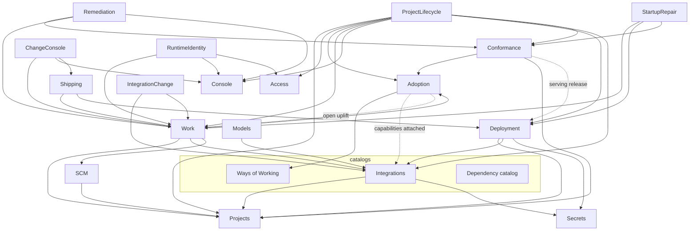

# The architecture

> Accepted architecture direction with historical implementation sketches, written
> 13 September 2026. This is not an inventory of today’s APIs. Use the
> [current ownership map](domains.md), [adopted layout](layout.md) and package
> guides for current implementation. Remaining differences require explicit
> findings; the code does not silently override accepted principles.

How Forge is put together, written 13 September 2026 from the shape
proposal, the API sketch and the review conversation that followed. This
is the design the code is to be brought to. It supersedes the "one
service per table" and "drivers stay in forge" guidance in `domains.md`,
which remains the map of where things are today. The record-store style
stays as the rule for how a subsystem talks to its own tables.

Plain words throughout. Where a Go block appears it is the shape, not a
contract; names close to what exists are kept, and a name that exists
today and is not shown should be assumed to survive unless the text says
otherwise.

## 1. The principles

1. **A subsystem is one type, built once, with its dependencies
   declared.** `deployment.New(db, deps)` takes a `Dependencies` struct
   whose fields are small interfaces `deployment` defines for itself,
   one to four methods each. The subsystem names no other subsystem's
   package except through those, or where the text marks a direct import
   as stable and obvious. This is what makes a subsystem reusable: to use
   it somewhere new, satisfy its interfaces and construct it.

2. **Bounded acts take their inputs; things worked over time take a
   source.** A deploy and a console session are bounded: the request
   carries everything they need, resolved by the caller, and the
   subsystem looks nothing up. Work acts on a repository for weeks, so it
   declares a source it can call back into. Deciding which of the two a
   subsystem is settles most of its dependencies.

3. **Objects own their rules; services load, call, save and record.** A
   Change, a Deployment, a Grant is a value with methods and no database
   handle. A command on it checks its invariants, changes the value and
   returns what the world must be told. The service wraps that in a
   transaction: read the row for update, build the object, call the
   method, write the row back, write the receipt. The store is the rule
   for what lies between rows (uniqueness, one open attempt); the object
   is the rule for what it holds.

4. **Authorization happens inside the operation.** Transports establish an
   `access.Caller` in context; domains ask the shared `access.Authorizer`,
   naming the capability and full resource before effects. Access checks current
   grants and credential limits. Domain eligibility stays with its owner.
   Trusted workers carry explicit scope bindings or a scoped system principal;
   missing caller context never becomes system authority.

5. **Receipts are part of the operation.** Every consequential command
   writes its audit line in the same transaction, and a receipt that
   fails fails the command. Operations that must share a transaction
   have an `…In(tx, …)` twin; facades compose those.

6. **A facade is a complete operation across subsystems.** Shipping a
   landed change, opening a console on a change, purging a project.
   Facades import their participants directly, own the transaction, and
   own tables only when they have durable state of their own
   (Remediation does; Shipping does not).

7. **Cross-cutting concerns are supplied, not imported from a hub.** The
   database, receipts, jobs, execution, models, secrets, configuration,
   logging. Each reaches a subsystem as a package it imports (database,
   audit) or a value it is constructed with (everything else).

8. **Uneven by design.** A catalog is mostly reads and publishes and
   needs few objects; Work is deep and needs many. The shape follows the
   domain rather than a template.

## 2. The picture

Access is a **library** at `internal/access`: the authorization rule, its
vocabulary (principal, caller, permission, capability, resource, denial), the
capability and role catalog, and `Checked`. It owns no tables, imports nothing
of forge, and every subsystem imports it the way it imports `stamp`.

Identity and Audit are **kernels**: subsystems that own tables and that every
other subsystem may import, and which may import only leaves, libraries and
other kernels. Identity never imports Projects, Work, a facade, or the App.
Identity's kernel licence covers the account and grant reads a domain preflight
needs — `RequireEnabledIn`, `RootIn`, `ApproverGroupsIn`, `ActiveGrantsIn` —
and narrowing those is open work, not a general permission.

Project authority facts arrive through a narrow port implemented by Projects.
The shape gate enforces these edges and counts App-retaining dependency
bindings; the callback baseline only decreases.



Solid arrows are stable dependencies, declared as interfaces or direct
imports. Dotted arrows are one-method ports that may be nil. Access has
no arrows out: everything asks it, it asks nothing. Console takes its
inputs. Deployment reads Projects, Secrets and Integrations to prepare its
Docker operations, and the dependency catalog to resolve declared services.
Work supplies an already-claimed execution through a narrow participant port;
Deployment neither claims nor completes workflow steps.

Two tiers of packages, told apart by path. A library sits at
`internal/<x>` and knows nothing of forge: it could be lifted into
another program as it is (`console`, `deploy`, `database`, `stamp`,
`execution`, `progress`, `dbtest`); its tests need nothing of forge either. Forge's own subsystems sit under
`internal/forge/<x>`, and the App that composes them is `internal/forge`
itself. A subsystem may use a library; a library never imports forge.
The shape checker's `layering` rule counts violations, at zero.

Nine subsystems and one cross-cutting service:

| | charter | kind |
|---|---|---|
| Access | who is asking, what they may do, the credentials that prove it | root |
| Projects | a project's identity and its repository | root |
| Integrations | the instance's connectors and what each project attaches | catalog with attachments |
| Ways of Working | the catalog of guidance, packs, policies and workflows | catalog |
| Adoption | what a project has taken on from the catalog, with history | the meeting of a project and its ways |
| Deployment | run selected versions of applications on targets; keep their data | bounded acts on inputs |
| Work | changes, runs, decisions, evidence, landing | works a repository over time |
| Console | interactive conversations with an agent | bounded sessions on inputs |
| Conformance | evaluate committed software against declared checks | reviews over a staged source |
| Models | model selection, capacity, inference admission, accounting | cross-cutting service |

## 3. The words everyone shares

```go
package access

type Principal struct {
    Kind string       // user | instrument | system | anonymous
    Name string
    Via  Delegation   // the credential or delegation the request came through, if any
}
type Permission struct { Capability string; Resource Resource }   // "change.approve", {change, 41, project 7}
type Resource   struct { Type, ID string; ProjectID int64 }

// Actual shared contracts live in access; no separate principal package.
type Caller struct { Principal Principal; Verified bool; Receipt string }
type Authorizer interface {
    Require(ctx context.Context, p Permission) (Caller, error)
}
```

```go
package database   // exists: DB, Tx, Queryer, InTx, Transact, Lookup, the test fault
package audit      // exists: RecordIn, RecordDecisionIn, Recent
package jobs       // exists: Queue, Enqueuer (EnqueueIn), InsertOnTx, InsertOperationTx
package execution  // exists: Runner, Request, Outcome: one bounded process or container
package stamp, schema, dependency (the catalog of need kinds)
```

## 4. Cross-cutting concerns

| concern | what it is | how it reaches a subsystem |
|---|---|---|
| authority | the answer to "may this principal do this" | the shared `access.Authorizer`; forge supplies `access.Checked` with Access and the project resource port |
| transactions and receipts | one transaction per operation; the audit line inside it | import `database` and `audit` directly; `…In(tx)` participants share a caller's transaction |
| jobs | follow-ups after commit, retries, schedules | `jobs.Enqueuer` (`EnqueueIn(ctx, tx, jobs.Request)`), whose one implementation (the root's `jobQueue`) sets each kind's queue and attempt budget; the daemon builds the queue once with every subsystem's handlers bound |
| execution | a bounded process or container with captured output | an `execution.Runner` value; the same one serves Work's agent runner, Console and Conformance's tools |
| agents | start and stop an agent runtime (pi) with a workspace, steering, contributions and model access | an `AgentRuntime` interface; one implementation in forge, shared by Work and Console |
| models | select a model for a project, hold capacity, admit inference, account for it | the Models service, constructed once; consumers get `ModelAccess`, a narrow view |
| secrets | references to values, resolved per consumer at the moment of use | a `SecretResolver` interface; the broker owns the stores; nobody sees all secrets |
| configuration | paths, images, networks, operator flags | constructor values; no global map, no package-level flags |
| logging, errors, lifetime | a reporter, a logger, one shutdown deadline | constructor values; owners implement `Start`, `Drain`, `Repair` and never extend the deadline |

## 5. The subsystems

Each subsystem is given the same way: its charter, its objects and the
rules they hold, its service with declared dependencies, and what it
hands out. `ctx` is `context.Context` throughout.

### 5.1 Access

Identifies people and instruments, holds authority, issues and resolves
credentials. Depends on nothing.

**Objects.**

```go
type Account struct { Name, Role string; HasPassword, Disabled bool; DefaultGroup string; ... }
func (a *Account) Disable(otherAdmins []Account) error   // the last-administrator rule, stated once
func (a *Account) Demote(otherAdmins []Account) error
func (a *Account) SetPassword(hash string) Followup      // ends the account's sessions

type Grant struct { ID int64; Subject Subject; Role, Capability string; Scope Scope; ExpiresAt, RevokedAt stamp.Time; ... }
func (g Grant) Applies(c Capability, r Resource) bool
func (g Grant) Live(at time.Time) bool
func (g *Grant) Revoke(by Principal, now time.Time) (Event, error)

type Delegation struct { ... }                          // a connected agent's OAuth connection
func (d Delegation) Bounds(pr Principal) Principal      // narrows a person's authority to what was delegated
func (d *Delegation) Rotate(presented string) (Pair, error)   // a reused refresh token is a leak: ErrLeaked

type Ticket struct { ... }                              // one push of one change from one expected tip
func (t *Ticket) Consume(now time.Time) error

type Decision struct { Allow bool; Code, Reason string; GrantIDs []int64; ReceiptID int64 }
```

The decision itself, `Decide(pr, delegation, capability, resource,
facts)`, is a pure function over the catalog of roles and the live grants
and stays one.

**Service.**

```go
package access

type Config struct { Profile string; SessionTTL time.Duration; OpenInstance bool }
func New(db *database.DB, cfg Config) *Service

// authority
func (s *Service) Require(ctx, pr Principal, p Permission) (Principal, error)   // implements Authority
func (s *Service) Decide(ctx, pr Principal, p Permission) (Decision, error)     // recorded
func (s *Service) Explain(ctx, pr Principal, p Permission) (Explanation, error) // not recorded

// who is asking
func (s *Service) Resolve(ctx, cred Credential) (Principal, error)              // cookie, token, bearer, ticket
func (s *Service) SignIn(ctx, name, password string) (Session, error)
func (s *Service) SignOut(ctx, session string) error
func (s *Service) Bootstrap(ctx, first Account) error

// the directory and grants
func (s *Service) Users(ctx, pr Principal) ([]Account, error)
func (s *Service) SaveUser(ctx, pr Principal, e Edit) error
func (s *Service) RemoveName(ctx, pr Principal, name string) error
func (s *Service) Groups(ctx, pr Principal) ([]Group, error)
func (s *Service) SaveGroup(ctx, pr Principal, g GroupEdit) error
func (s *Service) DeleteGroup(ctx, pr Principal, name string) error
func (s *Service) PersonalGroup(ctx, user string) (string, error)
func (s *Service) Grants(ctx, pr Principal, at Scope) ([]Grant, error)
func (s *Service) Grant(ctx, pr Principal, g GrantRequest) (Grant, error)
func (s *Service) Revoke(ctx, pr Principal, id int64) error

// instruments
func (s *Service) IssueToken(ctx, pr Principal, name string) (plaintext string, err error)
func (s *Service) RevokeToken(ctx, pr Principal, name string) error
func (s *Service) RegisterClient(ctx, c ClientRegistration) (Client, error)
func (s *Service) Authorize(ctx, pr Principal, req ConsentRequest) (code string, err error)
func (s *Service) Exchange(ctx, code string, proof PKCE) (Connection, Pair, error)
func (s *Service) Refresh(ctx, refresh string) (Pair, error)
func (s *Service) Disconnect(ctx, pr Principal, delegationID int64) error
func (s *Service) IssueTicket(ctx, pr Principal, changeID int64, ref, expectedTip string) (string, Ticket, error)
func (s *Service) ConsumeTicket(ctx, id int64) (bool, error)

// participants and upkeep
func (s *Service) EstablishOwnershipIn(tx, projectID int64, creator string) error
func (s *Service) RemoveProjectIn(tx, projectID int64) error
func (s *Service) Sweep(ctx) error
```

**Hands out.** `Principal`, `Decision`, `Grant`, `Session`, `Connection`.
Cookies and trusted-header extraction stay in transport; PKCE, audience
and replay rules are here.

### 5.2 Projects

A project's identity and its repository: the record, generic Git, and
the host operations (GitLab today). Depends on Access only.

**Objects.**

```go
type Project struct { ID int64; Slug, Name, DefaultBranch, Namespace, Icon, Blurb, OwnerGroup, ReleaseDomain, ModelProfile string; ... }
func (p *Project) Rename(slug, name string) (Event, error)        // slug rules
func (p Project) Repository() Repository
func (p Project) RemovableBy(pr Principal, live Activity) error   // the purge's refusal: running work, live chats

type Repository struct { Path, Remote, DefaultBranch, Tip string; Host string }
type Tree struct { Commit string; ... }                          // a read-only view of one commit
func (t Tree) Read(path string) ([]byte, error)
func (t Tree) Contract() (Contract, error)                       // the app's own declaration at this commit
```

`pack`, `adoption_revision` and `drift_note` leave the project record;
they are Adoption's (§5.5).

**Service.**

```go
package project

type Dependencies struct {
    Authority Authority
    Hosts     map[string]Host   // "gitlab", ...: registered at construction
    DataDir   string
}
func New(db *database.DB, deps Dependencies) *Service

func (s *Service) Find(ctx, ref ProjectRef) (Project, error)        // id or slug
func (s *Service) List(ctx, pr Principal) ([]Project, error)
func (s *Service) Edit(ctx, pr Principal, id int64, d Details) (Project, error)
func (s *Service) Initialize(ctx, pr Principal, id int64, from Origin) error
func (s *Service) Tree(ctx, id int64, commit string) (Tree, error)
func (s *Service) PrepareWorkspace(ctx, in WorkspaceRequest) (Workspace, error)   // a checkout for a run or a console
func (s *Service) Inspect(ctx, id int64) (Repository, error)
func (s *Service) AttachRemote(ctx, pr Principal, id int64, r Remote) error
func (s *Service) Snapshot(ctx, id int64, commit string) error                   // record the contract as evidence

type Host interface {
    Push(ctx, repo Repository, ref, expectedTip string) error
    Archive(ctx, repo Repository) error
    MergeRequest(ctx, repo Repository, mr MergeRequest) (string, error)
}

func (s *Service) CreateIn(tx, spec Spec) (Project, error)
func (s *Service) RemoveIn(tx, id int64, who string, payload map[string]any) error
```

**Hands out.** `Project`, `Repository`, `Tree`, `Workspace`. Work builds
SCM on `Tree`, `PrepareWorkspace` and `Host`.

### 5.3 Integrations

The instance's connectors (a GitLab, a GlitchTip, a registry, a model
provider) and what each project attaches. A catalog with attachments.
Depends on Access and a secret resolver.

**Objects.**

```go
type Connector struct { Name, Capability, Provider string; Config map[string]any; Version int; Managed bool; ... }
func (c *Connector) Configure(cfg map[string]any, p Provider) (Event, error)   // validated by the provider; a new version
func (c Connector) At(version int) Snapshot

type Attachment struct { ProjectID int64; Capability, Connector string; Resource map[string]any; Provenance Provenance; ... }
func (a Attachment) Resolve(c Connector) Selected                             // the connector as this project sees it
```

**Service.**

```go
package integration

type Dependencies struct {
    Authority Authority
    Secrets   SecretResolver
    Providers map[string]Provider   // registered at construction
}
func New(db *database.DB, deps Dependencies) *Service

// the catalog
func (s *Service) Connectors(ctx) ([]Connector, error)
func (s *Service) Describe(ctx, name string) (Snapshot, error)
func (s *Service) SaveConnector(ctx, pr Principal, e ConnectorEdit) (Connector, error)
func (s *Service) TestConnector(ctx, pr Principal, name string) (Probe, error)
func (s *Service) RemoveConnector(ctx, pr Principal, name string) error
func (s *Service) ServiceKinds(ctx) ([]ServiceKind, error)
func (s *Service) SaveServiceKind(ctx, pr Principal, k ServiceKindEdit) error

// the attachments
func (s *Service) Attached(ctx, projectID int64) ([]Attachment, error)
func (s *Service) Attach(ctx, pr Principal, a AttachRequest) (Attachment, error)
func (s *Service) Detach(ctx, pr Principal, projectID int64, capability string) error
func (s *Service) Resolve(ctx, projectID int64, capability string) (Selected, error)
func (s *Service) Contributions(ctx, in ContributionRequest) (Contributions, error)   // env, files, MCP servers for an agent
func (s *Service) PinVersionsIn(tx, projectID int64) (map[string]int, error)          // what a run records at start
func (s *Service) HasCapabilitiesIn(tx, projectID int64, caps []string) error       // Adoption's lock, FOR SHARE

type Provider interface {
    Validate(cfg map[string]any) error
    Probe(ctx, cfg map[string]any, secrets Delivery) (Probe, error)
    Contribute(ctx, sel Selected, consumer Consumer) (Contributions, error)
}

func (s *Service) RemoveProjectIn(tx, projectID int64) error
```

**Hands out.** `Selected`, `Contributions`, `Snapshot`.

### 5.4 Ways of Working

The catalog of guidance blocks, packs, policies and workflows: what can
be adopted. No project appears in it. Depends on Access only; could ship
as a library.

**Objects.** Mostly records with versioning: `Block` and `Pack` know
their versions and pins; `Pack.Requires() []Capability`. A catalog needs
few rules of its own.

**Service.**

```go
package wow

type Dependencies struct { Authority Authority; Stock fs.FS }
func New(db *database.DB, deps Dependencies) *Service

func (s *Service) Blocks(ctx, f BlockFilter) ([]Block, error)
func (s *Service) Block(ctx, ref BlockRef) (Block, error)
func (s *Service) PublishBlock(ctx, pr Principal, b BlockEdit) (Block, error)
func (s *Service) Packs(ctx) ([]Pack, error)
func (s *Service) Pack(ctx, name string, version int) (Pack, error)
func (s *Service) PublishPack(ctx, pr Principal, p PackEdit) (Pack, error)
func (s *Service) OfferPack(ctx, pr Principal, name string, on bool) error
func (s *Service) Workflows(ctx) ([]WorkflowEntry, error)
func (s *Service) Workflow(ctx, name string, version int) (*schema.Spec, int, error)
func (s *Service) PublishWorkflow(ctx, pr Principal, yaml string) (name string, version int, err error)
func (s *Service) BindSystemWorkflow(ctx, pr Principal, stock, name string) error
func (s *Service) Validate(ctx, yaml string) (*schema.Spec, error)
func (s *Service) Policies(ctx) ([]LibraryPolicy, error)
func (s *Service) PublishPolicy(ctx, pr Principal, p LibraryPolicy) error
func (s *Service) Resolve(ctx, pins []Pin) ([]ResolvedPin, error)      // names and constraints to exact versions
func (s *Service) Compile(ctx, pins []ResolvedPin) (text, hash string, err error)
func (s *Service) SyncStock(ctx) (SyncCounts, error)
```

### 5.5 Adoption

What a project has taken on from the catalog, with its history. Where a
project and its ways of working meet. Its own subsystem with its own
tables: adoptions, imports, installed policies, lanes, extensions.
Every runtime asks Adoption for a project's procedure; none asks the
catalog directly.

**Objects.**

```go
type Adoption struct { ProjectID int64; Pack string; Version, Revision int64; Imports []ResolvedPin; Policies []Policy; Lanes, Extensions map[string]bool; Drift string; ... }
func (a *Adoption) Prepare(c Candidate, attached func([]Capability) error) (Plan, error)   // what changes; refuses a missing capability
func (a *Adoption) Advance(p Plan, expected int64) (*Adoption, Event, error)              // the revision check is here
func (a Adoption) Resolve(cat Catalog) (Resolved, error)                                   // the compiled guidance from the pins
func (a *Adoption) NoteDrift(note string) Event
```

**Service.**

```go
package adoption

type Dependencies struct {
    Authority    Authority
    Ways         Catalog            // wow: Pack, Block, Workflow, Resolve, Compile
    Capabilities CapabilityLocker   // one method: Integrations.HasCapabilitiesIn
    Uplift       UpliftOpener       // one method, Work satisfies it: OpenUpliftIn(tx, projectID, Candidate); nil adopts without a change
}
func New(db *database.DB, deps Dependencies) *Service

func (s *Service) Prepare(ctx, in Request) (Candidate, error)
func (s *Service) Adopt(ctx, pr Principal, c Candidate, expected int64) (Adoption, error)
func (s *Service) AdoptIn(tx, pr Principal, c Candidate, expected int64) (Adoption, error)
func (s *Service) Current(ctx, projectID int64) (Adoption, error)
func (s *Service) History(ctx, projectID int64, limit int) ([]Adoption, error)
func (s *Service) Resolve(ctx, projectID int64) (Resolved, error)                        // guidance, pinned blocks, policies, lanes, extensions
func (s *Service) Workflow(ctx, projectID int64, name string) (*schema.Spec, int, error)
func (s *Service) Checks(ctx, projectID int64) ([]DeclaredCheck, error)
func (s *Service) SetLane(ctx, pr Principal, projectID int64, name string, on bool) error
func (s *Service) SetExtension(ctx, pr Principal, projectID int64, name string, on bool) error
func (s *Service) InstallPolicy(ctx, pr Principal, projectID int64, p PolicyInstall) error
func (s *Service) RemovePolicy(ctx, pr Principal, id int64) error
func (s *Service) RemoveProjectIn(tx, projectID int64) error
```

One migration moves `adoption_revision`, `drift_note` and `pack` off the
projects table onto the adoption record.

**Hands out.** `Resolved`, `Adoption`, the pinned `*schema.Spec`,
`[]DeclaredCheck`.

### 5.6 Deployment

Runs selected versions of applications on targets and keeps their
retained data. Bounded acts on inputs: a deploy is admitted with
everything it needs and recorded immutably, so recovery reads its own
record.

The performing half is the `deploy` library: the app contract, the
driver contract and the Docker, DigitalOcean and Portainer drivers. A
driver is handed a `deploy.Placement` (what the deployment is called
and what the provider last said) and a `deploy.Source`, and returns an
`Observation`; it keeps no records and never asks whose app it runs:
its collaborators (secrets, registry, integrations) are built per owner
by the caller and close over that. `cmd/forge-deploy` runs
it with no database: the proof it stands alone. This subsystem is the
remembering half: targets, releases, attempts, settlement, recovery,
backups and retained data, mapping its records to placements at the call.

**Objects.**

```go
type Target struct { ID int64; Name string; Kind Kind; Config TargetConfig; State TargetState; ... }
func (t *Target) Offer(group string, caps OfferCaps) (Offer, error)
func (t *Target) Retirable(open []RetainedResource) error         // never the last connector with open resources
type Offer struct { ... }
func (o Offer) Permits(t *Target, app Application, attrs Attributes, standing int) error

type Deployment struct { ID int64; Application Application; Name string; Target *Target; Attributes Attributes; Generation int64; Standing bool; ... }
func (d *Deployment) Admit(req DeployRequest, now time.Time) (*Attempt, error)   // one open attempt; generation fence
func (d *Deployment) Removable() error
func (d *Deployment) DeployableByHand() error
func (d *Deployment) Retire() (RetainedResources, Event)

type Attempt struct { ID int64; Deployment *Deployment; Generation int64; Inputs Inputs; State AttemptState; Checkpoint Checkpoint; ... }
func (a *Attempt) Note(cp Checkpoint) error                        // provider identifiers as soon as they exist
func (a *Attempt) Complete(obs Observation) (Outcome, error)
func (a *Attempt) Fail(cause error) Outcome
func (a *Attempt) Uncertain(cause error) Outcome                   // honest unknown, for recovery
func (a Attempt) Resumable() bool

type Release struct { ... }        ; func (r *Release) Promote(to string) (Event, error)
type Backup struct { ... }         ; func (b Backup) Restorable() error
type Need struct { ... }           ; func (n *Need) Fulfil(binding, handle map[string]any) (Event, error)
```

**Service.**

```go
package deployment

type Dependencies struct {
    Authority Authority
    Drivers   map[Kind]DriverFactory
    Secrets   SecretResolver   // references to values at execution time; values are never stored
    Jobs      Followups
    DataDir   string
}
func New(db *database.DB, deps Dependencies) *Service

type DeployRequest struct {
    Application Application    // slug
    Deployment  string
    Source      Source         // a committed tree (path + commit) or a bundle id
    Contract    Contract       // the app's declaration at that commit
    Connectors  []Connector    // selected cloud or registry connectors, configuration with secret references
    Needs       []NeedSpec     // what the contract declares, already looked up in the catalog
    Notes       string
}

// targets and offers
func (s *Service) Targets(ctx, pr Principal) ([]Target, error)
func (s *Service) Attach(ctx, pr Principal, t TargetSpec) (Target, error)
func (s *Service) Check(ctx, pr Principal, name string) (TargetState, error)
func (s *Service) Retire(ctx, pr Principal, name string) error
func (s *Service) Offer(ctx, pr Principal, target, group string, caps OfferCaps) error

// deployments
func (s *Service) Deployments(ctx, app Application) ([]Deployment, error)
func (s *Service) Bind(ctx, pr Principal, in BindRequest) (Deployment, error)
func (s *Service) Unbind(ctx, pr Principal, id int64) (RetainedResources, error)
func (s *Service) History(ctx, id int64) ([]Release, error)

// deploying
func (s *Service) Plan(ctx, in DeployRequest) (Plan, error)
func (s *Service) Deploy(ctx, pr Principal, in DeployRequest) (Release, error)
func (s *Service) DeployIn(tx, pr Principal, in DeployRequest) (Admitted, error)   // admission only, for Shipping
func (s *Service) Promote(ctx, pr Principal, releaseID int64, to string) (Release, error)
func (s *Service) Observe(ctx, attemptID int64) (Observation, error)
func (s *Service) Recover(ctx) (RecoveryResult, error)

// previews, backups, inventory, retained data
func (s *Service) StartPreview(ctx, in PreviewRequest) (Preview, error)
func (s *Service) StopPreview(ctx, key string) error
func (s *Service) Backups(ctx, id int64) ([]Backup, error)
func (s *Service) TakeBackup(ctx, pr Principal, id int64) (Backup, error)
func (s *Service) Restore(ctx, pr Principal, backupID int64) (Release, error)
func (s *Service) Inventory(ctx, targetID int64) ([]Resource, error)
func (s *Service) Retained(ctx, app Application) ([]RetainedResource, error)
func (s *Service) Settle(ctx, pr Principal, retainedID int64, to RetentionState, note string) error

type Driver interface {
    Reconcile(ctx, d *Deployment, generation int64, art Artifact, key string, log Logf, checkpoint Checkpoint) (Observation, error)
    Resume(ctx, d *Deployment, generation int64, noted map[string]any, log Logf) (Observation, error)
    Observe(ctx, d *Deployment) (Observation, error)
    Teardown(ctx, d *Deployment, generation int64) error
    Controls() Controls
}
type DriverFactory func(t *Target, cfg TargetConfig) (Driver, error)

func (s *Service) RemoveApplicationIn(tx, app Application) error
```

Drivers implement `Driver` directly: `deployment/docker`,
`deployment/portainer`, `deployment/digitalocean`, each with
`var _ deployment.Driver = (*Driver)(nil)`. The package imports none of
forge, Work, Projects or Conformance. `Notes` is text because the one
query that joined Work's changes table goes.

**Standalone.** `cmd/forge-deploy`: parse flags, read the contract from
the tree, build drivers, `deployment.New` with `SingleOperator`,
`jobs.Inline()` and an environment-backed secret resolver, `Deploy`,
print the release. The same constructor behind a mux is a deployment API.

### 5.7 Work

Creates changes, runs pinned procedures, records decisions and evidence,
lands approved source. Works a repository over time, so it declares
sources. `workflow.Service` has most of this surface already; what
changes is how it is constructed and where its objects' rules live.

**Objects.**

```go
type Change struct { ID, ProjectID int64; State ChangeState; Title Title; Branch string; ExpectedRevision int64; ... }
func (c *Change) Begin(by Principal) (Event, error)
func (c *Change) Abandon(by Principal, why string) (Event, error)
func (c *Change) RequestLanding(current Adoption) (LandingRequest, error)   // the expected-revision check
func (c *Change) Retitle(by Principal, t Title) (Event, error)               // human vs generated ownership

type Run struct { ID int64; Change *Change; Definition *schema.Spec; Stage string; Steps []*Step; State RunState; ... }
func (r *Run) Advance(now time.Time) (Advanced, error)        // gate passed? next stage, steps to dispatch
func (r *Run) Approve(pr Principal, stepID int64, note string, now time.Time) (Event, error)
func (r *Run) Override(pr Principal, stepID int64, why string) (Event, error)
func (r *Run) Retry(stepID int64, mode RetryMode) (Retried, error)
func (r *Run) Complete() (Completion, error)                  // refuses on an open step
func (r *Run) Interrupt() Event                               // restart repair

type Step struct { ... }
func (s *Step) Attempt(n int, evidence Evidence) (Outcome, error)
func (s Step) Gate() Gate
```

**Service.**

```go
package workflow

type Dependencies struct {
    Authority    Authority
    Projects     ProjectSource       // Find, PrepareWorkspace, Tree, Hosts; SCM is built on these
    Procedures   ProcedureSource     // Adoption: Workflow, Resolve, Current; pinned at run start
    Integrations ContributionSource  // Contributions, PinVersionsIn
    Runners      Runners             // the registered step kinds
    Completion   CompletionRecorder  // Shipping's participant: RecordCompletionIn(tx, CompletedRun)
    Jobs         Followups
    DataDir      string
}
func New(db *database.DB, deps Dependencies) *Service

// changes
func (s *Service) Create(ctx, in ChangeDraft) (*Change, error)
func (s *Service) Edit(ctx, in ChangeEdit) (*Change, error)
func (s *Service) Import(ctx, in ImportBranch) (*Change, error)
func (s *Service) OpenUpliftIn(tx, projectID int64, c adoption.Candidate) (*Change, error)   // Adoption's port
func (s *Service) Change(ctx, id int64) (*Change, error)
func (s *Service) Changes(ctx, project int64, in ChangeList) ([]ChangeSummary, error)
func (s *Service) Abandon(ctx, in StopWork) (*Abandoned, error)

// runs and decisions
func (s *Service) StartRun(ctx, in StartChangeRun) (*Run, error)
func (s *Service) Advance(ctx, id int64) (*AdvanceResult, error)
func (s *Service) Approve(ctx, in Approval) (*Step, error)
func (s *Service) FailStep(ctx, claim *Step, evidence json.RawMessage) error
func (s *Service) Override(ctx, in Override) (*Step, error)
func (s *Service) RetryStep(ctx, in RetryCommand) (Retried, error)
func (s *Service) SendBack(ctx, in SendBack) (Retried, error)
func (s *Service) RequestLanding(ctx, changeID int64) (*Run, error)
func (s *Service) Run(ctx, id int64) (*Run, error)
func (s *Service) Snapshot(ctx, id int64, view ReadView) (*RunSnapshot, error)
func (s *Service) Runs(ctx, in RunQuery) ([]RunSummary, error)
func (s *Service) Artifact(ctx, id int64) (*ArtifactBody, error)
func (s *Service) ChatContinuation(ctx, changeID, stepID int64) (ChatContinuation, error)

type Runner interface {
    Run(ctx, at Attempt, in StepInput) (StepEvidence, error)
    Stop(ctx, at Attempt) error
}
type Runners map[string]Runner   // "agent/pi", "check", "deploy", "script"

func (s *Service) Start(ctx) error
func (s *Service) Drain(ctx) error
func (s *Service) Repair(ctx) error
func (s *Service) RemoveProjectIn(tx, projectID int64) error   // refuses while a run is running
```

`Approve` and `FailStep` commit their verdict, any agent reset, and required
receipts before Work schedules rework through its own dispatcher. Callers receive
the approved step or an error, never an instruction to dispatch an agent.
Dispatch coalesces requests made by an active stage. If shutdown refuses a new
task, the committed pending step remains available to normal restart recovery;
the command does not wait for the agent to finish.

The `deploy` runner is an adapter forge builds over Deployment; the
`check` runner over Conformance; the `agent/pi` runner over the shared
agent runtime. Work imports none of them. SCM stays `internal/forge/scm`,
constructed by Work with the host operations Projects supplies.

### 5.8 Console

Interactive conversations with an agent. Disk records, no tables. A
session lives in one project's checkout but never looks a project up:
everything it needs arrives when it is opened. Depends on an agent
runtime and model access.

**Objects.**

```go
type Session struct { ID string; Scope Scope; Workspace Workspace; State SessionState; Transcript *Transcript; ... }
func (s *Session) Accept(m Message) (Delivery, error)     // refused while the agent's turn is open
func (s Session) HandedBack() bool
func (s Session) Idle(now time.Time, limit time.Duration) bool
func (s *Session) End() Event
```

**Service.**

```go
package console

type Dependencies struct {
    Authority Authority
    Agents    AgentRuntime
    Models    ModelAccess
    Config    Config   // images, networks, idle timeout, data dir
}
func New(deps Dependencies) *Service

type OpenRequest struct {
    Scope         Scope          // a project id, optionally a change id: for listing and authority
    Workspace     Workspace
    Steering      string         // the compiled guidance
    Contributions Contributions
    Continue      *Continuation  // resume a lane agent's own session
}

func (s *Service) Open(ctx, pr Principal, in OpenRequest) (Session, error)
func (s *Service) Get(ctx, pr Principal, id string) (Session, error)
func (s *Service) List(ctx, pr Principal, scope Scope) ([]Session, error)
func (s *Service) Messages(ctx, id string, c Cursor) (MessagePage, error)
func (s *Service) Send(ctx, pr Principal, id string, m Message) (Receipt, error)
func (s *Service) Interrupt(ctx, pr Principal, id string) error
func (s *Service) End(ctx, pr Principal, id string) error
func (s *Service) Attach(ctx, pr Principal, id string, size Size) (Terminal, error)
func (s *Service) Upload(ctx, pr Principal, id string, f File) (Attachment, error)
func (s *Service) Identity(ctx, id string) (RuntimeIdentity, bool)
func (s *Service) Busy(ctx, scope Scope) (bool, error)
func (s *Service) Resume(ctx) error
func (s *Service) Shutdown(ctx) error
```

A console does not start changes or previews; ChangeConsole (§6) does.

### 5.9 Conformance

Evaluates committed software against declared checks and records
findings separately from failures to evaluate. Owns evaluation
strategies and review execution.

**Objects.**

```go
type Review struct { ID int64; Source SourceHead; Checks []DeclaredCheck; State ReviewState; Verdicts []Verdict; ... }
func (r *Review) Record(v Verdict) error                  // a verdict for a check not in the set is refused
func (r *Review) Finish(c Completion) (Standing, error)
func (r Review) Delta(prev *Review) ReviewDelta
type Verdict struct { ... }
func (v Verdict) FixedBy(next Verdict) bool
func (v Verdict) Excepted(ds []Disposition, now time.Time) (*Disposition, bool)
type Disposition struct { ... }
func (d *Disposition) Revoke(by Principal) (Event, error)
```

**Service.**

```go
package conformance

type Dependencies struct {
    Authority  Authority
    Projects   SourceStager      // stage a commit's tree for tools
    Procedures CheckSource       // Adoption: Checks(projectID)
    Serving    ServingObserver   // Deployment: the serving release; nil skips runtime checks with a stated reason
    Agents     AgentRuntime      // model-judged checks
    Tools      map[string]Tool
    Budget     Budget
}
func New(db *database.DB, deps Dependencies) *Service

func (s *Service) Review(ctx, pr Principal, in ReviewRequest) (*Review, error)
func (s *Service) Evaluate(ctx, in Assessment) ([]Verdict, error)      // one source, one check set, no review row
func (s *Service) Reviews(ctx, limit int) ([]ReviewSummary, error)
func (s *Service) View(ctx, reviewID int64) (*View, error)
func (s *Service) Standing(ctx, projectID int64) (*RecordedStanding, error)
func (s *Service) History(ctx, projectID int64, limit int) ([]HistoryPoint, error)
func (s *Service) Fixes(ctx, projectID int64, limit int) ([]Fix, error)
func (s *Service) Confirm(ctx, pr Principal, in Confirmation) (*Adjudication, error)
func (s *Service) Except(ctx, pr Principal, in ExceptionRequest) (*Disposition, error)
func (s *Service) RevokeException(ctx, pr Principal, id int64) (*Revocation, error)
func (s *Service) ClearHistory(ctx, pr Principal) (*HistoryRemoval, error)

type Tool interface { Evaluate(ctx, staged Source, c DeclaredCheck) ([]Verdict, error) }

func (s *Service) Repair(ctx) error
func (s *Service) RemoveProjectIn(tx, projectID int64) error
```

Whether Conformance should take the staged source in the request, the
way Deployment does, is open; a review runs many checks over one
staging, so the staging's lifetime is its concern for now.

### 5.10 Models

Model selection, capacity, inference admission, accounting. A
cross-cutting service every agentic thing uses.

```go
package model

type Dependencies struct {
    Authority    Authority
    Integrations ProviderResolver
    Secrets      SecretResolver
    Identity     RuntimeIdentity    // who is behind an inference request
    Config       Config             // trusted networks, default model
}
func New(db *database.DB, deps Dependencies) *Service

func (s *Service) Select(ctx, in SelectionRequest) (Selection, error)
func (s *Service) Catalog(ctx) ([]Model, error)
func (s *Service) ConfigureSlot(ctx, pr Principal, in SlotEdit) error
func (s *Service) Acquire(ctx, binding string, holder Holder) (Permit, error)
func (s *Service) PublicConfig(ctx, in SelectionRequest) (PublicConfig, error)
func (s *Service) Handler() http.Handler
func (s *Service) Usage(ctx, w UsageWindow) (UsageReport, error)
```

## 6. Facades

Each is its own package, imports its participants directly, owns the
transaction, and exposes complete operations.

```go
package shipping        // Work's completion + Deployment's execution in one transaction
func New(work *workflow.Service, deploy *deployment.Service, inputs DeployInputs, jobs Followups) *Service
// DeployInputs resolves a landed change into a DeployRequest: forge builds it over Projects, Integrations, the catalog.
func (s *Service) Completion() workflow.CompletionRecorder
func (s *Service) Ship(ctx, pr Principal, in ShipRequest) (deployment.Release, error)
func (s *Service) Preview(ctx, pr Principal, changeID int64) (deployment.Preview, error)

package changeconsole   // a console that works a change
func New(work *workflow.Service, chats *console.Service, ship *shipping.Service, inputs SessionInputs) *Service
// SessionInputs resolves a project's workspace, steering and contributions: forge builds it over Projects, Adoption, Integrations.
func (s *Service) Open(ctx, pr Principal, changeID int64) (console.Session, error)
func (s *Service) Land(ctx, pr Principal, sessionID string) (*workflow.Run, error)
func (s *Service) Preview(ctx, pr Principal, sessionID string) (deployment.Preview, error)
func (s *Service) Recheck(ctx, pr Principal, sessionID string) (*workflow.Run, error)
func (s *Service) Stop(ctx, pr Principal, sessionID string) error

package remediation     // findings become changes; owns items, attempts and its worker
func New(db *database.DB, checks *conformance.Service, work *workflow.Service, chats console.ActivityObserver, jobs Followups) *Service
func (s *Service) Admit(ctx, pr Principal, in FixRequest) (Item, error)
func (s *Service) Items(ctx, projectID int64) ([]Item, error)
func (s *Service) Retry(ctx, pr Principal, itemID int64) (Attempt, error)
func (s *Service) Start(ctx) error; Drain(ctx) error; Repair(ctx) error

package integrationchange   // attach a service by opening a governed change
func New(integrations *integration.Service, work *workflow.Service) *Service
func (s *Service) Attach(ctx, pr Principal, in AttachRequest) (*workflow.Change, error)

package projectlifecycle    // create with ownership and adoption; purge every owner's records
func New(db *database.DB, p Participants) *Service
func (s *Service) Create(ctx, pr Principal, in CreateRequest) (project.Project, error)
func (s *Service) Remove(ctx, pr Principal, id int64) (Removed, error)   // refuses live work or chats; external cleanup after commit

package runtimeidentity     // who is behind an inference request
func New(work workflow.AttemptObserver, chats console.IdentitySource, auth access.AccountReader) model.RuntimeIdentity

package startuprepair
func New(work, deploy, checks Repairer) *Service
func (s *Service) Run(ctx) error
```

## 7. The App

```go
package forge

type App struct {
    Access       *access.Service
    Projects     *project.Service
    Integrations *integration.Service
    Ways         *wow.Service
    Adoption     *adoption.Service
    Deployment   *deployment.Service
    Work         *workflow.Service
    Console      *console.Service
    Conformance  *conformance.Service
    Models       *model.Service

    Shipping     *shipping.Service
    Changes      *changeconsole.Service
    Fixes        *remediation.Service
    Lifecycle    *projectlifecycle.Service

    Web          http.Handler   // routes; every handler is parse, call, respond
}

func New(db *database.DB, cfg Config, drivers Drivers, queue jobs.Admitter) (*App, Lifecycle, error) {
    auth     := access.New(db, cfg.Access)
    secrets  := secret.NewBroker(db, drivers.SecretStores)
    projects := project.New(db, project.Dependencies{Authority: scoped(auth, "projects"), Hosts: drivers.Hosts, DataDir: cfg.DataDir})
    integr   := integration.New(db, integration.Dependencies{Authority: scoped(auth, "integrations"), Secrets: secrets, Providers: drivers.Providers})
    ways     := wow.New(db, wow.Dependencies{Authority: scoped(auth, "ways"), Stock: cfg.Stock})
    adopted  := adoption.New(db, adoption.Dependencies{Authority: scoped(auth, "adoption"), Ways: ways, Capabilities: integr})   // Uplift wired below
    models   := model.New(db, model.Dependencies{Authority: scoped(auth, "models"), Integrations: integr, Secrets: secrets, Config: cfg.Models})
    agents   := agent.New(cfg.Agent, drivers.Processes, drivers.Containers, models, integr)
    deploy   := deployment.New(db, deployment.Dependencies{Authority: scoped(auth, "deployment"), Drivers: drivers.Deployment, Secrets: secrets, Jobs: queue, DataDir: cfg.DataDir})
    checks   := conformance.New(db, conformance.Dependencies{Authority: scoped(auth, "conformance"), Projects: projects, Procedures: adopted, Serving: deploy, Agents: agents, Tools: drivers.Tools})
    ship     := shipping.New(nil, deploy, deployInputs{projects, integr, cfg.Needs}, queue)                 // Work wired below
    work     := workflow.New(db, workflow.Dependencies{Authority: scoped(auth, "work"), Projects: projects, Procedures: adopted, Integrations: integr,
                   Runners: workflow.Runners{"agent/pi": agentRunner{agents}, "check": checkRunner{checks}, "deploy": deployRunner{ship}, "script": scriptRunner{drivers.Processes}},
                   Completion: ship.Completion(), Jobs: queue, DataDir: cfg.DataDir})
    ship.Work, adopted.Uplift = work, work           // the two back-edges, set once, before Start
    chats    := console.New(console.Dependencies{Authority: scoped(auth, "console"), Agents: agents, Models: models, Config: cfg.Console})
    models.Identity = runtimeidentity.New(work, chats, auth)
    fixes    := remediation.New(db, checks, work, chats, queue)
    app := &App{Access: auth, Projects: projects, Integrations: integr, Ways: ways, Adoption: adopted, Deployment: deploy, Work: work,
                Console: chats, Conformance: checks, Models: models, Shipping: ship,
                Changes: changeconsole.New(work, chats, ship, sessionInputs{projects, adopted, integr}), Fixes: fixes,
                Lifecycle: projectlifecycle.New(db, participants(projects, auth, adopted, work, chats, deploy, integr, checks, fixes, models, secrets))}
    app.Web = routes(app)
    return app, lifecycle{repair: startuprepair.New(work, deploy, checks), start: []Starter{work, chats, deploy, checks, fixes}}, nil
}
```

Two back-edges exist, Work into Shipping's completion and Work into
Adoption's uplift, and they are set once after construction and before
anything starts. Construction performs no repair and no execution; the
daemon binds queue handlers, runs startup repair, then starts owners, and
gives them one deadline to drain.

## 8. Composing new things

**A deploy tool.** No Work, Console or Conformance in the binary.

```go
deploy := deployment.New(db, deployment.Dependencies{Authority: deployment.SingleOperator, Secrets: envSecrets, Drivers: drivers, Jobs: jobs.Inline()})
rel, err := deploy.Deploy(ctx, operator, deployment.DeployRequest{Application: app, Deployment: "prod",
    Source: deployment.BundleSource(bundleID), Contract: contract, Connectors: connectors})
```

**A fix-it bot.** Conformance, Work and a console, no Deployment.

```go
checks := conformance.New(db, conformance.Dependencies{Authority: auth, Projects: projects, Procedures: adopted, Tools: tools})
work   := workflow.New(db, workflow.Dependencies{Authority: auth, Projects: projects, Procedures: adopted, Integrations: integr,
            Runners: workflow.Runners{"agent/pi": agents}, Completion: shipping.None()})
chats  := console.New(console.Dependencies{Authority: auth, Agents: agents, Models: models})
fixes  := remediation.New(db, checks, work, chats, jobs.Inline())
item, err := fixes.Admit(ctx, bot, remediation.FixRequest{ProjectID: id, Finding: findingID})
```

**A console in a directory.** Nothing but an agent runtime.

```go
chats := console.New(console.Dependencies{Authority: console.Anyone, Agents: agents, Models: models})
sess, err := chats.Open(ctx, me, console.OpenRequest{Scope: local, Workspace: console.Dir(path), Steering: text})
```

## 9. How each level is tested

- **Objects**: pure unit tests, no database. `Run.Advance` with a run
  built in memory; `Account.Disable` with a slice of other admins.
- **Services**: on the real Postgres through the test harness, as today.
  Dependencies are the real neighbour or a small fake of the declared
  interface. Never a mocked store.
- **Ports to the world** (drivers, hosts, providers, tools, the agent
  runtime): faked in the subsystem's tests, exercised for real in their
  own package's tests.
- **Facades**: on the database with real participants, because their
  point is the transaction.
- **The App**: constructed in tests as in production, with the fake
  drivers, and driven through HTTP for the handlers.

## 10. From here to there

What is in the wrong place today is listed file by file in the shape
proposal's gap table. The order, each item a set of small
behaviour-preserving commits that leave the tree green, each through
the full gate:

1. **Deployment.** The driver contract into the package; `DeployRequest`
   carrying inputs; `Deployment` and `Attempt` as objects; forge's
   `deployment_*.go`, `driver_*.go`, `do_platform.go`, `release_flow.go`,
   `deployment_recovery.go` behaviour moved; adapters and aliases
   deleted; `cmd/forge-deploy` as the proof.
2. **Shipping.** The completion participant and previews out of forge;
   the Work join in `releasesql` removed.
3. **Adoption out of Ways of Working.** The three project columns
   migrated; `Adoption` as an object; Work, Console and Conformance
   pointed at it.
4. **Console.** `OpenRequest` with inputs; the registry, container and
   DinD lifecycle out of forge; ChangeConsole as the facade; the shared
   agent runtime below Work and Console.
5. **Access.** `Account`, `Grant`, `Delegation` as objects; one
   `access.New`; the 141 aliases and the wiring gone; OAuth behaviour out
   of forge.
6. **Conformance and Remediation.** Evaluation out of forge; the eight
   remediation stores and workers into the Remediation facade.
7. **Projects and Integrations.** Generic Git and the host driver into
   Projects; connectors and attachments as objects; the last facade
   portions of the project handlers into ProjectLifecycle.
8. **Work last.** `Change` and `Run` as objects; runners registered;
   scheduling in; the 44 aliases gone.

Measured per step by: usable operations on the subsystem, bypasses
removed, forge files with the subsystem's name in them, aliases, and a
standalone build where one is promised.

## 11. Decisions taken, and open

Taken in review, 13 September:

- Subsystems expose operations, not their stores. Private fields, no
  `Module.Targets`.
- Adoption is its own subsystem, not part of Ways of Working and not a
  facade; the project's three adoption columns move to it.
- Ways of Working depends on nothing but authority.
- Console and Deployment take their inputs; neither looks up a project.
- Remediation is a facade with its own tables and workers.
- SCM stays a sibling of Work, built on Projects' host operations.
- Adoption does not call Conformance; a requested assessment composes
  both explicitly.
- Shared agent and container execution sits below Work and Console.
- Objects carry rules; the last-administrator check takes the other
  administrators as an argument.

Deployment decisions, 13 September:

- The driver contract's `Artifact` carries its `Source` (bundle, staged
  workspace, revision, slug, contract). Moving the drivers showed that the built-in
  Docker host's driver needed the selected tree, which the artifact did
  not carry; the fix is in the contract, not a side channel, and drivers
  that render everything into the artifact ignore the field.
- `DeployRequest` does not yet carry `Connectors` or `Needs`. Connector
  configuration reaches a driver through its factory, resolved by forge
  at construction; needs come from the contract the source carries.
  Both close when Integrations' surface settles (§5.3) and the
  dependency catalog is a value handed in; until then the request is
  complete for every target the forge has.
- Target-kind capabilities beyond the driver contract (rendering the
  artifact, fulfilling a managed need) are optional interfaces a driver
  may implement (`Renderer`, `NeedFulfiller`), discovered by type
  assertion inside the subsystem, not switches on the kind in forge.
- The Deployment stores stay reachable as fields on the service until
  each operation of §5.6 replaces the calls that need them; the first step of
  the migration is shape, not surface, and the surface arrives by
  operation.

- The built-in Docker host driver (`deployment/docker`) may declare seven
  dependencies, all cross-cutting or Integrations-level ports of the
  kind Deployment already declares: `Secrets` (a per-consumer resolver),
  `Registry` (login through the attached registry connector), `Needs`
  (the dependency catalog and the local emulators), `Probe` (the health
  probe), `Routes` (front-door headers and tier domains), `Receipts`
  (audit) and `Followups` (the queue). The stack boot moves with the
  driver and is the shared execution the landing deploy, previews and
  the LAN release call through Deployment. Decided 13 September, so the move
  of the Docker host driver could start; revisit if a dependency turns out to carry
  a rule rather than a fact.

Open:

- Whether Conformance takes a staged source in the request.
- Whether Integrations' connectors and attachments should be two
  packages, as Ways of Working and Adoption became.
- The exact `Principal` and `Scope` words, and where `principal` lives.
- Which of Work's forty-odd existing service methods are consumer
  operations and which are internal.

### Access extraction decisions

- Keep the existing `access.Principal`, `Resource`, `Capability` and `Context`
  words during this extraction. The shared `principal` package remains open; there is
  no second identity model. The new Permission composes those words, and scoped
  adapters translate each consumer's own operation and actor types.
- The first Access service step keeps existing operations' parameters and behavior
  while replacing store access with flat methods. The new error-returning
  Require/Decide/Explain contract performs checked reads; Require fails on a
  failed required decision receipt. The old transport Authorize behavior is
  preserved during its shape migration, including its existing receipt-error
  logging, and is not a substitute for Require inside subsystem operations.
- Workflow owns author eligibility; Access does not read the change creator.
  Project display names and containing scopes arrive on Resource through the
  ProjectResources port; Access imports neither Projects nor Work.

- The shape checker's alias rule parses Go declarations. Its original line
  regex mistook local capability assignments for aliases and missed grouped
  aliases; the corrected baseline is recounted rather than reshaping valid
  source to fit the regex. Dependency and constructor rules are unchanged.

- Superseded by the 14 September authority extraction: Work and Conformance
  own eligibility and operation mapping inside their packages and take
  `access.Authorizer`. No authority adapter retains App. Ordinary bootstrap
  exceptions are gone; trusted system work has an explicit scope binding.
- Approval's membership observation also moves behind Access, retaining the
  exact checked query behavior and fault-injection marker. This needs one named
  query despite the initial expectation that no SQL changes would be needed;
  the account role read reuses UserByName. No sqlc configuration change is needed.

- Access's old `Delegation {Kind, ID}` described channel provenance, not the
  durable OAuth connection. It becomes `Channel`; the existing Connection
  record becomes the canonical `Delegation` object. Protocol response fields
  and behavior stay the same; no owner-local compatibility alias is added.
- Object persistence needs named row-lock and whole-row-save queries. Preserve
  users-table → user/grant lock ordering, and delegation → token lock ordering.
  Existing store entry points used by package database tests remain available,
  but delegate to the same object rules as Service; no second rule survives.
- Ticket expiry controls admission in ByToken. Consume completes a push already
  admitted, so it checks revocation and prior consumption without rechecking
  expiry. Its now argument stamps completion. A push that spans the twenty-minute
  admission window is not retroactively refused.
- Refresh and ticket consumption gain atomic receipts as required by the target
  operation model. A reused refresh token ends the delegation and its tokens
  before ErrLeaked is returned; the transaction must commit that revocation.
  The existing low-level rotation entry point retains its false/nil reuse
  result for database callers, translating the same object error.

- Account retains the existing People payload's `Username` spelling; it replaces
  User rather than introducing a duplicate Name/Username identity. Stored password
  and timestamps stay private. Rotation loads one presented credential under lock,
  not an unbounded token history. Whole-row writes retain immutable columns from
  the locked record. Token-pair insertion and bulk revocation check the complete
  affected set, so a suppressed write cannot produce a successful receipt.

### Adoption extraction decisions

- Adoption owns project_packs along with imports, installed policies, lanes,
  extensions and receipt history. Catalog usage reports belong to Adoption;
  Ways keeps definitions and publications, with no project-owned queries.
- Three existing query-count/snapshot contracts survive the split: one read for
  pack membership and publication, three for the workflow catalog view, and
  three/four for policy conformance. Their existing named reports live under
  Adoption and may join catalog records. This bounded exception to owner-only
  report SQL preserves transaction visibility and batching while the catalog
  service itself no longer observes projects. It is not permission for new
  cross-domain queries; replacing it requires an explicit change to those
  reader contracts, not silently weakening their tests.
- The Adoption object has one current aggregate row in adoptions; immutable
  receipt history stays in project_adoptions. The three former project columns
  move to the aggregate. A revision-zero project, dangling current pointer,
  pack differing from its receipt, or newer uplift target must preserve its
  exact current values without manufacturing a historical receipt. This refines
  §5.5's phrase 'onto the adoption record'; current metadata and historical
  evidence are separate records owned by the same object/service.

- The shape checker previously treated transitive dependencies as direct arrows.
  Work -> Adoption -> Ways would therefore be reported as Work -> Ways, even
  when Work never imports the catalog. Its door rule now inspects direct Go
  imports (including owner subpackages), still forbids direct Work -> Ways, and
  checks every internal package for a Forge import. Broken package inspection
  fails closed. Standalone commands still inspect transitive dependencies.
  Eight checker regression tests pass; the comparable baseline stays 1/67/133/0
  before the split. No architecture arrow was added to hide a dependency.

- Work's existing WorkflowSource is a fourth bounded report exception: it keeps
  its single-statement ancestry, repository, current-revision and merge-artifact
  snapshot, now joining Adoption's current row. Splitting that read would break
  its tested snapshot/count contract. Run admission and uplift validation instead
  use typed Adoption participants; no new cross-owner report is introduced.

- Runtime consumers supply an Adoption Source naming the project and its selected
  immutable receipt. Missing, foreign or damaged receipts fail without using
  today's selections. Imported resources use exact pins; other resources use
  the receipt's time. Live preview and fleet checks are separate operations.
  Procedure admission retains live lane and installed-policy rules around its
  pinned workflow.
- Conformance receives typed live and historical check declarations through a
  caller-owned snapshot. Adoption owns live selections; Ways owns historical
  definitions; Conformance interprets evaluators. The existing batched snapshot
  and query-count contract remains, including optional missing historical
  evidence; query and decoding failures remain errors. Forge translates the
  ports, and Adoption does not call Conformance.
- Adoption stores and their constructors are private. The value owns Prepare,
  Advance, Resolve and NoteDrift; prepared plans privately hold copied decision
  data. Service transactions lock project identity then current Adoption,
  validate, invoke rules, save with checked writes and record immutable history
  and audit. Equal-content review clears drift without inventing a revision;
  missing history and revision overflow fail.
- Checked selection, pack installation and Work target admission revalidate
  exact publications, weakening and capability requirements. Pack installation
  has private prepared provenance and cannot enter through selection or a
  serialized uplift. Work retains its Change transaction; Adoption owns target
  identity and rederives introduced checks. Integration locks real project
  attachments and bindings through settlement. Verified HTTP/MCP and explicit
  project-scoped system contexts establish authority; actor wording alone does
  not grant it.
- Individual editing/receipt commands remain the next step. Each owner command
  must preserve its existing capability and extension membership requirement,
  then compose edit, exact union, checked save and receipt atomically. Remove
  public Advance's arbitrary callback after those callers move. Pack pull is
  one derived command; drift verification keeps a project-scoped system context.

### Schema ownership, 13 September

Current table declarations live in their owner's schema fragment; the central
schema package embeds their generated assembly and owns numbered migrations.
Operational writes go through the owner, including shared-transaction
participants. The [schema ownership guide](schema-ownership.md) describes the
manifest, generation, checked write boundary and static-analysis limits.
This does not change the bounded cross-owner read exceptions above.

### Work extraction decisions

- Work is built once. `workflow.Dependencies` names what Work needs and
  does not own: the authority; Conformance's scanner snapshot; the law
  rules; the abandonment and completion recorders; the merge observer
  and effects (the SCM driver and what follows a merge); Adoption's
  landing pairs and its start resolver; the landing retry budget; the
  release-note filler; the registered runners; slots; git; the
  repository locks; the automatic step kinds; the data dir. `New`
  builds every part in order, including the SCM service, the merges,
  the advancer, the starter and the dispatcher, and the dispatcher's
  view of the rest of Work (prepare a workspace, advance after a
  runner) is internal to the package.
- The caller of a Work operation travels in `access.Caller`, established by
  HTTP, MCP or trusted orchestration. `workflow.Dependencies.Authority` takes
  `access.Authorizer`; Workflow itself maps operations and checks eligibility.
  Tests of its private policy live inside Workflow. App tests use explicit caller
  contexts and retain operation/transport assertions, without binding identity
  through a replacement authority adapter.

- The built parts stay exported fields on the service for now, the
  same transitional door Deployment's stores were: forge's remaining
  direct reads name `a.Work.<Part>`; they go private as Service
  operations replace those reads. Tests that need a part with a
  different dependency (a swapped driver, a policy, a start hook)
  build their own from the same constructors in test files; the shape
  checker does not count test files.
- The older engine that survived only through tests (forge's
  `workflowStore` transitions and completion, its policy gate and
  retry/rework wrappers; workflow's `Advancements`, `Laws.Enforce`,
  `Landings.Apply`, `StepRetries.Retry`, `Reworks.Request`,
  `Start`/`Edit`) is gone. Tests that proved a rule through it drive
  the live door; the advancer's tests use a test-side assembly with
  the real stage entry, law refresh and completion effects and merge
  admission stood in as allowed.
- Every forge alias over Work is gone; forge names `workflow.X`.

### Access OAuth operations, 14 September

Access's single Service owns client registration, authorization inspection,
browser-bound consent, code exchange, OAuth credential resolution and client
revocation. HTTP carries typed requests and results; it owns browser admission,
cookies, pages, discovery, redirects and protocol errors. Access's OAuth store,
code and token records are private. A caller cannot provide a stored code row
or assemble refresh rotation separately from leak settlement.

Code and credential states derive from stored timestamps inside Access. A code
claim, delegation, initial token pair and receipt settle atomically; a losing
claim reloads the recorded consumption time for replay revocation. Consent claim
still precedes code issuance in a separate transaction. Refresh keeps its
existing delegation-first lock order and atomic leak revocation/receipt.

OAuth resolution applies consent to the current person; it does not authorize
a resource action. Browser identity selection remains an App responsibility.
The following account-admission slice moves administrator network policy into
Access and requires readable, enabled account facts. Best-effort last-use and
replay-revocation writes remain explicit limitations.

### Account admission, 14 September

Account verifies a presented password, requires enabled state and narrows a
personal token's role. Access owns SignIn, SessionIdentity and
PersonalTokenIdentity; session and token stores are private. SignIn reads its
administrator network policy before creating the session. The transport owns
cookies, request/header/proxy selection and error responses. Bootstrap and
account/password editing remain separately scoped administrative operations.

Session, personal-token and OAuth identity use one checked current-account
observation. Failure to read that record returns no identity, and a disabled
account cannot sign in or exercise a retained credential. Last-use stamps are
best effort and cannot substitute for account facts. No transaction spans
bcrypt; credential lifetimes and chat/runtime tokens are unchanged.


### Account commands, 14 September

Access accepts NewAccount and AccountChange, validates names and roles, and
prepares passwords before acquiring a transaction. The account directory and
prepared hash input are private. Bootstrap returns SignedIn only after the
administrator, default grants, required receipt and first session commit;
a session write failure rolls everything back so setup can be retried.
SaveUser retains Account's last-administrator rules, role-grant updates and
password-reset/session invalidation in one transaction.

HTTP retains internal-mode availability, cookies and response mapping. The
following internal-authority slice replaces SaveUser's admitted actor string
with a checked Principal. Runtime credentials and chat lifetimes are unchanged.


### Group commands, 14 September

Access takes GroupChange and Group normalizes the member list. SaveGroup records
member names, description, exact membership and receipt in one transaction.
Names are deduplicated and locked in sorted order for persistence; the receipt
keeps the normalized request order and repeated names. Required insertions use
the strict shared membership query, and removals compare selected and removed
counts. Group deletion checks both membership removal and the group-row deletion.
A failed write leaves no partial group or newly observed account behind.

HTTP retains transport responses. Group kinds and the existing special-group
editing policy are unchanged. The following slice adds checked internal
administrative authority.

### Internal administrative authority, 14 September

SaveUser, RemoveName, SaveGroup and DeleteGroup accept a verified Access Principal.
Access checks the current enabled administrator account and credential bounds
inside the mutation transaction, under the existing users-table lock. The first
administrator closes the unseeded open-instance exception for the next command;
demotion or disabling cannot intervene between the authority check and mutation.
Password hashing stays outside the transaction, with an authority precheck and
another check under the lock. Required mutation receipts commit with the writes.

App supplies identity and startup auth mode. HTTP parses requests and translates
Access denials; the four duplicate handler and route administrator guards are
removed. Other administrator routes still use App's guard. This is a checked
command boundary, not authentication of arbitrary Principal values: only trusted
adapters may construct the caller. No public store or transaction callback crosses
the package boundary.

### Access configuration commands, 14 September

SetAdministratorNetworks and SetProfile replace the public generic settings
writer. They require identity:manage-auth through Access's checked capability
kernel. AdministratorNetworks owns input validation and caller-lockout prevention;
the transport supplies the trusted client address. Network GET derives its list
and caller inclusion from one policy snapshot. App's adminNetworks wrapper is gone.

Each setting is serialized with a per-key transaction lock, including its first
write. The network command reads the previous value under that lock, then commits
the setting and mutation receipt together. Authorization and its required decision
receipt precede that transaction: they do not fence concurrent grant revocation,
and a decision receipt can survive a failed write. HTTP retains parsing and error
mapping.

### Personal-token administration, 14 September

IssueToken, Tokens and RevokeToken now take verified Principals and context.
Access applies its current-account administrator rule under the same account lock
and transaction as issuance, listing or revocation. NewToken owns the required
name, default owner and role bound; IssuedToken returns metadata and plaintext
only after insert and receipt commit. The private store has no independent
create/list/revoke transaction wrappers, and HTTP's six duplicated administrator
guard sites are removed.

Token derives its live/revoked state from the stored timestamp. Its one private
revocation transition is persisted after a locked name lookup; a skipped update
is an error, while an absent/already-revoked token returns false. Resolution uses
the same live rule. No status column or second state representation is added.
The administrator check uses an adapter's verified Principal; it does not reload
the caller's credential revocation during the command.

## Authority kernel extraction — 14 September 2026

Identity and Audit are kernels, and Access is a library (`internal/access`,
split out 14 September: the rule and its vocabulary, no database). The
dependency gate forbids a kernel's imports back into subsystems, facades or
unknown non-leaf packages. `Checked` owns no database and
never caches grants. Project supplies containing resource facts without replacing
change, run, step or release-target IDs. The earlier constructor sketches describe
future shapes; their per-subsystem `Authority` declarations are superseded by the
shared `access.Authorizer`, and Ways' unused authority port is deleted.

Workflow owns named/group/role approvers, independent approval and quorum. Its
account/eligibility preflight preserves refusal order before capability evaluation.
Conformance owns the action permitted by a run or remediation scope; Workflow
resolves a run's recorded project, and Remediation verifies its pinned observation.
A completed observation cannot start a new review, but admitted work can still
finish and read its project's records. These are scope proofs, not expiring keys.
Deployment owns console/change eligibility and the protected-target second check.
The preview source adapter only translates checked Work reads and Console labels.

The ordinary sequence is caller → domain resource/eligibility → checked capability
→ transaction or runtime effects. Eligibility order is deliberately domain-specific:
approver eligibility precedes its capability check, preserving the existing denial
codes. A console binding is checked before reading a selected preview change.
See [policy decisions](../decisions/authority-policy-2026-09.md).
