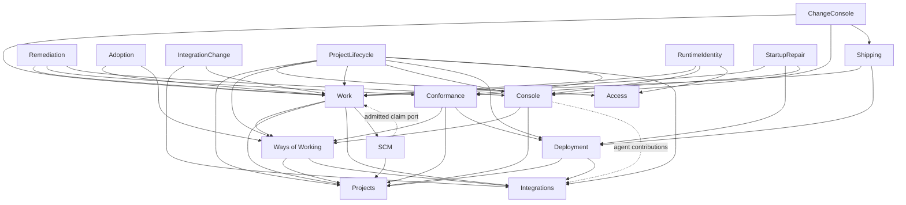

> Superseded by [architecture.md](architecture.md), which took this proposal through review on 13 September 2026. Kept as the evidence and the gap table.

# The application’s shape

Proposal written 13 September 2026, against the tree of that day. This is a design,
not an implemented API. Counts are physical production-file lines, including
comments; package totals exclude tests/generated Go. Below, **F** means
`internal/forge/`; `:n` identifies an evidence location, `(nL)` a whole-file count.
The accompanying ledger records the reviews.

## The subsystems

The application runs governed changes, hosts interactive consoles, and deploys
selected software. Ways of Working supplies the procedures; Conformance examines
the results. Projects supplies repositories, Integrations supplies configured
services, and Access decides authority. These are operation boundaries, not
one-package-per-table boundaries. Forge still has 48,193 production lines in
271 files; `F app.go:17` (142L) holds their runtime state.

Public operations below are proposed package contracts. Commands receive context
and verified caller scope, not an actor string masquerading as authority.
Stores, generated records and runtime handles remain private.

**Work** creates changes, runs pinned procedures, records decisions/evidence and
lands approved source. Its existing `workflow.Service` and `Authority` already
support this shape (`internal/workflow/service.go:48`, 241L). Own changes, runs,
steps, attempts, schedules, landing and workspace admission; keep dispatch,
materialization and merge rules private. Surface: create/edit/import change
(`ChangeDraft → Change`); start/stop (`StartRequest → Run`, `StopRequest → Result`);
retry/send back/approve/override (`Decision → Result`); advance (`RunID → Result`);
read history/evidence (`Scope → RunSnapshot, Artifact, Continuation`). Work owns
runner contracts; SCM owns the admitted merge driver contract.

**Console** maintains interactive conversations, including restart adoption and
terminal attachment. It has disk records, not SQL tables: `session.json` and pi
JSONL (`F console_session.go:39`, 413L). Surface: open/get/list (`OpenRequest →
Session`); read messages/transcripts (`Cursor → MessagePage`); send (`Message →
Receipt`); attach (`Size → Terminal`); upload/read attachment; interrupt/end;
observe runtime identity; reserve project removal; resume/shutdown. The registry,
credentials, files, tmux, steering and DinD stay private behind its interactive
runtime interface. Plain Console does not start changes or choose deployment
sources (`F console_api.go:133`, 709L).

**Deployment**, rather than the map’s “Delivery,” runs selected application
versions and manages their retained data. It owns targets, attempts, generations,
releases, inventory, backups and their workers (`internal/deployment/execution.go:9`,
148L). Surface: list/attach/check/retire target; offer target; bind deployment;
read history; plan/deploy/promote (`SelectedSource or Bundle → Release`);
observe attempt; start/inspect/stop preview; inspect inventory; take/restore
backup; tear down (`Request → RetainedResources`). Private stores, release
execution, probes and retention sit behind a Deployment-owned `Driver`.

**Access** identifies people/instruments and manages authority and credentials.
It owns directory, grants, sessions, OAuth, tickets and decision records
(`internal/access/decision.go:170`, 483L). Surface: bootstrap; sign in/out;
resolve credential (`Credential, Audience → Principal`); edit directory;
grant/revoke; decide/explain (`Principal, Capability, Resource → Decision`);
issue personal token; register client; approve connection; exchange/refresh;
disconnect; issue/consume ticket; expire credentials. Hashing, grants and OAuth
stores stay private. Cookies and trusted-header extraction remain transport;
PKCE, audience and replay rules belong here (`F oauth.go:383`, 601L).

**Ways of Working** publishes reusable guidance, packs, policies and workflows,
and records exactly what a project adopts. Surface: read/publish guidance;
read/publish/offer pack; read/publish workflow; bind system workflow;
read/publish policy; prepare (`AdoptionRequest → Candidate`); adopt
(`Candidate, ExpectedRevision → Adoption`); resolve adopted content; validate
procedure; inspect standing/history. Keep pins, conflict resolution, stock loading
and policy interpretation private. It checks declarations, not application
behavior (`internal/wow/pins.go:28`, 99L; `F wow.go:33`, 641L).

**Conformance** evaluates committed software against versioned checks and records
findings separately from evaluation failures. Surface: start review/evaluate
(`Source, CheckSet, Budget → Review, Assessments`); read reviews/standing/history/
fixes; confirm finding; create/revoke/list exceptions; clear history; shutdown.
It owns evaluation strategies and review execution, not just review tables
(`internal/conformance/execution.go:18`, 271L). Snapshot preparation, comparison,
source staging and tool/model/probe implementations remain private. Its existing
`Authority` is the precedent, not its App-dependent adapter.

**Projects** owns project identity and repository access. Surface: find/list/edit
(`ProjectID, Details → Project`); initialize repository; read committed tree;
prepare workspace; inspect repository; attach remote (`Commit → Tree`,
`WorkspaceRequest → Workspace`). Generic Git and the SCM-host interface belong
here; Work retains change ownership and merge admission. A project column does
not confer ownership of adoption or model policy (`internal/project/project.go:24`,
228L).

**Integrations** owns the instance connector catalog and project attachments,
not every subsystem configured by a connector. Surface: list/describe/test/save/
remove connector; list/save service kind; attach/detach/list services; resolve
capability; prepare contributions (`BindingVersion, Consumer → Contributions`).
Validation, templates and provisioning adapters stay private; it owns a small
provider interface. Secrets remain a separate broker. Projects and Integrations
are separate because instance providers serve multiple projects and runtimes
(`design/subsystems/project-integrations.md:26`, 220L; `F services.go:74`, 345L).

**Facades.** These expose complete operations, not collections of services:

| Facade | Composes and preserves | Consumers; present evidence |
|---|---|---|
| Shipping | Work source/attempt + Deployment execution; completion/release/membership/jobs share a transaction | Deploy runners, release APIs; `F deploy_run.go:24` (198L), `workflow_completion_store.go:24` (46L) |
| ChangeConsole | Work continuation/workspace + Console; preview through Shipping | Chat HTTP/MCP and rehearsal worker; `F console_steering.go:368` (465L), `console_rehearse.go:32` (146L) |
| Remediation | Conformance findings + Work changes; private item/attempt records and worker lifetime; Console busy observation | Remediation API/scheduler; `F remediation_attempt_store.go:90` (209L), `remediation_worker.go:95` (124L) |
| Adoption | WoW candidate + Work uplift and shipped stamp, atomically | Adoption API/completion worker; `F wow.go:374` (641L) |
| IntegrationChange | Attachment selection + governed Work creation | Integration HTTP/MCP; `F project_integrations.go:341` (399L) |
| ProjectLifecycle | Create with owner grants/adoption; purge owner participants, reserve live activity, then external cleanup | Project HTTP/MCP; `F handlers_project.go:151,499,620` (717L) |
| RuntimeIdentity | Console live session + Work current attempt/owner + Access account status | Models’ inference admission; `F inference_identity.go:22` (94L) |
| StartupRepair | Work, Deployment and Conformance repair in one transaction | Daemon before admission; `F startup_recovery.go:42` (67L) |

## Dependency graph

Arrows mean **needs an operation from**, not “must import.” Ordinary stable
service dependencies may be direct imports. Authority/runtime strategy ports
are declared by consumers; facades import their participants. Cross-cutting
supply is listed separately below. No subsystem imports Forge.



Rows need; columns provide. Each populated cell states the operation justifying
that direction. “—” means no direct business dependency. Shipping is an
additional provider to ChangeConsole for previews. ProjectLifecycle also calls
Model, ADR and Secret removal participants, retaining their own rules.

| Needs ↓ / Provides → | Work | Console | Deployment | Access | WoW | Projects | Integrations | Conformance | SCM |
|---|---|---|---|---|---|---|---|---|---|
| Work | — | — | — | — | Resolve pinned procedure/policy | Prepare repository workspace | Pin binding versions | — | Execute admitted merge |
| Console | — | — | — | — | Resolve steering | Read project snapshot | Prepare agent contributions | — | — |
| Deployment | — | — | — | — | — | Stage exact committed tree | Resolve selected provider | — | — |
| WoW | — | — | — | — | — | Read/advance adoption identity | Lock required capabilities | — | — |
| Conformance | — | — | Observe serving release/probe | — | Resolve versioned checks | Stage source | — | — | — |
| Shipping | Claim/source/evidence | — | Deploy/settle release | — | — | — | — | — | — |
| ChangeConsole | Stop/continue/start/land | Open/control conversation | — | — | — | — | — | — | — |
| Remediation | Admit/observe/retry change | Observe project activity | — | — | — | — | — | Select/verify findings | — |
| Adoption | Create uplift/stamp shipped revision | — | — | — | Prepare/adopt candidate | — | — | — | — |
| IntegrationChange | Create wiring change | — | — | — | — | — | Select attachment | — | — |
| ProjectLifecycle | Refuse/remove work | Reserve/dispose sessions | Remove placements/cleanup | Establish/remove ownership | Initial adoption/removal | Create/remove root | Remove attachments | Remove project records | — |
| RuntimeIdentity | Observe attempt/owner | Observe live identity | — | Check account | — | — | — | — | — |
| StartupRepair | Interrupt orphan steps | — | Repair orphan releases | — | — | — | — | Repair orphan reviews | — |
| SCM | Prepare/settle exact claim | — | — | — | — | Perform Git/host operations | — | — | — |

Work’s registered runners invoke supplied agent/check/deploy operations; those
adapters translate admitted attempts and return evidence (`F engine.go:200`,
342L). This avoids Work importing Conformance while Remediation imports Work.
SCM is Work’s private collaborator despite remaining a sibling package. Its
claim port calls Work; that is not a reverse Go import (`internal/scm/service.go:26`,
330L). Work constructs it with Projects’ host operations. Console receives
Integration contributions through shared agent preparation; Work additionally
pins binding versions (`F run_start_wiring.go:122`, 160L).
Inference observes runtime owners through a port; it never drives their lifecycle.

## Cross-cutting concerns

| Concern | How supplied; boundary and evidence |
|---|---|
| Authorization | Enforce permissions at semantic operations. Preserve Work/Conformance’s own Authority interfaces with scoped Access adapters; a direct Access dependency is also reasonable where its types fit. HTTP supplies verified identity, not permission decisions alone. `internal/conformance/service.go:29` (184L), `F approval_authority_store.go:27` (99L) expose the good contract and remaining bypass. |
| Transactions and receipts | Import `database`/`audit` directly; named `...In` participants share the caller’s transaction. Receipts fail the command, unlike diagnostic logs. `internal/audit/audit.go:14` (56L). No generic repository; facades call named participants, not arbitrary writes. |
| Jobs and scheduling | Import transactional admission; construct River once with bound subsystem operations/retry policy. Work owns workflow schedules; daemon owns calendar maintenance. Queue completion cannot settle a domain outcome. `F job_wiring.go:28` (113L), `triggers.go:137` (219L). |
| Agent/process execution | Supply bounded process/container values; shared agent preparation serves Work, Console and evaluators. Keep session/attempt lifecycles with their owners. `internal/execution/runner.go:24` (207L), `F pihome.go:80` (168L). |
| Models and accounting | Construct a Models service over model/usage stores, Integrations and scoped Secrets; give inference RuntimeIdentity’s port. Surface: resolve model (`SelectionRequest → Selection`), configure slots, list catalog, acquire capacity (`Permit`), prepare `PublicConfig`, serve inference, read `UsageReport`. Callers supply project profile in the selection. Keep provider keys server-side; require both a trusted TCP peer network and a live scoped credential, including disabled-account/stale-attempt checks. Distinguish transcript estimates from inference receipts. `F inference.go:24` (402L), `inference_providers.go:230` (308L), `model_slots.go:36` (123L). |
| Runtime needs | Deployment consumes the dependency catalog’s need definitions; its drivers own fulfilment. These are not software package dependencies. `internal/dependency/catalog.go` (259L). |
| Secrets | Supply a scoped resolver (`Consumer → Delivery`); broker owns built-in/Infisical strategies and stable generated values. Never expose all secrets to a subsystem. `F secrets_broker.go:126` (244L), `internal/secret/store.go:65` (341L). |
| Configuration | Constructor values for paths, images, networks and operator flags; no App map or package-global VerifyOnly. Flags are not policy. `F features.go:9` (53L), `app.go:142` (142L). |
| Logging/errors/lifetime | Supply reporter and logger; return typed refusals/uncertainty. Daemon starts owners explicitly and supplies one shutdown deadline; owners never extend it or destroy durable chats on exit. `F self_errors.go:209` (226L), `cmd/forged/runtime.go:99` (163L). |

## What the App is after this

App holds consumers’ services/facades and HTTP presentation. Pages can compose
typed reads directly; facades own reusable commands and transactions. It holds no console
registry, model semaphore, driver switch or remediation worker. Construction
binds narrow dependencies once; startup repair/start/drain remain explicit.
Illustrative proposed constructor, with error handling omitted:

```go
func New(db *database.DB, cfg Config, drivers Drivers, queue jobs.Admitter) (*App, Lifecycle) {
    auth := access.New(db, cfg.Auth)
    secrets := secret.NewBroker(db, drivers.SecretStores)
    integrations := integration.New(db, secrets, drivers.Providers, authority.Integrations(auth))
    projects := project.New(db, drivers.Repositories, authority.Projects(auth))
    ways := wow.New(db, projects, integrations, authority.WoW(auth), cfg.Stock)
    models := model.New(db, integrations, secrets, cfg.Models, authority.Models(auth))
    agents := agent.New(cfg.Agent, drivers.Processes, drivers.Containers, models, integrations)
    deploy := deployment.New(db, projects, integrations, drivers.Deployment,
        secrets, queue, authority.Deployment(auth))
    checks := conformance.New(db, projects, ways, deploy, agents, authority.Checks(auth))
    // Work constructs SCM and its claim adapter using the repository operations.
    work := workflow.New(db, projects, ways, integrations, runners.New(agents, checks, deploy),
        shipping.Completion(deploy, queue), authority.Work(auth))
    chats := console.New(cfg.Console, projects, ways, agents, authority.Console(auth))
    ship := shipping.New(work, deploy)
    fixes := remediation.New(db, checks, work, chats)
    decisions := adrs.New(db)
    identity := runtimeidentity.New(work, chats, auth)
    return &App{
        Access: auth, Projects: projects, Integrations: integrations,
        Ways: ways, Work: work, Console: chats, Deployment: deploy,
        Conformance: checks, Models: models,
        Shipping: ship, Changes: changeconsole.New(work, chats, ship),
        Fixes: fixes, Adoption: adoption.New(db, work, ways),
        ProjectLifecycle: projectlifecycle.New(db, projects, auth, ways,
            work, chats, deploy, integrations, checks, fixes, models, secrets, decisions),
        IntegrationChanges: integrationchange.New(integrations, work),
        Inference: models.Handler(identity),
    }, lifecycle(db, queue, work, chats, deploy, checks, fixes)
}
```

The daemon binds queue handlers before starting owners; construction performs no
repair or execution. ProjectLifecycle’s broad dependency list is deliberate: it
is the purge composition, not an interface imposed on each subsystem. Real
constructors return errors; participant authority remains checked.

## The gap

Counts identify files to split, not promised deletions. HTTP parsing/rendering
stays outside; behavior and private state move with the owner. More evidence
and import directions are in the ledger.

| Owner | Misplaced Forge behavior (whole-file lines) | Aliases/wiring to remove |
|---|---|---|
| Work | `engine.go`342, `run_start_wiring.go`160, `workflow_scm_driver.go`279, scheduling in `triggers.go`219 | 44 Work type aliases, including Run/Step; `workflow_wiring.go`108, `workflow_dispatch.go`32; 28 `workflow_*.go` files total1,317 |
| Console | `console_session.go`413, `console_container.go`566, `console_dind.go`395, `console_steering.go`465, behavior in `console_api.go`709 | `console_pisession.go`12; chatMsg/piReader/piUsageMsg; transcript wrappers in `console_record.go`88 |
| Deployment | `release_flow.go`267, `deployment_recovery.go`108, `health_controller.go`270, `backups.go`393, `docker_source.go`244; split `preview.go`661/`lanrelease.go`683 | Target/Offer/Release aliases; `deployment_wiring.go`104, `docker_wiring.go`11, `driver_portainer.go`34, `target_store.go`34; adapters in `do_platform.go`157/`targets.go`143 |
| Access | OAuth behavior in `oauth.go`601; `authz_kernel.go`225, `internal_auth.go`344, `adminnet.go`211 | 141 Access aliases, including Capability/scopeKind; `access_wiring.go`65, `identity_store.go`23, `authz_catalog.go`141 |
| WoW | `wow.go`641, `adoption.go`299, `lanes.go`301, `library.go`1,269, `policy.go`394 | 19 forwarded names, including Adoption/adoptionReceipt; `wow_wiring.go`28, `pack_store.go`65, `library_store.go`30, `pack_publication.go`7 |
| Conformance/Remediation | `conformance_fleet.go`404, `conformance_llm.go`360, `conformance_tool.go`344, `conformance_runtime.go`260, `guidance_conformance.go`657; eight remediation stores1,008; runtime150/worker124/reconciler213 | No Conformance type aliases found; split `conformance_wiring.go`163; remove remediation schedule/reconcile wiring12/20 |
| Projects/Integrations | Generic portions of `gitrepo.go`460/`gitlab.go`415; `connectors.go`531, `services.go`345, `registries.go`542; facade portions of `handlers_project.go`717/`project_integrations.go`399 | Project alias; `project_store.go`42, `integration_wiring.go`9, `integration_store.go`76 |
| Shared facilities | `executor.go`252, `pihome.go`168, `inference*.go`1,027, `models.go`413, `accounting.go`180, `secrets_broker.go`244 | `model_wiring.go`7, `usage_wiring.go`7, `secret_wiring.go`8; ExecRequest/ExecOutcome/usageTotals aliases |

## Disagreements and judgement calls

- **Module or operation service?** The straw man correctly moves driver contracts;
  its public store fields preserve consumer orchestration. Recommend private
  stores and complete operations, building on Work/Conformance, not uniform
  per-table modules.
- **Remediation inside Conformance or a facade?** Both work. Recommend a durable
  facade owning its progress and workers because admission atomically creates
  Work too. Reject the straw man’s automatic “runtime stays in Forge.”
- **SCM inside Work or Projects?** Work’s reviewer favors nesting the merge
  protocol; Projects’ reviewer separates reusable Git/host operations. Keep
  `scm` a sibling for admitted merge rules; Projects supplies its host driver.
- **Does adoption call Conformance?** Its reviewer identified prospective checks;
  WoW’s reviewer stresses adoption is not proof of conformance. Keep normal
  adoption independent; a requested assessment composes both explicitly.
- **Docker/agent ownership?** Console and Deployment reviewers agree that shared
  execution belongs below both. Move daemon primitives, not lifecycle policy;
  retain immutable Docker source selection (`F targets.go:111`, 143L).

These decisions replace `design/architecture/domains.md:17,202`’s “drivers in Forge” and “one service
per table” guidance. The record-store style remains an internal implementation
rule, not the public application architecture. The product owner decides the boundaries above.

## Migration order

1. **Deployment first:** establish its driver and selected-source contracts, then
   one deploy/observe operation. Preserve generation and immutable-input tests;
   migrate callers and delete adapters in the same slice.
2. Extract Shipping’s completion participant and previews; preserve atomic
   membership/jobs. Remove the Work join in `internal/releasesql/queries.sql:62`
   (84L), not just its package import.
3. Extract shared agent preparation and Console lifecycle; then ChangeConsole.
   Retain continuation ownership, verified sends and bounded shutdown tests.
4. Complete Access operations/authority adapters; WoW prepare/adopt next. Close
   bypasses such as `F approval_authority_store.go:27` (99L) and independent
   adoption receipts (`F adoption.go:96`, 299L).
5. Move Conformance evaluation and the complete Remediation facade, including
   stores/workers. Replace its hidden WoW-table reads
   (`internal/conformance/preparation_store.go:44`, 238L).
6. Finish Projects/Integrations and their facades; then consolidate Work’s
   runners/scheduler. Replace the attachment Work join
   (`internal/integration/integration.go:266`, 436L).

Each numbered item comprises small, behavior-preserving commits: introduce one
operation, migrate all its consumers, remove the superseded path, then run the
existing relevant tests and full gate. Measure usable operations and bypasses
removed, not Module fields added. This discovery lane runs no gates.
