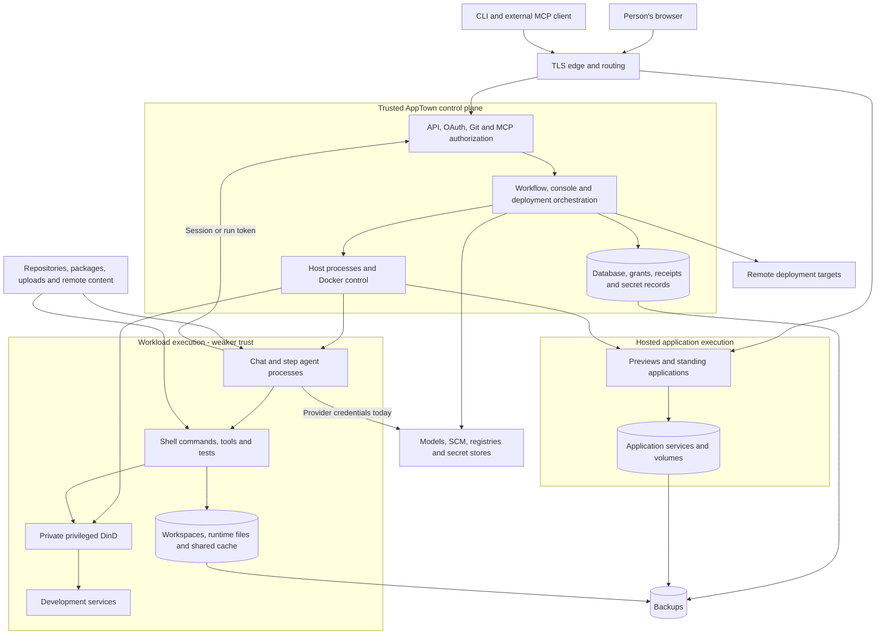

# AppTown threat model

This is the security model: what AppTown must protect, from whom, and how each
gap would be closed. Mitigations it describes as proposed are not implemented.
Where each threat stands is the status column of the
[threat register](threat-register.md); current identity and visibility
behaviour is [authentication and authority](../subsystems/auth.md), and the
inference boundary and its accepted limits are
[inference security](../subsystems/inference-security.md). A risk stays open
until its stated verification is done. Revisit this model when authority,
execution, credentials, networking or deployment changes.

## Assessment

AppTown's largest security risk is the proximity of two kinds of authority:
it holds infrastructure credentials and makes consequential decisions, while
also running arbitrary application code and agents that consume untrusted
material. A helpful agent, a private Docker daemon and a successful conformance
check do not separate those authorities by themselves.

For a known-user installation, the first work should protect provider spend,
the browser's AppTown authority, and the control plane from workloads. The
current design should not be offered as isolation between hostile tenants.
That would require a different worker boundary, explicit confidentiality
policy, and enforceable resource and spending limits.

This is a threat model, not a penetration-test report or certification. It
identifies credible attack paths, records controls found in code, and defines
what evidence would close each gap. It does not claim every path is exploitable
on the live network or every relevant vulnerability has been found.

The detailed [threat register](threat-register.md) holds the stable threat
IDs, supporting code, priorities and verification scenarios. This document
sets the context and the implementation sequence.

## 1. Scope and assumptions

The working deployment model is **known authenticated users, with untrusted
repositories, dependencies, attachments, application code and agent output**.
This is a working assumption, not a new product decision made on the user's
behalf. It includes mistakes by well-intentioned users, stolen accounts, and
malicious content introduced through otherwise legitimate work.

| Deployment | Security expectation | Consequence for this model |
|---|---|---|
| Trusted small team | Members generally cooperate; accounts, packages and prompts can still be compromised | Credential theft, browser attacks, host compromise and accidental destructive operations remain material |
| Known users with untrusted workloads (the working model) | Running a project must not confer authority over AppTown or other projects | Enforce boundaries outside the agent and the project's code |
| Hostile public users or tenants | Assume deliberate, repeated attempts to escape and consume resources | Isolated workers, private-project authorization, admission controls and abuse operations are release prerequisites |

In scope: browser UI and terminal; HTTP API; CLI, Git and MCP; internal and
proxy authentication; OAuth; chats and workflow steps; delegated agents;
repositories and worktrees; workflow definitions and conformance evidence;
toolchains and caches; Docker and DinD; previews and standing applications;
managed and manually created services; integrations, secret stores and model
providers; deployment targets; database, backups, recovery and maintenance.

External systems are included at their interfaces. We do not assess the
internal security of model providers, GitLab, Infisical, registries, cloud
providers or the hypervisor. Their credentials, responses, availability and
compromise effects still matter. Physical access and a malicious machine
administrator are outside the prevention promise of the present architecture;
their ability to read secrets and alter receipts is explicitly recorded.

The desired isolation is stronger than the implementation currently proves.
Reads follow current grants: a person reads a project's source, chats and
evidence only with read access to that project, and aggregate pages show only
readable projects ([authentication and authority](../subsystems/auth.md#visible-projects-and-aggregate-reads);
[authorization decisions](../subsystems/authorization-capabilities.md)).
There is no instance-wide profile that opens every project to every member.
An instance-wide read grant, such as the Auditor role, still reads every
project, and that is deliberate.

## 2. Evidence and uncertainty

Each register entry distinguishes an **observed** code/configuration behavior
from an **inferred** abuse path. “Not found” means absent in the reviewed
implementation, not proof that no edge proxy or operating-system control exists.
No secrets were extracted, no hostile payload was sent to a running agent,
and no live privilege escalation was attempted.

Existing focused Go tests for authentication, authorization, OAuth, MCP,
scoped Git reads, secret delivery/reveal and build-context exclusion passed
on the local isolated test database during this review. The exact validation
command is in §10. Those tests establish useful existing behavior; they do
not establish the proposed controls in the register.

### The service configuration a deployment should have

This is what the shipped unit files (`deploy/systemd/apptownd.service`,
`deploy/systemd/apptown-worker.service` and their `.env.example` files) and
[running an AppTown](../../stock/docs/guides/running-apptown.md) set up. It
describes no particular installation.

- **The daemon runs as root.** On Linux, `apptownd` runs as root when it runs
  containers on its own Docker: steps and chats run as root in containers
  that write into AppTown's folders, and AppTown must read and remove
  what they leave. This is a documented choice, not an oversight. It means
  that code which escapes a container on AppTown's host has root there
  (TM-03). A non-root user in the `docker` group would not be a boundary
  either, since control of Docker is equivalent to root.
- **No systemd sandboxing is relied on.** The shipped unit sets none of
  `NoNewPrivileges`, `ProtectSystem`, `ProtectHome` or `PrivateTmp`. An
  operator may add them, but they do not separate `apptownd` from the Docker
  daemon it controls. The separation the product offers is a worker machine
  and `-no-local-docker` ([agent isolation limits](../subsystems/agent-sandbox.md)).
- **The web listener is on loopback, behind a TLS proxy.** The example
  configuration binds the main listener to `127.0.0.1:7777`, puts a TLS proxy
  (such as Caddy or nginx) in front of it for the public address, and sets
  `-public-host` to that `https://` origin.
- **The console and inference listeners are private.** They bind to an
  address containers can reach (in the example, the Docker bridge address)
  and are never routed through public ingress. The inference listener admits
  only the configured worker networks (`APPTOWN_INFERENCE_NETWORKS`); a `/0`
  network is refused.
- **Sign-in is internal or a trusted proxy.** `-auth open` trusts any name a
  caller gives, so `apptownd` refuses to start with it on an address other
  machines can reach unless `-open-on-network` is given. A shared AppTown uses
  `-auth internal` (the first administrator needs the setup token from the
  data directory) or `-auth trusted-header` behind an authenticating proxy.
- **A worker listens on a private network address** and accepts only the
  AppTown, by mutual TLS with certificates the operator issues. On a cloud
  host the operator blocks the provider's metadata address and checks it with
  `apptown-worker -check-metadata`.

AppTown does not verify these on a running installation, and it does not check
edge rate limits and header stripping, firewall reachability from each worker
network, outer container or hypervisor confinement, live secret-binding
separation, remote-target privileges, backup encryption, access and
retention, or disaster-recovery objectives. Do not substitute assumptions
about these for application controls.

## 3. Assets and security objectives

| Asset | What must be protected | Worst relevant loss |
|---|---|---|
| Provider accounts and inference allowance | Keys, account scope, hard aggregate spending ceiling | Off-platform token theft or runaway authorized spending |
| Human authority | Passwords, sessions, personal tokens, OAuth consent, grants | Impersonated approvals, secret reveal, administration or deployment |
| Control plane | AppTown process, host Docker, OS, database credentials, secret-store identity | Instance compromise, other projects and deployment targets compromised |
| Source and private working material | Repositories, branches, prompts, uploads, logs, unmerged changes | Disclosure, silent modification or loss |
| Production applications and data | Release credentials, runtime secrets, service volumes, target accounts | Data theft, destructive migrations, malicious releases |
| Decision history | Approvals, check results, source identity, releases, audit receipts | False confidence about what was approved, tested or deployed |
| Availability and money | CPU, memory, PIDs, disk, network, queues, service and model spend | Host outage, recovery delays, unexpected bills |
| Recovery material | Backups, restore mappings, encryption keys, retained source and configuration | Irrecoverable state or recovery that reinstates compromise |

Required security properties, proposed as acceptance criteria:

1. Arbitrary code in a chat, step or application cannot read reusable model,
   control-plane or deployment credentials.
2. Every delegated action is bounded by current authority, resource, purpose
   and lifetime. Changing listeners or API transports cannot widen it.
3. A compromised runtime can spend only a bounded allowance, including its
   delegates and concurrent requests. Creating more sessions cannot bypass
   user/project/instance ceilings.
4. Untrusted content cannot inherit a browser's AppTown origin or turn a model
   suggestion into an approval, grant, secret binding or release decision.
5. A tested and approved source/artifact identity is the identity released.
   Agent-written success text is not independent execution evidence.
6. Workspace paths, Git configuration, caches and artifacts are treated as
   attacker-controlled when a privileged process consumes them.
7. Cleanup and shutdown are bounded. Credentials expire even when cleanup
   fails; recovery never silently restores wider or stale authority.
8. Recovery can restore known-good state without trusting compromised workers
   or destroying unrelated resources.

## 4. Actors and entry points

| Actor | Initial capabilities | Representative objective |
|---|---|---|
| Unauthenticated Internet client | Public HTTP, OAuth registration, enabled webhook/intake surfaces, hosted apps | Account takeover, resource exhaustion, exploit a public app |
| Authenticated member or stolen member account | Normal project work, uploads, chats and whatever reads/grants policy allows | Reach another project, obtain secrets, influence approvals |
| Repository/dependency/content attacker | Files, package scripts, tool output, documentation, images, web responses | Prompt injection or direct code execution inside a workload |
| Compromised agent or application | Its filesystem, process environment, network and delegated tokens | Steal credentials, pivot to host/LAN, consume money, corrupt evidence |
| Malicious preview visited by an owner | Script execution on the preview's web origin | Exercise the owner's AppTown session, social-engineer OAuth or release |
| External MCP client | Its own OAuth grant or personal token | Exceed consent, confuse sessions, misuse tools or Git tickets |
| Integration or supply-chain attacker | Provider responses, downloaded tools/images, mirror content | Introduce code, redirect credential-bearing requests, falsify results |
| Administrator/operator | Legitimate broad configuration and recovery authority | Accidental overgrant, unsafe restore, bad deployment; malicious admin is a residual trust assumption |

Prompt injection matters because the agent can execute tools, not because
every misleading document is itself an exploit. A model may faithfully
follow malicious instructions in a repository or tool result. Treat that
outcome as possible and constrain the tool's real authority. Guidance remains
useful for behavior, but it cannot be the isolation boundary. See the
[OWASP prompt-injection guidance](https://cheatsheetseries.owasp.org/cheatsheets/LLM_Prompt_Injection_Prevention_Cheat_Sheet.html).

## 5. System and trust boundaries

The diagram is a logical view of the current architecture. A box boundary
does not assert operating-system or network isolation. In particular, several
execution components share a host and Docker authority today.



| Boundary | What crosses it | What must decide authority |
|---|---|---|
| Internet → edge → AppTown | HTTP, identity headers, cookies, OAuth, uploads | Auth mode, trusted proxy contract, origin checks, bounded input |
| Person → instrument | Console/run/OAuth/Git grants | Current person authority intersected with purpose, resource and expiry |
| Agent → shell/tool | Model-selected commands and arguments | Runtime sandbox and narrow tool APIs, independently of the prompt |
| Workspace → host | Git commands, config reads, attachment sync, build context, mounts | Trusted Git metadata, filesystem containment, validated immutable input |
| Workload → Docker/network | Daemon requests, package downloads, service connections | Worker isolation, resource limits and enforced reachability policy |
| Project → project | Cache, read APIs, service network, tokens, host resources | Explicit confidentiality policy and physical access controls |
| Change → standing environment | Source/artifacts, migrations, secrets, target operations | Release authorization tied to immutable identity and target |
| Untrusted app/file → owner's browser | HTML, script, downloads, redirects and cookies | Origin separation, safe serving, anti-forgery and consent protections |
| Runtime → evidence/accounting | Reports, exit status, usage, transcripts | Trusted observation; distinguish claims from verified outcomes |
| Persistent state → restart/restore | Sessions, jobs, manifests, grants, resources | Revalidated leases/ownership and bounded recovery, not blind replay |

Important current distinctions:

- Read-only project chat protects the mounted project workspace from ordinary
  writes. It still runs processes and can hold credentials and make network
  requests. “Read-only” does not mean harmless.
- Writable change consoles and eligible implementation steps get private
  DinD. They do not receive the host Docker socket. Privileged DinD still
  shares a kernel with its Docker host; it is not a hostile-tenant boundary.
  [Docker's security documentation](https://docs.docker.com/engine/security/)
  explains why daemon privileges are part of the host attack surface.
- Local execution inherits the daemon environment, less any `GIT_*`
  variable and with no system or global git config (`gitexec.Environ`),
  and runs on the host. It is a
  trusted-operator mode, unsuitable for the working model's untrusted work.
- The console API's GET-only wrapper has deliberate POST exceptions and
  rejects PTY access. It is useful defense in depth; authorization must hold
  on the main listener too.
- App virtual-host proxying happens outside AppTown API authentication. App
  access control is separate. A private AppTown project does not automatically
  make its preview private.
- Per-workspace mise paths reduce accidental collisions, but mounting the
  entire writable cache volume still exposes neighboring paths to code.

## 6. Credential and sensitive-data flows

| Credential/data | Holder and delivery | Scope/lifetime and consequence |
|---|---|---|
| Model-provider key | AppTown only; runtimes' generated model configuration names the session token, never the key | Reusable provider authority; any copy ever delivered into a runtime must be rotated |
| Inference credential | Existing chat/step session token; provider keys remain on AppTown | Lifecycle-bound, explicitly allowed worker peer AND token, restricted binding/models, concurrency limits and receipts; monetary budgets deferred |
| Console token | Console process and persisted session metadata | Project/instrument restrictions; lifetime follows session management rather than a hard independent token TTL |
| Run token | Step env; derived from the step attempt under a key in the AppTown data folder (`runtime-token-key`), nothing stored per token | Run/project attribution; accepted at the inference gateway and the API only while the run is running, the attempt is the step's live attempt and the run owner's account is enabled; survives a daemon restart; no independent expiry, and anyone holding the key can mint tokens |
| Browser session | HttpOnly cookie (`__Host-apptown_session`, Secure, over HTTPS); token hash in DB | 30-day session; SameSite=Lax, host-only; Secure follows the public origin, so a plain-HTTP development AppTown uses a separate, non-Secure cookie |
| Personal token | Human/external client; hash in DB | Reusable until revoked; current user authority narrows it; generally broader than a purpose-specific OAuth grant |
| OAuth tokens | External client; token hashes and delegation in DB | Access 1 hour, refresh/delegation horizon 30 days; scoped/audience-bound, rotation and reuse handling |
| Git push ticket | Authorized external client; hash and constraints in DB | Short-lived, one-use, change/ref/expected-tip constrained; recheck authority at use |
| Project Git pull token | Git clients/runtimes that receive the configured read remote | Main-only read path, but persistent credential and source confidentiality still matter |
| SCM, registry and explicit step secrets | Selected step env and/or Docker auth/config files | Attachment/step-specific delivery exists; underlying provider credential scope may still exceed the task |
| Development-service credentials | Service client processes and generated config | Low value only with disposable data, unique credentials, isolated reachability and no production reuse |
| Need credentials of a deployment or preview (Docker host, Portainer) | The need's container and the app's environment; Portainer's stack file | Derived per deployment, preview or rehearsal from the built-in store's key, never stored; redacted from a boot's failure before it is kept; AppTown's own step servers keep the catalogue's fixed values |
| Application secrets | Broker → named app/init consumers through env | Environment bindings and consumer scopes; approved app code can necessarily read its own secret |
| Deployment and secret-store credentials | AppTown host/process and provider clients | High-value infrastructure authority; never appropriate ambient credentials for an ordinary chat or test |
| Transcripts, files, logs and backups | Workspace, session directory, DB, retained artifacts and operational storage | May contain any of the above if tools print or copy them; retention outlives the originating process |

The built-in store uses AES-GCM with its key stored in the same database.
That is obfuscation against incidental exposure of individual values, not
protection against someone who obtains the whole database. A database backup
must therefore be handled as credential-bearing material. The need
credentials of deployments and previews are derived from the same key, so the
same holds for them: whoever has the database can work them out.

“Ephemeral” is a lifecycle description, not an authority classification.
A disposable database credential that can reach production, a cloud account
or a shared service remains high value. Deleting a container does not revoke
an upstream key or erase copies from transcripts, Git history and backups.

The [runtime requirements](../requirements/runtime-environments.md) describe
the provisioned environments, and [inference security](../subsystems/inference-security.md)
the model gateway. This model adds security acceptance criteria; a proposed
control here is not an implemented guarantee.

## 7. Concrete attack chains

These chains connect individual register entries. They are inferred scenarios,
not reports that an attacker has performed them.

1. **Package → provider bill:** a legitimate task installs a malicious package;
   its script reads env or Pi configuration; it sends a reusable provider key
   outside AppTown; subsequent spending never reaches AppTown's accounting ledger.
   Relevant: TM-01, TM-02, TM-19.
2. **Attachment → owner authority:** a member uploads HTML; an owner opens the
   attachment URL; active content runs at AppTown origin and calls APIs with
   the owner's cookie. It need not read the HttpOnly cookie. Relevant: TM-08,
   TM-10, TM-17.
3. **Preview → delegated authority:** an owner visits a malicious same-site
   preview; it attempts a credentialed terminal WebSocket or apptownd OAuth
   consent submission. Success depends on browser cookie/origin behavior and
   the target account's authority. Relevant: TM-09, TM-27, TM-28.
4. **Workspace → host:** a workload changes a symlink or Git metadata later
   consumed by AppTown; a host write or Git hook/filter operation reaches beyond
   the workspace under the root daemon identity. Relevant: TM-03–TM-05.
5. **One project → another:** code modifies files elsewhere in the shared cache
   volume; another workload runs the modified tool or consumes poisoned data;
   its credentials become exposed too. Relevant: TM-06, TM-13, TM-19.
6. **Passing check → wrong release:** code controls its tests or result files,
   then source or an image tag changes between checking and deploying. A green
   status is mistaken for proof of the deployed artifact. Relevant: TM-17,
   TM-18, TM-26.
7. **Cancellation → continuing cost:** a job loses its local controller, but a
   provider stream, nested container or retained credential remains usable.
   Restart reconstructs resources without revalidating authority. Relevant:
   TM-02, TM-20, TM-24.

## 8. Prioritized implementation sequence

Priorities reflect the working model, impact and prerequisites, not a numerical
prediction of exploit probability. **P0** means address in the first security
batches before expanding exposure; **P1** means required hardening;
**P2** means assurance and operational depth after the immediate boundaries.
P0 does not assert active compromise. Conditional findings require their
stated preconditions to be verified.

| Batch | Concrete outcome | Threats | Completion evidence |
|---|---|---|---|
| A. Protect browser authority | Serve active uploads as safe downloads or on an isolated origin; exact origin checks for terminals and browser mutations; bind OAuth consent to the session; secure production cookies | TM-08, TM-09, TM-12, TM-27, TM-28 | Browser tests against sibling preview and unrelated origin; apptownd consent denied; safe file-serving tests |
| B. Separate model credentials, then bound spend | First: private inference gateway using lifecycle tokens and explicit worker networks, no runtime provider keys, attribution and concurrency limits. Later: transactional budgets and provider-side backstop | TM-01, TM-02, TM-15 | Canary-secret runtime inspection, native Pi protocol tests, cancellation/restart/provider-failure tests; budget tests when that control is implemented |
| C. Stop workspace-to-control-plane authority | Disable local execution for untrusted work; isolate worker hosts/VMs from control plane; remove trusted host operations over attacker-writable metadata and paths; separate cache mounts | TM-03–TM-07 | Harmless escape-attempt fixtures, cross-workload cache tests and measured worker-network reachability |
| D. Make delegation consistent | Uniform principal/revocation checks on every transport; purpose/resource/lifetime bounds on instruments; explicit read policy; scoped webhook credentials | TM-10–TM-13, TM-21, TM-27 | Transport × principal × resource negative tests; live revocation of open sessions and instruments |
| E. Protect delivery and data | Environment-secret policy, isolated dev services, immutable release evidence, restricted target adapters, safe backup/restore and ownership-aware cleanup | TM-14, TM-16–TM-19, TM-22, TM-23, TM-25 | Preview cannot receive production canaries; artifact identity tests; disposable restore and target-scope exercises |
| F. Bound operations and improve assurance | CPU/PID/disk/network/queue ceilings; runtime leases, bounded shutdown and expiry; external audit export, retention and incident exercises | TM-15, TM-20, TM-24, TM-26, TM-28 | Resource-exhaustion and restart tests; expired credential denied despite failed cleanup; restore/incident drill |

Batches A and B are the best first application changes. Batch C establishes
the isolation needed to make those changes durable against hostile code;
it is not optional merely because keys have moved behind a proxy. Resource
admission limits from F should accompany any increase in users or workload
concurrency. Existing correctness refactors remain useful when they create
these enforceable boundaries; they should be directed by this model.

### Model gateway: chosen initial boundary

The [inference security contract](../subsystems/inference-security.md) is the
current decision and implementation reference. AppTown holds reusable provider
keys and proxies permitted native inference operations. The existing chat or
step token authenticates Pi. Admission also requires an explicitly allowed
worker-network peer; forwarded headers are not trusted. Chats have no short
wall-clock expiry: their token survives idle periods and restart, but ends with
the chat. Step tokens end with their attempt and daemon process.

The accepted first batch is attributable, fairly arbitrary inference within
configured models, with request/concurrency limits and trusted transport
receipts. **Hard spending budgets and short-lived renewable inference leases
are not prerequisites for this batch.** Transactional monetary reservations,
shared user/project/instance limits and provider-side billing backstops remain
follow-up controls under TM-02. The proxy does not claim to bound total spend.

Network binding reduces off-network token theft. It cannot stop an allowed
runtime from relaying requests or deliberately spending; attribution identifies
a credential, not proof of the human's intent. The shared-host and privileged
worker risks remain. If those residuals become unacceptable, move the model loop
and the worker onto separately enforced trust boundaries as well.

Deleting files cannot invalidate copies of a provider key already made; a key
ever delivered into a runtime must be rotated
([inference security](../subsystems/inference-security.md)).

## 9. Decisions and residual risk

Project source, prompts, transcripts and attachments are read through current
project grants, not visible to every authenticated member
([authorization decisions](../subsystems/authorization-capabilities.md)). That
every representation, including Git, MCP, events and error metadata, applies
the same filter is still to be shown (TM-11).

These are unresolved product and operational decisions, not tacit approvals:

- Which users may run arbitrary code, start privileged builds, provision
  services, expose previews or consume paid inference? What are the hard
  per-user/project/instance allowances?
- Where will isolated workers live, and which infrastructure is allowed to
  share their kernel? A gateway on the same compromised root host is not a
  protected credential boundary.
- Should previews require viewer authorization by default? Can untrusted
  applications move to a separate registrable domain from AppTown?
- Which service data is permitted in development? Which secrets, if any,
  may intentionally be shared across environments? Who approves that exception?
- What recovery-point and recovery-time objectives, backup retention, audit
  retention and provider-data retention are acceptable?

Residual risks after the proposed work include malicious approved application
code reading its own production secrets, a compromised provider seeing data
sent to it, a stolen inference grant spending its remaining allowance, supply
chain/kernel defects, and a trusted administrator accessing instance data.
Risk acceptance should record the threat ID, owner, scope, reason, compensating
control and review date. The register's status column names the accepted
ones and where each acceptance is recorded.

## 10. Verification and maintenance

Use industry-standard tools for secret detection, dependency/image
vulnerabilities and well-understood security rules. Use intent-based agent
review for semantic questions such as whether a check proves the promised
behavior. Neither replaces deterministic authorization, resource enforcement
or independent tests of trust boundaries. This follows the project's intent
for conformance: test valuable guarantees rather than mandate incidental
wording or count arbitrary patterns.

A focused regression command for the trust boundaries:

```sh
env -u APPTOWN_TEST_DB_URL go test ./internal/forge \
  -run 'Test(Authz|OAuth|InternalMode|BootstrapThenLogin|PasswordReset|ConsoleToken|ProjectRoster|RouteGuards|GitHTTP|MCP|SecretsDelivered|RevealSecret|StagedBuildContext)' \
  -count=1
```

It uses the local disposable test databases; it is not a full-suite run, a
dependency audit, a browser exploit test or a firewall assessment. Each register
entry's **Verify** paragraph is proposed future
evidence, not a statement that its tests already exist.

For security changes, test allowed behavior as well as denial. Include
cross-project attempts, stale/revoked identity, concurrent requests, restart,
partial infrastructure failure and malicious input controlled by an otherwise
authorized actor. Use canary secrets, disposable databases and worker fixtures;
never prove containment by risking real production data.

Maintain a route/transport inventory and a runtime credential/mount/network
inventory. Changes to either should trigger review of affected threat IDs.
Retain evidence and mark an entry mitigated only when a current guide or test
shows its control; a deployment's own configuration (firewall, edge, provider
limits, backups) is for its operator to verify. Reassess after incidents, new model
providers, new service kinds, worker changes, new public ingress, or changes
to release/approval policy. Review accepted risks at least each quarter.

The structure follows the four recurring questions in the
[OWASP Threat Modeling Cheat Sheet](https://cheatsheetseries.owasp.org/cheatsheets/Threat_Modeling_Cheat_Sheet.html):
what we are building, what can go wrong, what we will do, and whether it works.
STRIDE categories in the register are a coverage aid, not a substitute for
the concrete attack paths.

## 11. Operational response outline

1. Identify the affected project, account, worker, grant and time window using
   trusted gateway/control-plane records. Preserve logs and snapshots with
   restricted access; do not copy live secrets into an incident issue.
2. Disable new work and revoke affected sessions, delegates and grants.
   Stop or quarantine implicated runtimes with bounded operations. If provider
   keys may have leaked, revoke them at the provider: AppTown session revocation
   alone does not stop off-platform use.
3. For possible host compromise, isolate the worker/control host and treat
   its reachable database, secret-store, registry, SCM and deployment
   credentials as exposed. Recover from a trusted machine; do not rely on
   the suspect host's logs as the only evidence.
4. Determine affected artifacts, releases and data. Restore to an isolated
   target first, verify identities and integrity, then recover service.
   Rotate secrets and invalidate restored old sessions before reopening.
5. Reconcile provider usage, queued work and orphaned services. Record what
   was lost, what is uncertain, and the tests/controls needed to prevent
   recurrence. Update the relevant threat entries and recovery procedure.

This outline still needs an exercised operator runbook, provider-specific
revocation procedures and agreed recovery objectives. Bounded shutdown must
remain a requirement even during an incident; credential leases and an
external kill path cover work that cannot be synchronously stopped.
