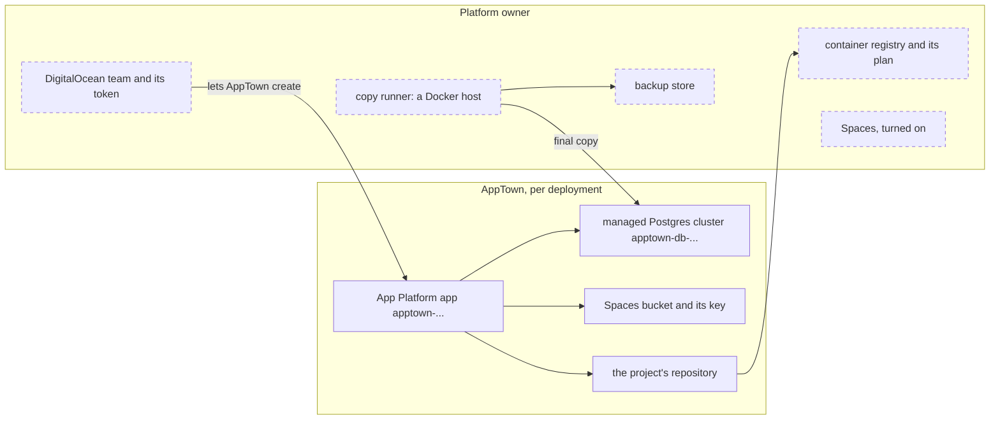

# App Platform target setup

A DigitalOcean App Platform target runs each deployment as an App Platform
app. A declared Postgres becomes a managed database, and declared object
storage becomes a Spaces bucket. This target is experimental: no real app has
been qualified on it yet.

## Who owns what

| Platform owner | AppTown |
|---|---|
| The DigitalOcean team, and the token AppTown uses | One App Platform app per deployment, `apptown-…` |
| The container registry and its plan. AppTown creates one on the Starter plan only when the team has none | One repository in the registry per project, named after the project |
| Spaces, turned on for the team | A managed Postgres cluster, `apptown-db-…`, for a deployment that declares Postgres |
| The copy runner and the backup store | A Spaces bucket (`bucket`) and a key that reaches it alone (`spaces-key`), for a deployment that declares object storage |
| Apps, clusters and repositories AppTown did not create | A short-lived full-access key, `apptown-maker-…`, while it makes or deletes a bucket |

Clusters carry the tag `apptown-instance:<id>`, and apps the setting
`APPTOWN_INSTANCE`, because App Platform apps take no tags. The app's
address is App Platform's own, so there is no DNS to set up.

## What you need

- The **App Platform targets** feature turned on under **Setup → Features**
  ([Features](features.md)).
- A DigitalOcean account, and one of its regions: `syd`, `sgp`, `blr`, `nyc`,
  `sfo`, `tor`, `lon`, `fra` or `ams`. Add one target per account and region.
- The account's container registry. App Platform pulls images only from it.
  If the account has none, AppTown creates one on the first release, on the
  Starter plan. Starter holds one repository and Basic five. Each project
  released here takes one, and a restored copy takes one more for AppTown's
  gate image. A release that would not fit is refused before anything is
  made, so choose Basic or larger for more than one project.
- Spaces turned on for the account, if any app declares object storage.
- For backups, a backup store and a copy runner ([Deployment
  backups](deployment-backups.md)).

## The credential

Create a personal access token under **API → Tokens** in DigitalOcean's
control panel, for a team that holds only AppTown's apps. A custom-scoped
token needs create, read, update and delete on apps, databases, the container
registry, Spaces keys and tags, and read on the account.

Store it as an AppTown secret, under **Integrations › Secrets** or with
`apptown secret set DIGITALOCEAN_ACCESS_TOKEN < file`.

The token makes and deletes Spaces keys. For each bucket it makes a key that
reaches that bucket alone. While it makes or deletes a bucket it also makes a
full-access key named `apptown-maker-…`, and deletes it again straight after.
A maker key left behind by an interruption is listed under **Not accounted
for** on the target's page as a live full-access key.

## Add the target

Open **Deployments › Targets → Add a deployment target** and choose
**DigitalOcean App Platform**.

| Field | What to enter |
| --- | --- |
| name | A short name for the target, such as `do-syd` |
| token secret | The name of the secret holding the token |
| region | The region apps run in |

**Check** reads the account and its container registry, and says how many of
the registry's repositories are used. When the account has no registry, the
form asks for **container registry to create**: a name, unique across
DigitalOcean. Nothing is recorded until you press **Add target**. Then set its
offer and facts. Apps get App Platform's own address, so there is no apps
domain.

## What happens when you deploy

In this order, through DigitalOcean's API:

1. Check the registry has room for the project's repository, and that the
   repository, if there, is one AppTown created. Nothing is made if not.
2. Make each declared service, in the order the app declares them:
   - Postgres: record that a cluster is being made, create it, wait until
     it is online, then create the app's database and user;
   - object storage: make a temporary full-access key, create the bucket,
     make the bucket's own key, store its secret, and delete the temporary
     key. If that delete fails, the key is named, and the next release or
     take-down deletes it.
3. Create the registry if the team has none, and claim the project's
   repository.
4. Copy each release image into the repository by digest.
5. Write the app's configuration: a service or worker for each part, and
   each `init` step as a pre-deploy job.
6. Create or update the app, record it, and wait for that deployment of the
   app to go active.
7. Check the active deployment is this one, and that the app answers.

While App Platform builds the new deployment of the app, the previous one
keeps serving. If the new one fails, the release fails with the failing
step's reason and its last log lines.

Old images are removed by a daily clean-up, which then asks the registry for
a garbage collection.

## What happens when you take down

With a copy runner and a backup store set:

1. Delete the app. If no other deployment of the project is on this team,
   delete the images in the project's repository.
2. Revoke the deployment's AI model keys.
3. Take a final copy of the database and the bucket, on the copy runner,
   into the backup store.
4. Check it comes back:
   - the database copy is filled into a new database on the same cluster,
     checked, and dropped;
   - the bucket copy is filled into a throwaway store on the copy runner,
     checked, and removed.

   If the copy or a check falls short, the cluster and bucket stay, and the
   deployment reads "app removed, data kept; deploy again to serve".
5. Delete the cluster. DigitalOcean deletes its own backups of the cluster
   with it.
6. Delete the bucket's key, then empty and delete the bucket, under a
   temporary full-access key.

Without a copy runner the take-down is refused, unless you choose to take it
down without a final copy. Then the app, the images and the bucket's key are
deleted, and the cluster and the bucket stay, listed as retained. They keep
costing money.

If it stops part way, take it down again: an app already gone is skipped,
and a new final copy is taken. If the cluster was already deleted, a new
copy cannot be taken; the operation names the backup set that holds its
data.

AppTown never adopts an app, cluster or repository it did not create, even
one with the same name; the release is refused instead. It never deletes
them. It never deletes the registry.

The registry frees space, and an emptied repository's place on the plan, only
in a garbage collection. AppTown requests one after its image clean-up removes
old images, when no App Platform release is running. You can also start one in
DigitalOcean's control panel. While a collection runs, the registry refuses
pushes, so a release started then fails and says so.

## Check it worked

The target's page shows **Target check:** with the account, and the
**Container registry** line with its plan and the repositories used. With
**Edit target** you choose the copy runner; until one is chosen the page says
backups and restore tests are unavailable. The **Capacity** page lists the
size each part runs on with its listed price, and an estimated monthly cost.

## Costs and limits

- Apps, managed databases, the registry plan and Spaces are billed by
  DigitalOcean. The estimate covers app sizes only: managed databases are
  not priced by DigitalOcean's API, and are left out.
- Postgres and object storage are the only services offered. Every part and
  `init` step must use the same image.
- **Restart** works. **Start** and **Stop** are disabled, because App Platform
  cannot keep an app stopped.
- Container logs, diagnostics and limit events are not reported.
- A Spaces key can make an object public with a `public-read` ACL. Apps must
  not; it publishes the object at Spaces' address.
