# How AppTown works

This is the orchestration map: how a wish typed into a chat becomes
running software, and what machinery moves it at each step. Every box
below is a real component; every arrow is code. Terms in **bold** get a
one-line gloss where they first appear.

## The pieces

AppTown is one program, `forged`: the API, the engine that runs
workflows, the chat sessions, and the front door that routes preview
traffic. Around it: containers for agents, checks and previews, git
repositories for anything that must be remembered, and model providers
for the thinking, which agents reach only through AppTown's own
**inference gateway** (it holds the provider keys and counts the usage; an
agent's container holds a session token, never a provider key). That work runs on AppTown's own host, or mostly on a
separate worker machine when one is configured (see "Where work runs",
below).

Three kinds of caller reach it. A person in a browser or at the `forge`
CLI, and — through a separate address — a **coding agent on someone's own
computer**, speaking MCP (the standard way a coding agent talks to tools
outside its editor). All three ask the same API for the same records.

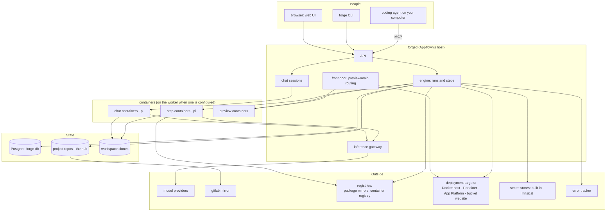

## Where work runs

An AppTown runs in one of three ways. The choice is the operator's, made
with `forged`'s start-up flags.

| | Where project code runs | What stays on AppTown's own host |
|---|---|---|
| no worker | AppTown's own host: agents, checks, previews, chats and script steps in containers on its Docker; a script step runs as a plain process on the host only under `-host-scripts` | everything |
| `-worker-url` | `forge-worker`, a separate machine with its own Docker: agent, review, tests and script steps, checks, change previews, and new change chats by default | project chats, chats that continue a step's agent, change chats opened on AppTown or already running there, deployments on the built-in Docker host, and intranet releases of a landing that has no published images |
| `-no-local-docker` (needs a worker and an external database) | the worker | nothing: the host has no Docker and runs no project process; what the worker cannot run (project chats, continuations) is refused, and releases go to attached targets |

With a worker, a step the worker cannot run is refused, not moved to AppTown's host, and a worker that cannot be reached is an error. The two
machines share no files. AppTown sends a step the one commit it works
on, as a Git bundle, over a connection where each side proves who it is
(mutual TLS); the worker sends back the commits the step made. Agents are
given two AppTown addresses to call back to, for model access and the
`forge` CLI, each with a credential minted for that step or chat. Those
addresses are what AppTown configures, not a network restriction: what
else a container can reach is decided by the operator's network and
firewall. A landing's release images are built on the worker too, and
pushed to the project's container registry, where every target pulls
them by digest.

A worker takes most project work off AppTown's host, not all of it:
what the table lists as staying on AppTown's host still runs there. Only
`-no-local-docker` keeps every project process off it. Nor is the worker
a strong sandbox: code on it can reach the network, and
the private Docker a step or chat may get is not a boundary against
hostile code.

## Open harness

The agent inside every container is `pi` — a minimal, open coding
harness. Technically the executor just runs a command in a workspace:
Claude Code or Codex could sit in those boxes. The choice of an open
harness is institutional, not mechanical, and most of this document
quietly depends on it.

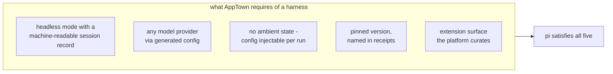

Why each requirement rules out a closed harness:

- **Any provider.** Model slots and profiles route chat to one vendor,
  batch work to another, delegates to a third, and a local GPU when it
  is enough. A harness married to its own vendor collapses the whole
  model economy to one column.
- **No ambient state.** Receipts promise that what steered a run is
  exactly the archived steering file plus the generated config. A
  harness with its own account, login state, auto-updates, or
  phone-home behavior steers runs with things the record cannot see.
- **The record is the product.** Evidence, billing, and the chat UI all
  read the session record. It must be an open, stable format AppTown
  can parse — not a proprietary app's internal state.
- **Pinned and receipted.** The runtime version is baked into the agent
  image and named in every step's evidence. Self-updating harnesses
  make "which procedure ran" unanswerable.
- **Curated extensions.** AppTown decides what code runs inside the
  agent (one delegation extension, at a pinned version) and what is
  content (skills in the repo). That line can only be drawn on a
  harness that exposes it.

The deeper point: AppTown's promises — steering is inspectable,
evidence is complete, model choice is policy — are enforceable only on
a harness that can be read and configured down to the file. The harness
is part of the institution's law, and law you cannot read is not law.
`pi` is the reference implementation of this contract, not a hard
dependency: any harness that honors all five requirements could take
its place, and the receipts would say so.

## Three doors into work

All work arrives through one of three doors, and they all end at the same
place: a **change** (one unit of work with its own branch, workspace,
and story).

- **Chat**: a person talks to a helper. A project chat answers
  questions, helps set the project up, and starts work, opening a change
  and handing back the link. A change chat edits that change's workspace
  directly; the conversation is the work.
- **Invoke**: a **workflow** (a written procedure: stages of steps with
  gates) is started on the project, and agents execute its steps.
- **A coding agent of your own**, on your computer, connected to
  `/mcp/user`. It opens a change, puts AppTown's agent on it, runs its
  checks, boots its preview and hands it off — or works in a checkout on
  your machine and pushes the result to the change. It acts as you, with
  a short-lived credential bound to that one address.

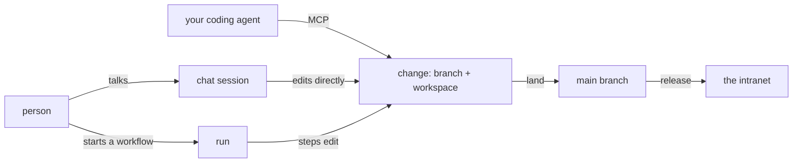

Nothing reaches `main` except by **landing** — the gated merge at the
end — no matter which door the work came through. The third door is not a
looser one: an outside agent cannot approve, administer or write `main`.
It can do the work and ask for a landing; a person approves it.

See [Connect a coding agent](/docs/guides/connect-a-coding-agent) for the setup.

## Anatomy of a chat turn

A chat session is a long-lived container holding one `pi` process (the
coding agent) inside tmux. The web page and the terminal are two views
of the same conversation. The session's workspace is the change's own
clone, mounted writable at `/work`.

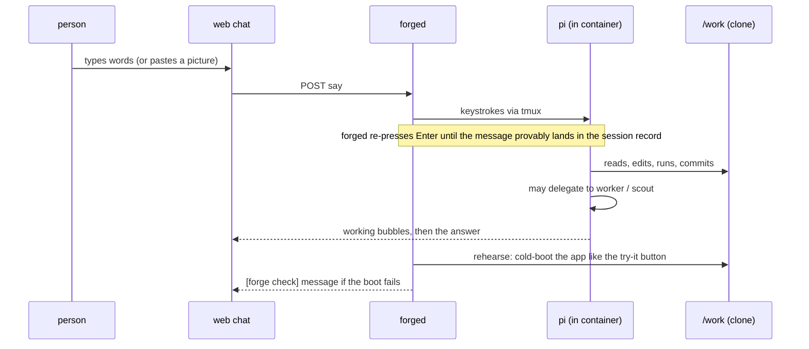

Three guarantees inside that loop:

- **The record wins.** The session file (JSONL) is the source of truth
  for what was said; the UI and billing both read it, never the screen.
- **Rehearsal.** When the helper hands back a turn and the workspace
  has a runnable app, AppTown boots it cold — the same way a deploy
  would — and feeds failures back to the *helper*, not the person.
- **Complaints.** Platform friction gets filed to the complaints box by
  the agent itself; the wording that demands this is compiled into the
  binary so no project can silence it.

## How chat and steps share state

Chat containers and step containers are different containers and never
talk to each other — there is no channel between agents. Everything
meets at the change: one directory, one branch, one record.

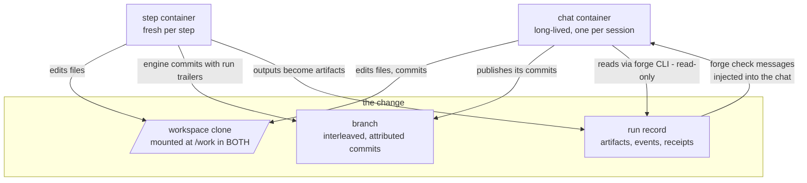

Three lanes, nothing else:

- **Files**: the same workspace directory is mounted into both. `.forge/`
  inside it is runtime state (step steering, transcripts, the app
  contract) — visible to both, owned by whoever wrote it.
- **Git**: the branch is the durable handoff. Work travels as commits: a
  landing takes what is committed and published to the branch, never
  uncommitted files ([How changes reach main](/docs/guides/changes-and-main)),
  so the gates run on exactly what will merge; step commits carry run
  trailers. The history reads as an attributed conversation between
  the two surfaces.
- **The record**: everything non-file goes through forged — the chat
  helper reads run state with the read-only CLI, step outputs become
  artifacts, and rehearsal failures come back as `[forge check]`
  messages in the chat.

The absence is deliberate: no shared memory, no agent-to-agent
messages. Surfaces coordinate through committed files and the recorded
run — both inspectable later.

## Runs: stages, steps, gates

A **run** executes one workflow against one change. A workflow is
stages in order; a stage is steps; the run cannot leave a stage until
its gates say so. The workflow definition is **snapshotted into the run
at birth** — editing a workflow never changes a run already in flight
("procedure snapshots"). Policies are the exception: they are law, and
law is re-checked at the moment of merge, not at birth.

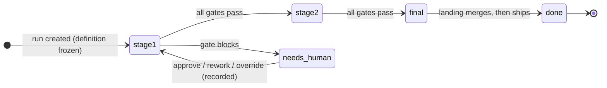

Step types, by what gates them:

| step type | what it is | what "pass" means |
|---|---|---|
| `agent/pi` | an agent works in the workspace | it finished and its output exists; a step whose report is reviewed against the diff must also have left the change with something committed |
| `agent/review` | an independent agent checks claim vs diff | the diff satisfies the request, or the step's own `question` is answered yes |
| `approval` | a person decides | the named approvers (or quorum) said yes — **against a written standard of approval** |
| `scan` | dep scan, secrets scan, sbom | the scanner found nothing blocking |
| `tests` | the committed tree runs its own tests | they passed — or none exist and the evidence says so |
| `preview` / boot gate | the app cold-boots from the workspace | it came up and looks like an app |
| `guidance/conformance` | the project's guidance checks run against the committed tree | every gating check passed |
| `artifact/require` | a required document exists | it is attached to the run |
| `reconcile` | the branch already contains main; it changes neither branch ([How changes reach main](/docs/guides/changes-and-main)) | contains main, and the candidate is pinned |
| `scm/merged` | the landing merge | merged clean — or blocked with the reason in plain words |
| `policy/current` | law re-checked at merge time | today's rules still allow this landing |

Every agent step leaves a **receipt**: the exact steering text it ran
with (archived and hashed), the model, slot and profile that served it,
token usage, and its output. "What was this agent told and what did it
cost" is always answerable from the run, not from memory.

## A change's life

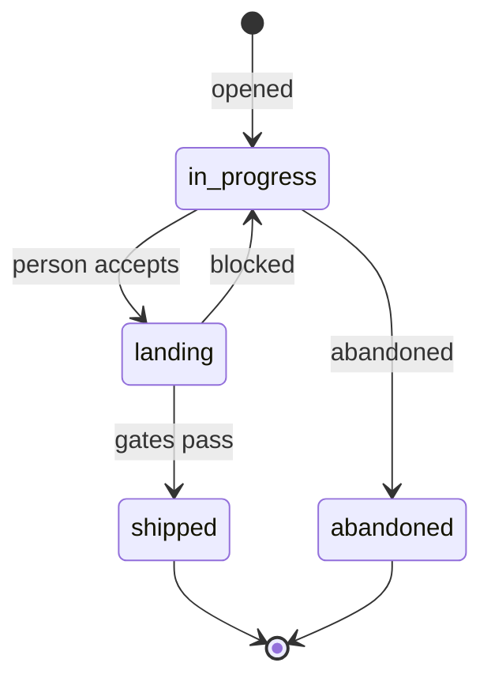

While `in_progress`, chat turns and working runs accumulate on the
change's branch. "Blocked" out of `landing` covers both a merge that
cannot proceed and rules that changed mid-wait — either way the change
page shows the one clear next action. `shipped` means the gates passed,
the merge landed, and the deploy ran.

The landing run is where governance concentrates: scans, the approval
(with its **means** — the written sentence saying what an OK asserts),
the law re-check, the merge, the deploy. A change that waits while the
rules change gets paused with a "Restart landing" action, never
silently grandfathered.

## Git: the hub and the clones

One rule explains all of it: **every workspace is a real, self-contained
clone; the hub is the project repo; forged moves commits between them;
nothing but a landing touches main.**

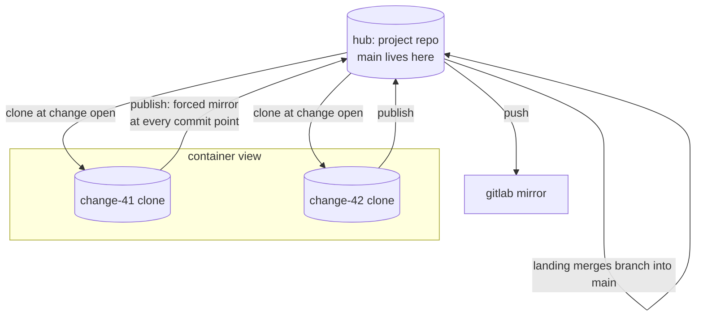

Consequences, each deliberate:

- Containers get **full working git** (status, diff, log, commit) —
  a workspace has no pointer to anything outside itself.
- Workspaces have **no push remote**: transport is exclusively the
  host's job, so an agent cannot push anywhere, only commit. A change
  chat gets one read-only remote that shows only `main`, so it can catch
  up mid-work; it still cannot push through it.
- The workspace is the **authority for its branch** until it lands; the
  mirror into the hub is forced, so a rework that rewinds history
  mirrors faithfully.
- The hub's working tree is touched only by AppTown's own writers, which all
  commit and leave it clean — so **any dirt on the hub is an integrity
  event**: recorded with a diff snapshot, shown to everyone on the
  project page, resolvable only by an admin's recorded decision (keep
  or discard), never silently absorbed.

## Step execution: what a step container sees

The [runtime environment guide](/docs/guides/runtime-environments) compares
chat and step capabilities, including toolchains, private Docker, services,
credential grants and persistence. These depend on the task and executor;
the presence of a CLI alone does not imply access to its service.

Every agent step (and every chat container) runs `pi` with a
**generated home** — nothing ambient leaks in, and everything that
steers it is on the record.

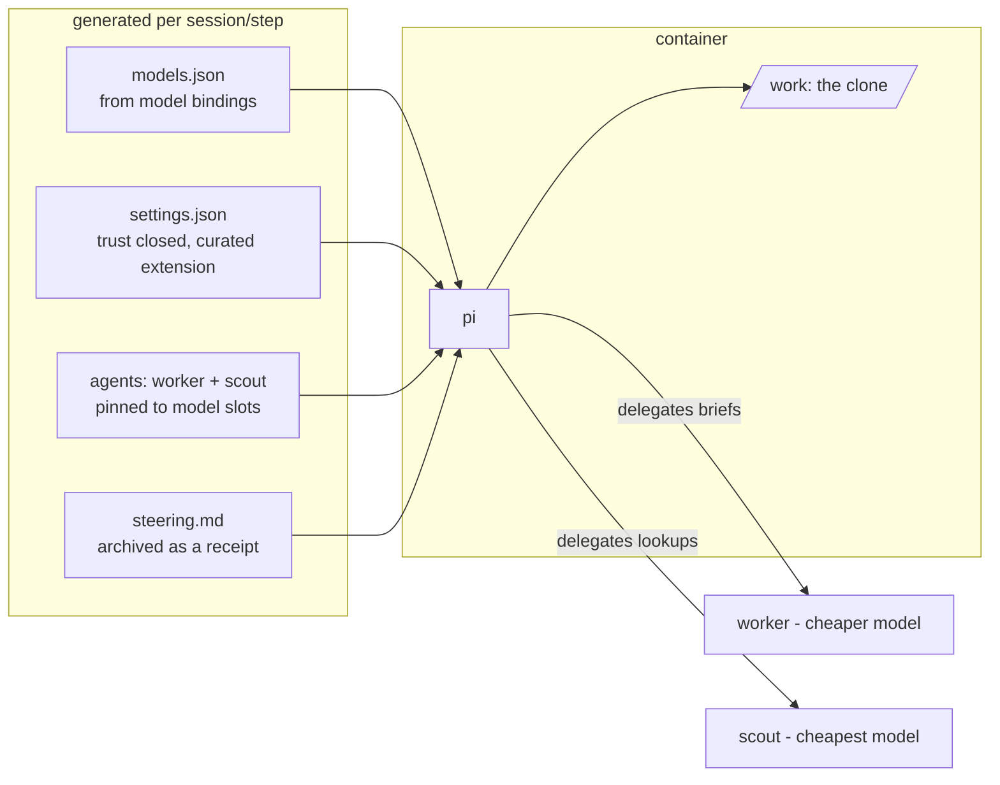

The `worker` and `scout` here are delegate agents on cheaper models,
inside the same container; they are not the worker machine described
above.

The one extension pi may load (delegation) is baked into the agent
image at a pinned, receipted version. Skills are different — they are
content, may live in the repo at `.agents/skills/`, and are pinned by
the same snapshot as the code. Code that runs inside the agent is
platform; words the agent reads are content.

## Choosing the model: slots × profiles

Everything that spends tokens names its demand with a **slot** (a
purpose: `default`, `plan`, `implement`, `review`, `security`, `fast`,
`chat`, `worker`, `scout`, `draft`). A project declares a **profile**
(how demanding its work is: `standard`, `high`).
The instance maps (slot × profile) → model in one visible matrix;
resolution is a lookup, never arithmetic, and the receipt records which
cell won.

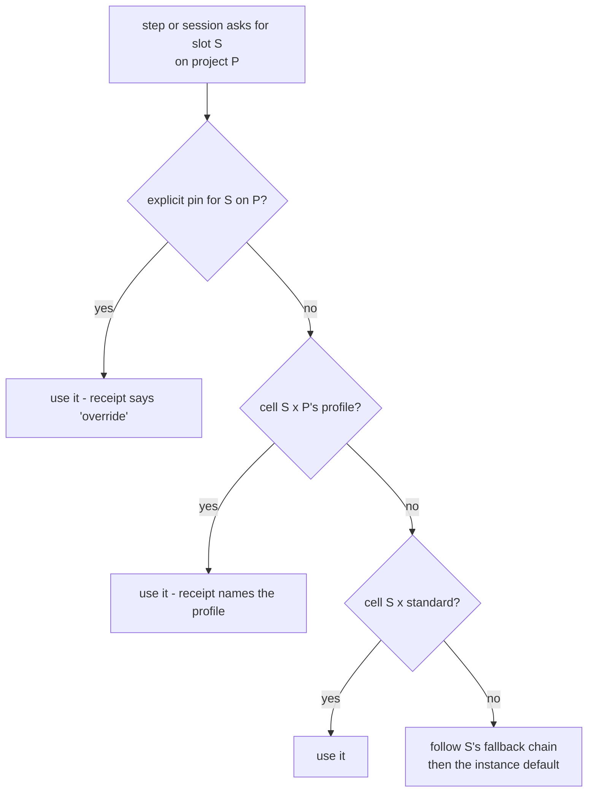

## Serving: previews, deployments, releases

Three tiers, one caching rule each, all provably fresh:

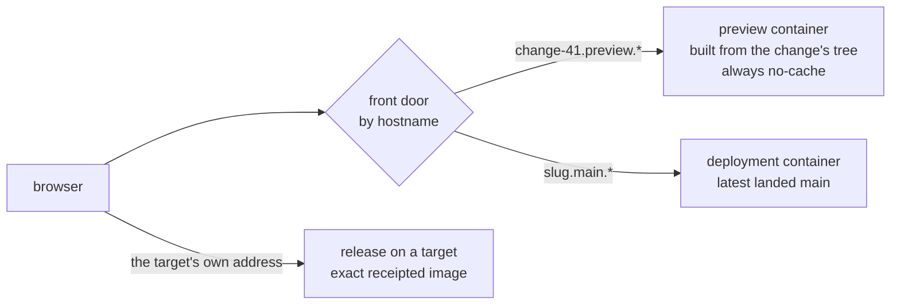

- A **preview** exists to show the latest edit: its container is
  fingerprint-gated (a changed tree kills and rebuilds it) and its
  responses are never cached.
- A **deployment** serves what landed on main, redeployed by the
  landing run.
- A **release** is recorded by image digest: every later deploy of it
  runs exactly those bytes. It is built from the landed source. Landing
  makes a merge commit whose files are exactly those of the change the
  gates checked: the same source under a different commit id. The gates
  scan an image they build separately, and the two builds are not proven
  identical.

## From code to running app

Every app carries [the app contract](/docs/guides/contract-reference),
`.forge/app.yaml`: `app:` (the containers the app is, one marked
`public: true`) and `needs:` (the services it uses). Each part declares
one of `build`, `image` or `static`. AppTown never writes packaging: it
builds the app's own `Dockerfile`. Services (a database, a cache) are
declared under `needs:` and provided per deployment. For local work,
`forge dev up` generates a Compose file from the contract.

| form | the public part says | what is built |
|---|---|---|
| static | `static: public` (a committed folder) | nothing; the folder is served by AppTown's file server |
| static, built | `static: { build: ., target: site, output: dist }` | the declared `Dockerfile` stage, and only its `output` folder is served |
| build | `build: .` (+ `ports:`, default 8080) | the app's `Dockerfile`, from the committed tree |
| image | `image: <pushed ref>` (+ `ports:`) | nothing; the image is pulled as it is |

Four surfaces consume the contract, with rising strictness:

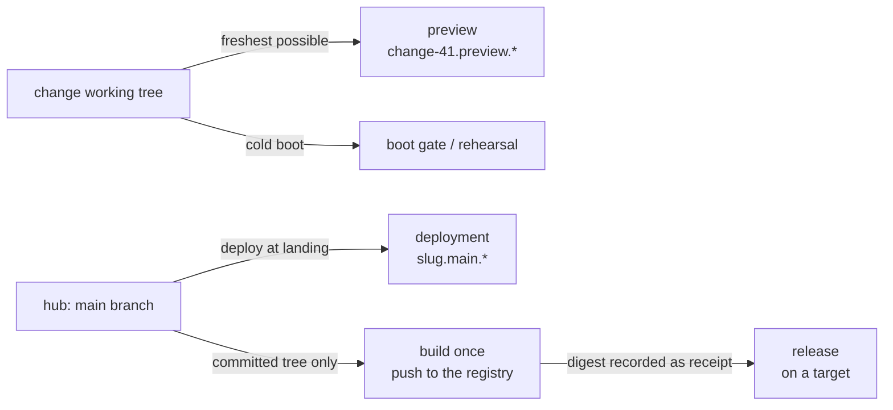

- **Preview**: boots from the change's folder, its committed files and
  tracked edits (never untracked or ignored files): a preview exists to
  show the latest edit. A changed tree rebuilds it. An `image` part runs
  its image, even with a `Dockerfile` beside it. With a worker, every
  change preview boots there.
- **Boot gate**: the same cold boot, as a gate — the app must come up
  from nothing, because that is exactly what a deploy will demand.
- **Deployment**: after landing, the deploy step boots the contract
  from the hub's main. Data dirs mount named volumes that survive
  redeploys; preview volumes die with their preview.
- **Release**: the release stages the COMMITTED tree only (dirty files
  cannot ship) and builds it once. With a worker, the build runs there,
  the images go to the project's container registry, and the bundle
  records each by digest; every target pulls those digests and nothing
  is built on a target. Without a worker, a landing's deploy builds on the
  Docker host and records image IDs. An intranet release (`forge
  release`) of a landing without published digests builds a build or
  static contract again on AppTown's Docker and pushes to the project's
  container registry, for Portainer to pull.
- **Rebuild and recovery**: a release by digest comes back from its
  recorded images. A release built on a Docker host without digests is
  rebuilt from its recorded commit's inputs, not today's source, so it
  needs its build inputs (base images, package registries) to be
  reachable; [Running AppTown](/docs/guides/running-apptown) says what
  comes back by itself.

Previews favour freshness (the folder, rebuilt as it changes); releases
favour exactness (the committed tree, by digest where there is a worker);
deployments sit between (committed `main`, redeployed per landing).

### Where a release can go

A **deployment target** is a place releases run. There are four kinds:

| kind | what it runs | gets a landing? |
|---|---|---|
| Built-in Docker host | containers on AppTown's own Docker (absent under `-no-local-docker`); an attached Docker host is the same kind, reached over SSH | yes, `main` |
| Portainer environment | a stack on the intranet, one deployment per project | by promotion, or the intranet release |
| App Platform (DigitalOcean) | an app; images copied into the account's container registry | by promotion |
| Bucket website (S3-compatible) | a static-only app, served as files from its own bucket | by promotion |

A bucket website refuses, with the reason, anything but one public static
part.

### What a deployment owns

A deployment owns what AppTown recorded creating for it, and nothing
else: on a Docker host its containers, network, data volumes and images;
on App Platform the app and AppTown's registry repository; on Portainer
the stack and the volumes its deploys made; on a bucket website the bucket; and any AI-model key made for
the app. Finding something already there, or matching its name, never
makes it the deployment's. The one exception is explicit: for deployments
made before ownership was recorded, an administrator can approve what a
one-time inspection proposes, and exactly what is approved is recorded.

**Taking a deployment down** deletes what it owns. Data goes only after
a backup: on a Docker host AppTown stops the app, copies every data
volume, and deletes the data only when every copy succeeded; otherwise it
starts the app again and deletes nothing. That final backup is kept with
the project, until the project is purged, and can be restored into a
standing Docker-host deployment of the same project that has a place for
every item in it. A Portainer deployment is backed up the same way,
through Portainer's Docker proxy, and its take-down deletes the volumes
its deploys made after a complete final set. An App Platform database or
bucket is deleted after a checked final copy, or stays until a person
removes it. A bucket website holds no data. What AppTown could not delete is listed too, with why. Deleting a
project stops its new work at once, takes each of its deployments down
this way, `main` last, and stops, naming the deployment, if one is
refused. The deleted project is then kept, read-only, with its backups,
for 30 days, and can be restored until its purge starts. See
[how long things run](/docs/guides/container-lifecycle) for the practical
side.

## Keeping the estate in line

Shipping is not the end of it. Every project adopts some **ways of working**
(written practice, versioned, shared across projects), and some of those carry
**checks** — a shell script, a maintained scanner, a probe against the running
app, or a rubric a model judges.

A **review** runs those checks across the fleet and records what it found. A
finding does not become a ticket somewhere else: it becomes work in the same
machinery as everything above. **Remediation** opens a change on the project,
puts an agent on it, and that change lands through the same gates as any other.
The loop closes when the next review sees the check pass.

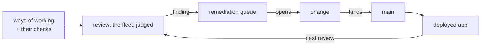

Two things follow from drawing it this way. A fix is a change, so it carries the
same evidence, approval and receipts as any other work — there is no separate
back channel for compliance. And the estate is judged as it actually runs, not
only as it is written: a runtime check probes the deployed app through the same
front door its users come through.

See [Conformance](/docs/guides/conformance) for what the page shows and how to
bring a project back.

## What is written down, where

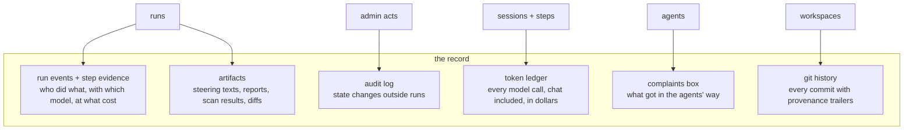

The stance behind all of it: **acts are public, reasons are recorded,
procedure snapshots, law does not.** If a claim about the system can't
be answered from these records, that's a defect — file a complaint.
