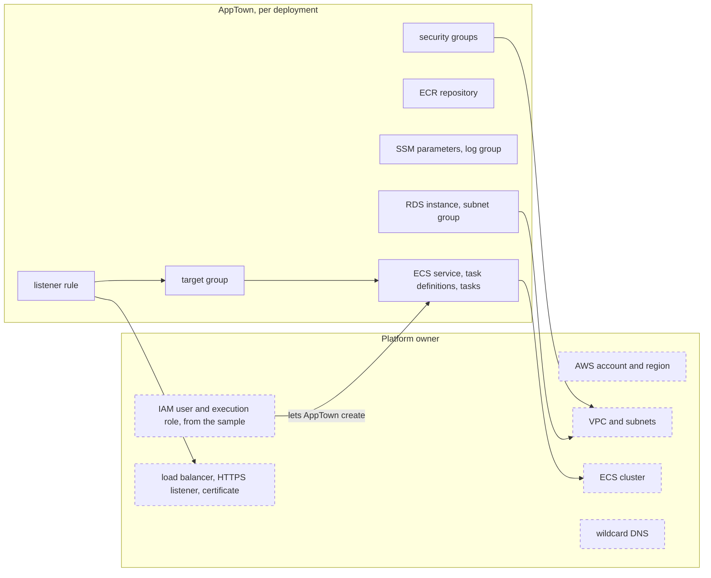

# AWS ECS target setup

An AWS ECS on Fargate target runs each deployment as one public part on
Fargate, in an AWS estate you already have, with an optional dedicated
PostgreSQL RDS instance. This target is in beta. The samples below have not
been applied or qualified against AWS.

## Who owns what



| Platform owner | AppTown |
|---|---|
| The account and region, and the IAM user and execution role the sample makes | An ECS service (`ecs-service`), its task definitions (`task-definition`) and one-off tasks (`ecs-task`) |
| The VPC, the task and database subnets | A target group (`target-group`) and a rule on your listener for the app's host name (`listener-rule`) |
| The ECS cluster | An ECR repository with the release images (`ecr-repository`) |
| The load balancer, its HTTPS listener and certificate, and its other rules | SSM parameters for secrets (`ssm-parameter`) and a log group (`log-group`) |
| The wildcard DNS record | A security group for the app, and one for its database (`security-group`) |
| The ECS and RDS service-linked roles | For Postgres: an RDS instance (`rds-instance`) and its subnet group (`rds-subnet-group`) |

Everything AppTown creates carries the tags `apptown:instance` and
`apptown:deployment`, and AppTown checks both before it changes anything.

## What you need

- The **AWS ECS targets** feature turned on under **Setup → Features**
  ([Features](features.md)).
- An existing VPC, and in it:
  - an ECS cluster that supports FARGATE;
  - task subnets that all route through an internet gateway, or all through a
    NAT gateway;
  - an HTTPS listener on an internet-facing application load balancer in that
    VPC, with an issued certificate for `*.<apps domain>`;
  - optionally, database subnets in at least two zones (they default to the
    task subnets).
- The ECS and RDS service-linked roles. If they are missing, an administrator
  creates them:

  ```sh
  aws iam create-service-linked-role --aws-service-name ecs.amazonaws.com
  aws iam create-service-linked-role --aws-service-name rds.amazonaws.com
  ```

- A container registry attached to each project that deploys here. Images
  must be published by digest for `linux/amd64`.
- For database copies, a backup store ([Deployment
  backups](deployment-backups.md)). Copies run as one-off Fargate tasks, so no
  copy runner is needed.

## The credential

These [CloudFormation](https://github.com/flokkit/apptown/blob/main/stock/docs/guides/aws-target-setup.yaml) and
[Terraform](https://github.com/flokkit/apptown/blob/main/stock/docs/guides/aws-target-setup.tf) samples make an IAM user and a task
execution role for AppTown, without an access key. An AWS administrator applies
one of them. AppTown never runs or reads the stack, Terraform state or
outputs. The samples do not create a VPC, subnet, cluster or DNS record, or
change an existing load balancer.

Give them the installation id, the VPC id, the task subnets, the cluster name
and the HTTPS listener ARN. CloudFormation also takes the installation prefix.
Compute it from the exact installation id, without a trailing newline:

```sh
printf %s '<installation id>' | shasum -a 256 | cut -c1-8
```

Terraform derives the same eight hexadecimal characters from `installation_id`.
Select the administrator account and region with the AWS provider's own
configuration when applying Terraform. That is separate from AppTown's
credentials.

Both samples use the listener you supply. If the estate has no load balancer,
an administrator can turn on `CreateLoadBalancer` (Terraform:
`create_load_balancer`) and supply public subnets and an existing ACM
certificate. This creates a load balancer, its security group and HTTP and
HTTPS listeners. HTTP redirects to HTTPS; unmatched HTTPS requests get 404. It
is a standing, billable resource the administrator manages, outside
AppTown's deployments.

Create the user's access key separately, and store the pair as AppTown
secrets, under **Integrations › Secrets** or with `apptown secret set`. The
defaults are `AWS_ACCESS_KEY_ID` and `AWS_SECRET_ACCESS_KEY`. AppTown reads the
pair each time it uses it. It does not use environment credentials, profiles,
an instance role or an assumed role.

### What the key may do

The JSON policies in both samples grant the same rights. Changing a resource
named by id requires this installation's existing tag. EC2, ECS and ELB
tagging is allowed only during the named create actions, so the key cannot
claim a foreign resource by tagging it. Creating a security group has separate
grants for the tagged new group and the existing VPC. Service and task ARNs
name the cluster; listener-rule ARNs derive from the supplied listener. ECR,
logs, SSM, RDS and target-group grants, which name resources, are limited to
the installation prefix; AppTown still writes and checks their tags.

The key can read region-wide resources. Deregistering a task definition needs
a wildcard grant: the key could deregister another team's revision, although
AppTown checks its own records and the live tags before it does. AppTown cannot
tell whether another policy gives the user more. Do not use the installation's
reserved name ranges for anything else.

Before turning on deployments, evaluate the user policy with IAM's
`SimulateCustomPolicy`, giving the actual resource ARNs and request context:

| Case | Expected |
| --- | --- |
| Own tagged service, task definition, task, target group and listener rule creates | allowed |
| Security-group create: own request tag, named VPC | allowed |
| Security-group create: wrong request tag, or another VPC | denied |
| Own service update, own task stop, own listener-rule delete | allowed |
| Rule create on another listener | denied |
| Standalone retag of a foreign security group, service or listener rule | denied |
| Foreign task stop in the shared cluster | denied |
| Foreign listener-rule delete | denied |

Then run a disposable release, rollback, copy, restore and take-down under that
policy. A fake does not prove IAM rules, routing, certificate reachability or
AppTown's AWS code.

Policy references: [EC2 security-group permissions](https://docs.aws.amazon.com/vpc/latest/userguide/vpc-policy-examples.html#vpc-policy-examples-security-groups),
[ECS authorization](https://docs.aws.amazon.com/service-authorization/latest/reference/list_ecs.html),
[ELB authorization](https://docs.aws.amazon.com/service-authorization/latest/reference/list_elbv2.html)
and [ELB create-time tagging](https://docs.aws.amazon.com/elasticloadbalancing/latest/userguide/tagging-resources-during-creation.html).

## Add the target

Open **Deployments › Targets → Add a deployment target** and choose **AWS ECS
on Fargate**. Copy the values from the sample's outputs.

| Field | What to enter |
| --- | --- |
| name | A short name for the target, such as `aws-syd` |
| access key secret | The name of the secret holding the access key id |
| secret key secret | The name of the secret holding the secret access key |
| expected account id | The 12-digit account the key must act in |
| region | The region, such as `ap-southeast-2` |
| cluster | The cluster's name, not its ARN |
| task subnets (comma separated) | The task subnet ids |
| database subnets (optional; uses task subnets) | Subnet ids for RDS, in at least two zones |
| HTTPS listener ARN | The listener's ARN |
| execution role ARN | The task execution role's ARN |
| apps domain | The domain apps are reached under, such as `apps.example.com` |

**Check** confirms that the key acts in the expected account, the region is
on, the cluster is active with FARGATE, the subnets and listener are in one
VPC with the routes and certificate above, the execution role is trusted by
ECS tasks, the service-linked roles exist, and the key may create a security
group (an EC2 dry run). It answers with the load balancer's address. Nothing
is recorded until you press **Add target**.

Point a wildcard DNS record, `*.<apps domain>`, at the load balancer yourself.
AppTown adds only its own rules to the listener.

## What happens when you deploy

AppTown checks the account, region, cluster, subnets, listener and roles
each time it connects. Then, in this order:

1. Create the app's security group, log group and ECR repository, if they
   are not there. For Postgres, AppTown first records that a database is
   being made.
2. For Postgres: create the database's security group and subnet group,
   create the RDS instance and wait until it is available. Then run a
   one-off task that creates the app's user and database. The task copies
   the Postgres image into the ECR repository, and its own task definition
   and SSM parameters are deleted when it ends.
3. Create the target group, let the load balancer reach the app's security
   group, and add a listener rule for the app's host name.
4. Copy each release image into the ECR repository by digest. Put the
   release's secrets in SSM parameters of its own, and write the task
   definitions.
5. Run each `init` step once as a task. Each must succeed.
6. Create or update the ECS service.
7. Wait until the service is steady and the target group reports it
   healthy, then check the app answers at its address. If not, AppTown
   tries to put the previous task definition back, or scales the service to
   zero on a first release; if that does not settle either, the release
   says so.
8. Delete the SSM parameters of releases older than the previous one.

## What happens when you take down

With a database and a backup store, the database is copied before it is
deleted:

1. Scale the service to zero, and delete the listener rule.
2. Revoke the deployment's AI model keys.
3. Take the final copy with one-off tasks. Check it by restoring it into a
   scratch database on the same instance, then drop the scratch database.
4. Delete the RDS instance and its automatic backups. Those are separate
   from AppTown's backups.
5. Delete the rest, in the order below.

Without a database, or after step 4, AppTown deletes what it recorded
creating, in this order. What a deployment does not have, or is already
gone, is skipped.

1. the listener rule;
2. the ECS service, after scaling it to zero and waiting until it is
   inactive;
3. one-off tasks;
4. the RDS instance;
5. the RDS subnet group;
6. task definitions;
7. the target group;
8. the ECR repository, with its images;
9. SSM parameters;
10. the log group;
11. security groups, the database's first.

A failure on the listener rule or the service stops the take-down. A failure
on anything else is listed as left. Without a final copy, the RDS instance,
its subnet group and its security group are kept, listed as retained; they
keep costing money.

If it stops part way, take it down again: what is already gone is skipped,
and a service that is already draining is waited for. AppTown never changes
the VPC, subnets, cluster, load balancer, its other listener rules, DNS or
the sample's stack.

## Check it worked

The target's page shows **Target check:** with the load balancer, and a line
saying whether the wildcard apps address resolves to that load balancer, and
when it was read.

## Costs and limits

- AWS bills for Fargate tasks, RDS, the load balancer and the rest. The
  **Capacity** page lists the size each part runs on; AWS prices are not read,
  so the cost reads unknown. Retained RDS resources keep costing money.
- The app must have one public part. Multiple parts, shared databases, object
  storage, data folders, restored copies and audiences other than public are
  refused before anything is made at AWS.
- Postgres must be version 16 or 17.
- **Start**, **Stop** and **Restart** are not offered.
- Database copies list every database except RDS's own `rdsadmin`. A database
  with tables is dumped; an empty one is checked again as empty. Each dump is
  restored and checked in a scratch database. A failed listing, count, dump,
  upload or check keeps the instance. Fargate's default scratch space is 20 GB;
  a copy that fills it fails.
- RDS's automatic snapshots are shown separately and are never AppTown backups.
