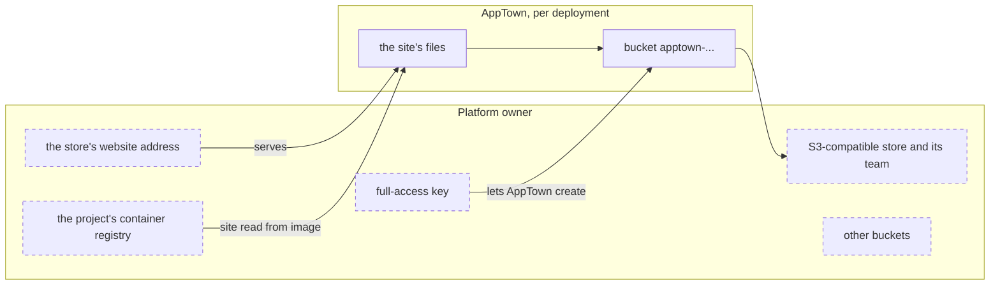

# Bucket website target setup

A bucket website target serves a static site as files from a bucket in an
S3-compatible store, at the store's website address. Each deployment gets a
bucket of its own. DigitalOcean Spaces is the store AppTown has been built
against. This target is experimental: no real app has been qualified on it
yet.

## Who owns what

| Platform owner | AppTown |
|---|---|
| The store, its team, and the full-access key AppTown uses | One bucket per deployment, `apptown-…`, private |
| The website address the store serves buckets at | Every file in that bucket, each readable by anyone |
| The project's container registry | A private `_apptown/instance` file that marks the bucket as this installation's |
| Other buckets in the team | |

The bucket is recorded with the deployment, not in its list of created
things, so a take-down's result names it as `bucket <name>`.

## What you need

- The **Bucket-site targets** feature turned on under **Setup → Features**
  ([Features](features.md)).
- An S3-compatible store that serves buckets as websites. On DigitalOcean,
  Spaces turned on for the team.
- A container registry attached to each project that deploys here. AppTown
  reads the site from the release image published there by digest.
- An app whose only part is one public `static` part, with no `init` steps and
  no `needs` ([The app contract](contract-reference.md), "Static sites").

## The credential

AppTown creates a bucket for each deployment, so the key must be able to
create buckets. In Spaces that is a full-access key, which can read, write and
configure every bucket in its team. Make a key for AppTown alone, in a team of
its own where other data must stay out of its reach. Store its two halves as
AppTown secrets, under **Integrations › Secrets** or with `apptown secret set`;
the defaults are `SPACES_ACCESS_KEY` and `SPACES_SECRET_KEY`.

## Add the target

Open **Deployments › Targets → Add a deployment target** and choose **Bucket
website**.

| Field | What to enter |
| --- | --- |
| name | A short name for the target, such as `spaces-syd` |
| endpoint | The store's S3 address, such as `https://syd1.digitaloceanspaces.com` |
| region | The store's region, such as `syd1` |
| website address | The address a bucket's site is served at, with `{bucket}` and `{region}` where the names go: `https://{bucket}.{region}-static.digitaloceanspaces.com` for Spaces |
| access key secret | The name of the secret holding the access key |
| secret key secret | The name of the secret holding the secret key |

**Check** lists the store's buckets with the key pair, and says how many the
key can see. It creates nothing. Nothing is recorded until you press **Add
target**. Then set its offer: tick only **public** under **Audiences**.
Anyone with a site's address can read every file in it.

## What happens when you deploy

In this order, through the store's S3 API:

1. Refuse an app that is not one public `static` part with no `init` steps
   and no `needs`.
2. Read the site's files from the release image, by digest.
3. On the first release, create the bucket, private, and record it before
   writing to it. A name already taken is refused.
4. Turn on the bucket's website setting, and write the installation mark.
5. Upload the files, each readable by anyone: assets first, then pages,
   then the file naming the release, last.
6. Check the site answers with the new release.
7. Delete files that are in neither this release nor the one before.

If an upload fails before the release marker is written, files already
uploaded stay in place, so the site may serve a mix of the previous and the
new release. Release again to finish publishing.

## What happens when you take down

There is no backup: the site is rebuilt from its release.

1. Delete every file in the bucket.
2. Delete the bucket.
3. Check the address stops answering.

If it stops part way, take it down again: a bucket already gone is skipped.
Keep nothing else in a deployment's bucket. AppTown never adopts a bucket
whose name is taken, and never touches other buckets.

## Check it worked

The target's page shows **Target check:** with the endpoint, the region and
how many buckets the key sees.

## Costs and limits

- The store bills for storage and traffic.
- Only a deployment whose audience is public is released here.
- A site may be at most 200 MiB.
- There is no custom domain: the site is at the store's website address.
- There is no fallback to `index.html` for other paths.
- **Start**, **Stop** and **Restart** are disabled.
- Nothing is backed up: the site is rebuilt from its release.
