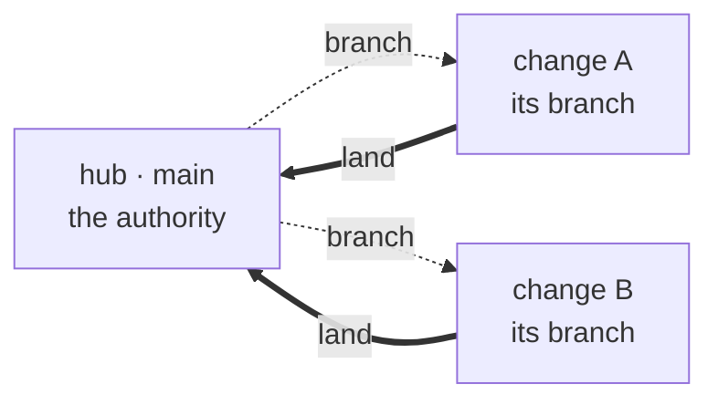
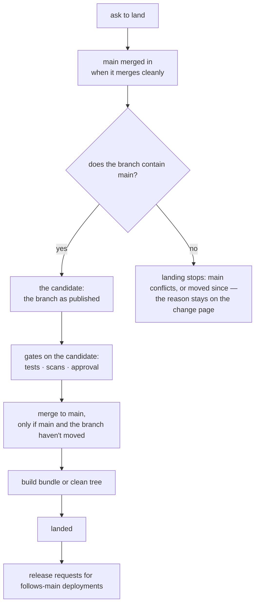

# How changes reach main

Every change is a branch off `main`, and `main` is the authority. Nobody
writes to `main` directly — not a person, not an agent, not a `git push`.
The only path from a branch to `main` is **landing**, through the gates.
This guide is how that works, the ways to work on a change, and how a change
stays close to `main` while it's being built.

## Ways to work on a change

A change can be worked in its chat, from your own computer, or by a
**lane**: a workflow named for what it is for. Every lane works on the
change's branch and ends at a person; only the landing merges.

- **Fix a bug** (`apptown fix`): the agent reproduces the bug first, as a
  failing test it commits, and a judge confirms the reproduction is real
  before a fix is tried. "Cannot reproduce" stops the lane. Its record
  reads: failing test, fix, the same test passing.
- **Quick change** (`apptown quick`): a small described task with one
  approval.
- **Plan and execute** (`apptown plan`): the agent drafts a plan with
  acceptance criteria, you approve the plan, and the work is then judged
  against those criteria one by one.
- **Implement** (`apptown build`): an application or a substantial new
  capability, from a description or an accepted spec; the project's
  attached integrations are wired in.
- **Dependency uplift** (`apptown uplift`): patch and minor updates checked by
  build and tests, majors listed with their changelogs, the result checked
  by a dependency scan.
- **Adopt or retire an integration** (`apptown adopt`, `apptown retire`): wire
  an attached service into the app, or prove it fully unwired.
- **Adopt a branch** (`apptown import <branch>`): bring
  in work done outside AppTown as a change. Its history is marked as
  reconstructed, not witnessed, and it lands like any other.

A change worked in a chat by a person is recorded as that, not as an
agent's work. Whatever the route, the landing asks the same things: a
summary that matches the diff, passing checks, and the approvals the
workflow names.

Before a code change reaches review or approval, AppTown runs its declared
tests against the agent’s committed work in a fresh checkout. The run uses
declared toolchains and services, throwaway secrets and no Docker access.
A failed test sends its output back to the agent in the same change, up to
three automatic rounds since the last person’s retry. A further failure stops
for a person. The change’s checks and the accept dialog show AppTown’s result.
An app without declared tests follows the same rule as landing: a part using
a listed toolchain requires tests; otherwise the step is not applicable.
Landing runs its tests again before merging.

## The shape

Each change has a branch and a **folder**: a full git clone of the project
with the change's branch checked out, where whoever is working on the change
works. `main` lives in the **hub**, the project's authority copy, and it
only ever moves when a change *lands*.



Two rules keep this safe when many people and agents share one AppTown,
and AppTown enforces them rather than trusting anyone:

- **You can pull `main`, you can't push it.** A workspace can fetch the
  latest `main` to stay current. Nothing pushes to `main`: the only write
  to `main` is the gated landing flow.
- **You can't see other changes.** From a workspace you see `main` and
  your own branch. Other people's in-flight changes are invisible.

## One worker at a time

A change has one worker at a time: its **chat**, a **workflow** doing the
work (implement, fix a bug), or a **desktop checkout**. Whoever has the
change works in its folder; the others are told who has it and wait.

- **A change has one chat.** Opening a chat on it again returns the same
  chat.
- **A workflow or a desktop checkout can't start while the chat is open**
  ("a chat is working on this change; open it or end it"), and a chat can't
  open while a workflow is working the change. End the chat first, or wait
  for the workflow.
- **"Continue in chat"** on a stuck step stops the workflow and opens the
  chat where it left off, its unfinished files included.
- **Landing doesn't count.** It only reads, so the chat keeps the change
  and can keep working while its landing runs.

A chat is not private to the person who opened it. Anyone who can read the
project can look at it; acting on it needs the right to work on the change.
[What chats and steps can use](runtime-environments.md)
says what each can do.

**Work travels as commits.** The helper commits what's ready, as a developer
would. When the branch is needed (a landing, a workflow or a checkout
starting, the chat ending) what's committed is published to the branch and
checked first; a publication is refused, and nothing leaves the folder, when
it would add:

- a file under `.apptown` other than `.apptown/app.yaml` (runtime files never
  travel);
- a file over 10 MiB, or more than 50 MiB of new files.

Files that aren't committed stay in the folder and aren't included; a
landing's record lists them, and a landing with uncommitted work and nothing
committed is refused ("nothing to land: commit it first"). Whoever takes the
change next finds those files committed as the previous worker's, never
lost.

## Staying current while you work

`main` moves under you — other changes land while yours is open. You can
catch up any time with a read-only, scoped remote AppTown provides:

```sh
git fetch "$APPTOWN_MAIN_REMOTE" main && git merge --no-edit -m "Merge main into $(git branch --show-current)" FETCH_HEAD
```

The `-m` gives the merge a plain message. Without it git names what it
merged by the remote's address, which is AppTown's internal one
("Merge branch 'main' of http://192.0.2.10:7778/...") and means nothing in
the project's history.

That remote is a **capability**: read-only, `main` only, this project
only. It's served over the network (so it works inside the container),
and git's own protocol enforces the shape — the ref advertisement lists
*only* `main`, so you cannot list or fetch another change's branch, and
you cannot push through it. Staying current is a pull; it never risks the
gates.

A workflow's agent steps don't need to. Before each agent step of a
change's run, AppTown merges `main` into the change itself
when the branch is behind it and the merge has no conflicts: an ordinary
merge commit, "Merge main into <branch>", made by AppTown and shown in
the change's history. When the merge would conflict, AppTown leaves the
branch alone and the step works on it as it is. The change's page and
`apptown wait -c` then say which files conflict, until you catch up in the
change's chat with the command above.

Landing does the same (below): asking to land a branch behind `main` merges
`main` in first when it merges cleanly. When it conflicts, the change page
names the files and sends you to the chat instead of offering **Check and
land**. On a long change while traffic is high, pulling as you go keeps each
catch-up small.

## Landing: main merged in, then the gates

When someone (or AppTown, for accepted work) asks to land a change, AppTown
first publishes what the change's folder has committed, then, when the
branch is behind `main` and the merge has no conflicts, merges `main` into
it: an ordinary merge commit, "Merge main into <branch>", made by AppTown and
naming who asked. It is made under the same hold as the publication: the
chat's, when a chat has the change, or a moment's hold the request takes
when nobody does. A chat's folder takes the merge too (a chat on a worker
takes it before it is published), and the chat is told. That merge is what
the landing checks.

Uncommitted work with nothing committed is refused before any merge
("nothing to land: commit it first"). A chat on a worker whose folder cannot
take the merge (it committed since its last save, or a file is in the way)
refuses the landing with that reason and nothing moves. A chat on AppTown
whose folder has a file in the way keeps the file; the branch holds the merge,
and the chat is told how to take it.

The landing's very first gate then checks that the branch **contains the
current `main`**:



Why?

1. **Every gate runs on the tree that will actually be on `main`**: the
   candidate already contains `main`. The approval names that candidate. An
   acceptance given on the work before `main` was merged in was given on
   other code, so the landing asks a person again.
2. **A branch that conflicts with `main` is caught before any gate runs**,
   and before anyone presses: the change page names the files and offers
   **Resolve in chat** instead of **Check and land**. The chat merges
   `main` into its folder (the read-only remote above), resolves the
   conflict there, commits, and lands again. A landing asked for anyway
   ends at its first step with the files, and the change page keeps that
   reason.
3. **What merges is what was checked.** The merge refuses unless `main`
   and the branch are still where the candidate was made. If `main` moved
   while the checks ran, the landing says so; restarting it checks the new
   candidate — all of its checks, not only the ones that failed. The merge
   is still recorded as a merge commit, so the landing stays visible in
   history.

While a change is landing, a boot of its preview boots the candidate, not
the folder: `apptown preview <change>`, or **Try it** (**restart** when one
is already running) on the change page. **Open** on a preview that is
already running asks AppTown first: it reuses the running one while it
serves the files as they are, and builds again when they changed, so what
opens is never an older build. The page says what a running preview was
built from: the change's working files and when, or the commit when it
was booted from one. (A chat on a worker that holds the change saves
first, and the preview boots what it saved.) A landing's runtime checks (a
page that loads, a readiness answer) are judged only against the candidate's
preview: when none runs, the landing's gate boots it, and if that boot fails
the checks say so and are not judged. Any other preview (the folder's, an
earlier commit's) is not judged.

A chat can keep working while its landing runs; what it publishes later is
not in that landing (and makes the landing refuse to merge a branch that
moved).

## Approval: what a person agrees to

A landing merges into `main` only when a person has approved it, or someone
allowed to land changes started it. The merge checks that authority however
the landing was started. Deployment is authorized separately: automatic
requests use each follows-main setting's recorded setter and credential,
rechecked before execution. Landing approvers remain part of the record.
Coding agents, chats, workflow steps and AppTown's own schedules can ask
for a landing; they cannot approve one, and they cannot stand in for that
person.

Which approvals a landing asks for comes from the project's workflow: who
may approve, how many must, and the sentence saying what approving means.
A project can also require independent approval, in which case the person
who opened the change may not approve it. An instance administrator is the
exception: they may approve any change, their own included, whoever the
workflow names.

When an approval is for a commit, the approval form starts with **This
change adds**: the secrets, services and app parts the commit declares that
the point where its branch meets `main` (their common ancestor) did not.
It is what the branch adds, not a comparison with today's `main`: something
`main` has removed since is not listed, and something both added is. For a
change that moves the project to a newer pack version, the list also names
the ways of working it brings. AppTown reads this from `secretspec.toml`,
`.apptown/app.yaml` and the recorded pack version, never by guessing from
source code. A file it could not read is shown as its own line, not as
"nothing new". What the form showed is
recorded with the decision. If it changed before the approval was saved,
the approval is refused and the form shows the new list.

On the command line, `apptown show <change>` lists what the change adds, and
`apptown approve <step-id>` shows what approving means before it asks.

## Scheduled changes

A workflow can carry a schedule: `on.schedule.cron` in its definition. The
stock `dependency-uplift` carries `0 6 1 * *`, 06:00 UTC on the 1st of each
month. The `dependency-updates` pack declares `schedules: [dependency-uplift]`.

- **What fires.** A project gets a firing only when one of its adopted packs
  lists the workflow under `schedules` in its adopted version: a change opened
  by AppTown, with its run started. Availability alone schedules nothing. An
  eval copy runs no schedules.
- **When.** The cron is read in UTC, AppTown's time. AppTown looks
  every 30 seconds, so a firing starts within a minute of its time.
- **Skipped while active.** If the project's previous run of that workflow
  is still active, the firing is skipped and recorded as skipped. A
  workflow can turn this off with `skipIfActive: false`.
- **No replay.** A schedule counts from when AppTown first saw it. Firings
  missed while AppTown was stopped are not made up: one fires at the next
  look, then the schedule continues from there.
- **By hand.** Run one now like any other change:
  `apptown invoke -p <slug> -w dependency-uplift -t "Dependency uplift"`.
- **Changing the cadence.** The cron is part of the workflow version a
  project adopted, so a different cadence is a new workflow version that the
  project adopts.

The project overview lists each schedule with its next firing and what its
last firing did; `apptown schedules -p <slug>` shows the same in UTC.

## From a terminal

The `apptown` command line stays with the work, from the request to the
running app:

    apptown fix "the /pulse endpoint reports the wrong service name"
    # shows the reproduction and the fix, asks you to approve, offers the
    # landing, and ends at:
    #   ⚑ change #57 shipped · release #8 · the main URL

    apptown status          # what's waiting on you, what's in flight
    apptown changes         # what's in flight and what each waits on (--all: shipped too)
    apptown show 57         # one change: now, what it's for, so far, runs, commits
    apptown follow 57       # re-attach to anything in flight
    apptown preview 57      # boot (or reuse) the change's preview and print its address
    apptown wait 57         # wait until it ships, stops, or needs a person

`apptown preview` is for a person's terminal and change chats. In a workflow
step, the workflow's preview step boots the preview; reviewers receive
`${{preview.url}}`. Run `apptown dev up` to rehearse the boot inside a step.

At an approval it shows the briefing and asks: approve, reject, show the
plan, spec or report the stage asks for, or see the diff. Rejecting takes a
comment and sends the work back with it. With `-y` each approval is one
line saying what it agreed to; without a terminal and without `-y`, it
stops and names the `apptown approve` or `apptown follow -y` command, and the
page.

`apptown review [-p project]` checks every project (or one) against the ways
of working it adopted. `apptown delete <slug>` deletes a project after you
type its slug back, and follows its clean-up until it is done.

## Why `main` is write-protected

The whole point of AppTown is that a change's landing is *evidenced* —
tests, scans, an accountable approval, a receipt. The one thing that would
make all of that optional is a `git push` straight to `main`. So that door
is shut, at both layers a workspace could reach:

- The **network endpoint** lets a workspace fetch `main`. It takes two
  narrow pushes and refuses every other: a local checkout's push with a
  change's short-lived credential lands in that change's holding ref, and a
  workflow step's push goes to its own scratch ref. A push to `main`, to
  another change's branch, or with a read-only credential is refused.
- The **hub itself** refuses, with a pre-receive hook, every push to any
  other ref, `main` included.

`main` is written by exactly one thing — the landing flow — and it stays
that way whether you're polite or not. Pull is a read, and reads are free;
the push to `main` is *the* governed act, and it's the only one there is.

## Re-run a blocked landing's checks

After fixing the problem that blocked a landing, run its failed gates again:

```sh
apptown recheck calendar#7
```

Name the change as `project#number` or its change ID, as with `apptown land`.
The change is a positional argument. `recheck` does not take `-c`.
Inside that change's chat, `apptown recheck` without an argument uses the
chat's change. Approvals still need someone with permission to give them.
