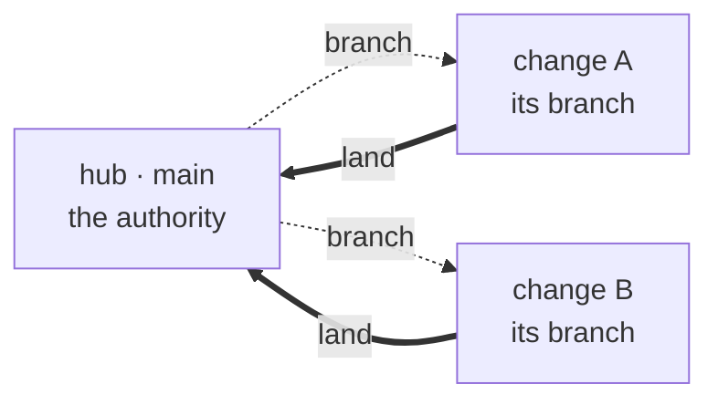
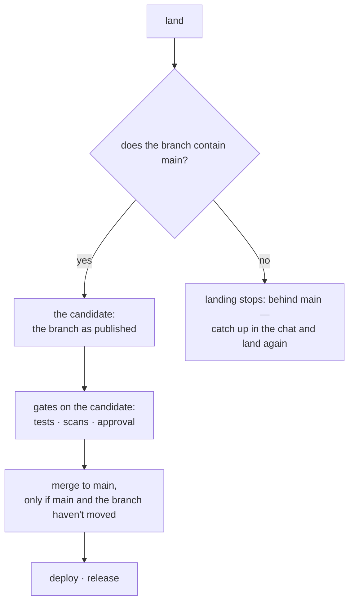

# How changes reach main

Every change is a branch off `main`, and `main` is the authority. Nobody
writes to `main` directly — not a person, not an agent, not a `git push`.
The only path from a branch to `main` is **landing**, through the gates.
This guide is how that works, and how a change stays close to `main`
while it's being built.

## The shape

Each change has a branch and a **folder**: a full git clone of the project
with the change's branch checked out, where whoever is working on the change
works. `main` lives in the **hub**, the project's authority copy, and it
only ever moves when a change *lands*.



Two rules make this safe on a shared, multi-participant box, and they're
enforced by machinery, not by trust:

- **You can pull `main`, you can't push it.** A workspace can fetch the
  latest `main` to stay current. Nothing pushes to `main`: the only write
  to `main` is the gated landing flow.
- **You can't see other changes.** From a workspace you see `main` and
  your own branch. Other people's in-flight changes are invisible.

## One worker at a time

A change has one worker at a time: its **chat**, a **workflow** doing the
work (implement, fix a bug), or a **desktop checkout**. Whoever has the
change works in its folder; the others are told who has it and wait.

- **A change has one chat.** Opening a chat on it again returns the same
  chat.
- **A workflow or a desktop checkout can't start while the chat is open**
  ("a chat is working on this change; open it or end it"), and a chat can't
  open while a workflow is working the change. End the chat first, or wait
  for the workflow.
- **"Continue in chat"** on a stuck step stops the workflow and opens the
  chat where it left off, its unfinished files included.
- **Landing doesn't count.** It only reads, so the chat keeps the change
  and can keep working while its landing runs.

A chat is not private to the person who opened it. Anyone who can read the
project can look at it; acting on it needs the right to work on the change.
[What chats and steps can use](/docs/guides/runtime-environments)
says what each can do.

**Work travels as commits.** The helper commits what's ready, as a developer
would. When the branch is needed (a landing, a workflow or a checkout
starting, the chat ending) what's committed is published to the branch and
checked first; a publication is refused, and nothing leaves the folder, when
it would add:

- a file under `.forge` other than `.forge/app.yaml` (runtime files never
  travel);
- a file over 10 MiB, or more than 50 MiB of new files.

Files that aren't committed stay in the folder and aren't included; a
landing's record lists them, and a landing with uncommitted work and nothing
committed is refused ("nothing to land: commit it first"). Whoever takes the
change next finds those files committed as the previous worker's, never
lost.

## Staying current while you work

`main` moves under you — other changes land while yours is open. You can
catch up any time with a read-only, scoped remote the forge provides:

```sh
git fetch "$FORGE_MAIN_REMOTE" main && git merge --no-edit -m "Merge main into $(git branch --show-current)" FETCH_HEAD
```

The `-m` gives the merge a plain message. Without it git names what it
merged by the remote's address, which is the forge's internal one
("Merge branch 'main' of http://192.0.2.10:7778/...") and means nothing in
the project's history.

That remote is a **capability**: read-only, `main` only, this project
only. It's served over the network (so it works inside the container),
and git's own protocol enforces the shape — the ref advertisement lists
*only* `main`, so you cannot list or fetch another change's branch, and
you cannot push through it. Staying current is a pull; it never risks the
gates.

A workflow's agent steps don't need to. Before each agent step of a
change's run on a worker, the forge merges `main` into the change itself
when the branch is behind it and the merge has no conflicts: an ordinary
merge commit, "Merge main into <branch>", made by the forge and shown in
the change's history. When the merge would conflict, the forge leaves the
branch alone and the step works on it as it is. The change's page and
`forge wait -c` then say which files conflict, until you catch up in the
change's chat with the command above.

Landing requires it (below): a branch behind `main` is refused until it has
caught up. On a long change while traffic is high, pulling as you go keeps
each catch-up small.

## Landing: already caught up, then the gates

Landing checks and merges; it never writes, merges into your branch, or
touches anyone's folder. It lands the change's branch as published, and its
very first gate checks that the branch **already contains the current
`main`**:



Why?

1. **Every gate runs on the tree that will actually be on `main`**: the
   candidate already contains `main`. The approval names that candidate.
2. **A branch behind `main` is caught early**, before any gate runs. The
   chat merges `main` into its folder (the read-only remote above), resolves
   any conflict there, commits, and lands again.
3. **What merges is what was checked.** The merge refuses unless `main`
   and the branch are still where the candidate was made. If `main` moved
   while the checks ran, the landing says so; restarting it checks the new
   candidate — all of its checks, not only the ones that failed. The merge
   is still recorded as a merge commit, so the landing stays visible in
   history.

While a change is landing, a boot of its preview boots the candidate, not
the folder: `forge preview <change>`, or **Try it** (**restart** when one
is already running) on the change page. Opening a preview that is already
running boots nothing. (A chat on a worker that holds the change saves
first, and the preview boots what it saved.) A landing boots no preview of
its own, so its runtime checks (a page that loads, a readiness answer) are
judged only against the candidate's preview: boot it, then run the gate
again. Any other preview (the folder's, an earlier commit's) is not judged.

A chat can keep working while its landing runs; what it publishes later is
not in that landing (and makes the landing refuse to merge a branch that
moved).

## Approval: what a person agrees to

A landing merges into `main` and deploys only when a person has approved
it, or a person allowed to land changes started it. The check is made at the
merge and at the deploy, so it holds however the landing was started.
Coding agents, chats, workflow steps and the forge's own schedules can ask
for a landing; they cannot approve one, and they cannot stand in for that
person.

Which approvals a landing asks for comes from the project's workflow: who
may approve, how many must, and the sentence saying what approving means.
A project can also require independent approval, in which case the person
who opened the change may not approve it. An instance administrator is the
exception: they may approve any change, their own included, whoever the
workflow names.

When an approval is for a commit, the approval form starts with **This
change adds**: the secrets, services and app parts the commit declares that
the point where its branch meets `main` (their common ancestor) did not.
It is what the branch adds, not a comparison with today's `main`: something
`main` has removed since is not listed, and something both added is. For a
change that moves the project to a newer pack version, the list also names
the ways of working it brings. The forge reads this from `secretspec.toml`,
`.forge/app.yaml` and the recorded pack version, never by guessing from
source code. A file it could not read is shown as its own line, not as
"nothing new". What the form showed is
recorded with the decision. If it changed before the approval was saved,
the approval is refused and the form shows the new list.

On the command line, `forge show <change>` lists what the change adds, and
`forge approve <step-id>` shows what approving means before it asks.

## Scheduled changes

A workflow can carry a schedule: `on.schedule.cron` in its definition. The
stock `dependency-uplift` carries `0 6 1 * *`, 06:00 UTC on the 1st of each
month.

- **What fires.** Every project that adopted and selected the workflow gets
  its own firing: a change opened by the forge, with its run started. An
  eval copy runs no schedules.
- **When.** The cron is read in UTC, the forge's time. The forge looks
  every 30 seconds, so a firing starts within a minute of its time.
- **Skipped while active.** If the project's previous run of that workflow
  is still active, the firing is skipped and recorded as skipped. A
  workflow can turn this off with `skipIfActive: false`.
- **No replay.** A schedule counts from when the forge first saw it. Firings
  missed while the forge was stopped are not made up: one fires at the next
  look, then the schedule continues from there.
- **By hand.** Run one now like any other change:
  `forge invoke -p <slug> -w dependency-uplift -t "Dependency uplift"`.
- **Changing the cadence.** The cron is part of the workflow version a
  project adopted, so a different cadence is a new workflow version that the
  project adopts.

The project overview lists each schedule with its next firing and what its
last firing did; `forge schedules -p <slug>` shows the same in UTC.

## Why `main` is write-protected

The whole point of the forge is that a change's landing is *evidenced* —
tests, scans, an accountable approval, a receipt. The one thing that would
make all of that optional is a `git push` straight to `main`. So that door
is shut, at both layers a workspace could reach:

- The **network endpoint** lets a workspace fetch `main`. It takes two
  narrow pushes and refuses every other: a local checkout's push with a
  change's short-lived credential lands in that change's holding ref, and a
  workflow step's push goes to its own scratch ref. A push to `main`, to
  another change's branch, or with a read-only credential is refused.
- The **hub itself** refuses, with a pre-receive hook, every push to any
  other ref, `main` included.

`main` is written by exactly one thing — the landing flow — and it stays
that way whether you're polite or not. Pull is a read, and reads are free;
the push to `main` is *the* governed act, and it's the only one there is.
