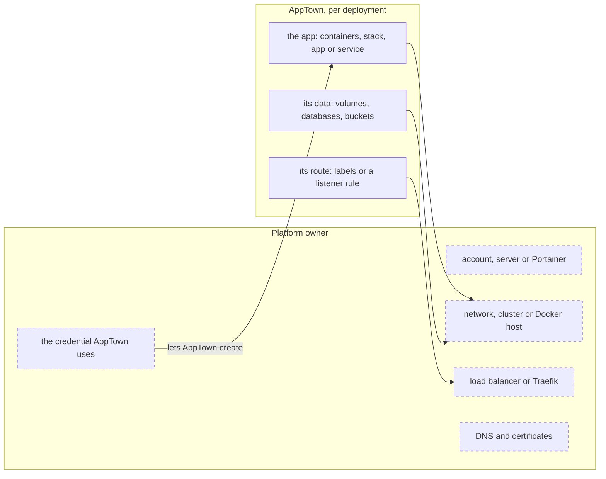

# Deployment targets

A deployment target is a place deployments run. An administrator adds one
under **Deployments › Targets → Add a deployment target** and offers it to the
projects that may use it. Each credential is the name of an AppTown secret;
set it under **Integrations › Secrets**, or with
`apptown secret set <NAME> < file`. Each kind has its own setup guide.

| Kind | What it runs | Services and data | Start and stop | Cost shown | Setup guide |
| --- | --- | --- | --- | --- | --- |
| Docker host | containers on AppTown's own Docker, or on a machine reached over SSH | services as containers; data folders | Start, Stop, Restart | none | [Docker host](docker-host-target-setup.md) |
| Portainer environment | a stack in a standalone Docker environment of a Portainer | services as containers; data folders | Start, Stop, Restart | none | [Portainer](portainer-target-setup.md) |
| DigitalOcean App Platform | an App Platform app | managed Postgres; Spaces buckets | Restart only | app sizes, estimated monthly | [App Platform](app-platform-target-setup.md) |
| Fly.io Machines | a Fly app, one Machine per part, public only | Postgres on a volume; data folders on volumes | Restart only | none (sizes listed) | [Fly.io](fly-target-setup.md) |
| Bucket website | static files in a bucket of its own, public only | none | none | none | [Bucket website](bucket-website-target-setup.md) |
| AWS ECS on Fargate (beta) | one public part on Fargate | a dedicated RDS Postgres | none | none (sizes listed) | [AWS ECS](aws-target-setup.md) |

A project's deployments are made on the project's **Deployments**.
What each kind runs is in [Previews and deployments](container-lifecycle.md).

## Who owns what

Every target splits the same way. The platform owner runs the place apps run.
AppTown makes, for each deployment, only what that deployment needs there.



| Platform owner | AppTown |
|---|---|
| The account, server or Portainer, and who may use it | What it creates for each deployment, recorded as soon as the provider confirms it, and what is inside those (a Fly app's Machines, a bucket's files) |
| The network, cluster or Docker host | The app's containers, stack, app or service, and its images |
| The load balancer or Traefik, DNS and certificates | The app's route: Traefik labels, or a rule on your listener |
| The credential, with the rights the setup guide lists | The app's data: volumes, databases and buckets, and their final backup |

A take-down deletes what AppTown recorded creating for the deployment,
with what is inside it: deleting a Fly app deletes its Machines, and
deleting a bucket website's bucket deletes its files first.

AppTown also marks what it creates with this installation's id: a Docker
label, a stack variable, a tag, a file or Machine metadata, depending on
the target. The target's page uses the mark to list what it finds there:
something that carries the mark but has no record is listed under **Not
accounted for**, and something without it is shown only to confirm a
record. Each target's guide says what it checks before it deletes.

## What happens when you deploy

A deploy goes through the same stages on every target. The deployment's
page shows the one it is in.

| Stage | What happens |
|---|---|
| getting the code ready | AppTown checks who asked and that they still may, and that nothing else holds the deployment. It checks the release fits the target before changing anything. |
| backing up the data | A copy of the deployment's data, before anything changes. Skipped, with the reason recorded, on a first release, when there is no data, or on App Platform and AWS, which keep their own. An incomplete copy stops the deploy, unless a person accepts that for a release they started by hand. |
| building the app | Services are made ready, images are pulled, built or copied to where the target runs them, and the target's configuration is written. |
| starting the app | AppTown creates or updates what runs. |
| checking the app answers | AppTown asks the app's readiness address. A deployment kept stopped skips this. |
| live | The deployment serves the new release. |

Each target's guide lists what it creates and changes, in order, and what
happens when a deploy fails part way.

## What happens when you take down

A take-down runs as a background operation. Follow it on its page; closing
the page does not stop it. While it runs, the deployment reads **taking
down**.

1. **Refused before anything changes** when the deployment is `main`, has
   a release in progress, is the source another deployment promotes from,
   is a restored copy, or has restored copies still standing.
2. **Final backup**, when the deployment holds data. The app's parts stop,
   and its services keep running so their data can be copied. If the
   backup does not cover all the data, AppTown starts the parts again and
   removes nothing.
3. **Delete** what AppTown recorded creating, in the target's order.
4. **Keep**, listed as retained resources on the target's page:
   - data with no final backup, where you chose to take it down without
     one;
   - anything that was there before AppTown's deploy;
   - anything a delete failed on.
5. **Revoke** the deployment's AI model keys.
6. **Remove** the deployment's records.

On App Platform, and on AWS with a database, the database is copied after
the app stops serving:

1. App Platform deletes the app. AWS stops the service and removes its
   listener rule.
2. The deployment's AI model keys are revoked.
3. The final copy is taken, and checked by filling it into a new database.
4. The database is deleted, then the rest of what AppTown created.

**If it stops part way**, the operation lists what was deleted, what was
left and what was not confirmed removed. The deployment reads **take-down
did not finish**. Take it down again to carry on: each target skips what is
already gone, and a new final backup is taken of data that is still there.
Two cases cannot be carried on this way. A maintainer inspects the provider
and removes the deployment's records by hand:
- the data was already deleted after its final copy: a new copy cannot be
  taken, and the operation names the backup set that holds the data;
- on Portainer, the stack was already deleted: the final backup cannot read
  it ([Portainer](portainer-target-setup.md)).

## Capacity, disks and logs

Each target opens with its status, a capacity strip, deployments and their
resource counts, resources not accounted for, settings and offers. Its
**Resources** page lists resources and filters by deployment; opening a resource
shows its full reference, ownership and generation. **History** keeps checks
and settings changes. A deployment's **Resources** link opens the same filtered
resource table.

The capacity strip has one thin bar for CPU, memory and disk. Each shows used
and total, or **unknown** with an empty bar when the complete current reading
is unavailable. Usage above 80% colours the bar. Limits do not stand in for use.

Previews run on the executor. **Integrations › Executor** shows where work runs,
the worker's address, connection check and version, running work and previews,
and its disks. A different worker version is marked beside AppTown's version.
Without a worker, work runs on AppTown's own server.

**How full a target is** is in detail on its **Capacity** page:
- **A Docker host** shows stacked bars, with the same numbers in a table
  beneath ("the numbers"):
  - **memory used**: what each holder's containers use, then the host
    itself (its system, caches and processes outside containers), then free;
  - **memory promised** and **CPUs promised**: the limits the running
    containers hold, against what the host has. A promise past the total runs
    past a mark at the total, striped; containers holding no limit are counted
    beside the bar, never drawn as a size. A CPU limit AppTown cannot read as
    a number of CPUs makes the sum "at least", and the rest of the bar "not
    read";
  - **disk**: used and free where Docker keeps its data, the folder it is,
    and when it was read. Below the warning threshold (a tenth free, capped at 40 GiB and never below
    the refusal floor) it shows the threshold; below the floor
    new work needs (see "Disk space" below) it says new releases are
    refused, and each deployment's card on that host says deploys are
    refused. A disk it could not read says why.

  The holders are each deployment (by its record: its public container and
  its stack's services), previews, agent work (steps, chats), AppTown's own
  containers (its database), AppTown containers no record names, and other
  containers AppTown did not start. `apptownd` itself is counted once: in the
  host's own use when it runs on the host, in its container when it runs in
  one. Colour follows
  the kind of holder; each deployment is named on hover and in the table, and
  links to it. Small holders of a kind fold into "N more".

  The host's own use, and free memory, are known only on the built-in host,
  and only when `apptownd` and the daemon report the same memory total.
  `apptownd`'s memory figures are then taken as the daemon machine's. A
  remote daemon on a machine with exactly the same memory as `apptownd`'s
  would be read wrongly. Otherwise the rest of the bar is hatched "not read",
  never free. Attached hosts do not
  report the host's own use in 1.0; that optional figure is absent from the
  capacity response and does not make a successful check unknown. Per-deployment
  disk use is not shown.

  **A Portainer endpoint** is read as a Docker host is, through the endpoint's
  Docker proxy in Portainer: what it has, every container's limits and use,
  who holds it and its disk. The containers of a stack AppTown released there
  count as that deployment's. Portainer's other stacks count as other
  containers.

  The disk is read by `df` in the daemon's standing reader: one long-lived
  container from a small pinned image (busybox), with no network and the
  folder mounted read-only. It is read at most every five minutes. If a host
  cannot run the reader, its disk shows as unknown, with the reason.

**Disk space.** New work is refused while a disk it would write to has less
free than its floor, a twentieth of the disk but at least 1 GiB and at most
20 GiB, or when the disk cannot be read; the refusal says what is free. Each
disk is read again when the work starts, not taken from the page's reading:
- a release, recovery or preview on a Docker host reads Docker's data
  folder there before it pulls or starts anything; the deployment keeps
  serving what it served;
- a release to a Portainer endpoint reads the endpoint's Docker data folder
  through Portainer before it sends the stack;
- a worker reads its state folder and its Docker's data folder once for a
  new task, before it writes anything of it; a release build's image that would leave the state folder under its floor
  is not copied, and the build fails saying so.

Stopping, taking down and removing are never refused. This keeps room for
the next piece of work; it does not reserve it, so two at once or one
larger than its free space can still fill a disk. The Executor page shows the disks where work runs; a target’s own disk is on its Capacity page.

To free space on a Docker host, remove what you know is unused: stopped
previews (AppTown stops and removes them itself after their idle time),
images no container uses that are not a release you may deploy again
(`docker image ls`, then `docker image rm` by name), and released tasks'
leftovers on a worker (releasing a task removes its files). Do not run
`docker system prune --volumes` or `docker volume prune`: a deployment's data
volume belongs to it, and a backup's evidence is not garbage. AppTown's own
image clean-up removes only the unused, untagged images it built itself.

**Container logs.** Every container AppTown starts for a deployment or
preview keeps its log in Docker's `json-file` files, rotated at 10 MiB with
three kept: about 30 MiB at most, and the oldest output is discarded. The
same holds for a worker's private services and daemons; a task's own
container is not rotated (its whole output is read while it runs, and it
goes when the task is released). Containers started before this keep their
logs until they are made again: a deployment's app parts at its next
deploy, a standing database only when it is next made again, never just to
change its logging. Portainer endpoints use their daemon's own default.

Cloud targets grow on demand, so their **Capacity** page lists the size each
part runs on instead of bars; what each kind prices is in its setup guide.

A deployment's card shows its share of its host, and over the last day each
part's **limit events**: killed out of memory, or exited without anyone
stopping it. An exit is what Docker saw, not proof that a limit was reached.
A crash-loop hold is AppTown's own act and is in the deployment's history,
not among these. When the held container belongs to a released generation, a
note is added to that release's log: the release still reads as shipped, and
the later crash loop and stop are separate facts beside it. Limit events
are read from the Docker host's event log every 15 seconds. Docker replays only its recent events, so a burst, or a time when
AppTown or the daemon was down, can leave a gap. App Platform does not report
them.

The card's **diagnostics** line says which part is failing and what to do
first, for the generation the deployment settled on. Its details show each
part's and need's container as its Docker host reports it when you look:
running, stopped or gone, the last exit code, an out-of-memory kill, Docker's
restart count for that container, when it started and finished, and its health
check ("not configured" when it has none). A host that does not answer shows
**unknown** with the facts last read and when, never stopped. Each limit event
names the generation it happened under where that is known. **Read log** shows a
part's newest 200 lines (at most 64 KiB) once, to someone who may operate the
deployment; logs can hold secrets, so AppTown keeps no copy and does not
redact them. App Platform and Portainer deployments say they do not report
these.

A Docker target's page also lists what AppTown recorded creating there
(containers, volumes, networks and images) beside what Docker reports now. A
container is one row per name, however many times it was replaced. **Missing**
means a complete answer from Docker did not include it; if any listing fails,
the page keeps the previous answer with its time and the error rather than
showing a partial one. Images on the host that no record names are not listed
for removal.

A deployment that reads **uncertain** (its last attempt was cut off, or its
records disagree) takes no new deploy until it is settled. Press **Check
again** on its card: AppTown asks the host what runs and records the
answer.

## Start, stop and restart

Open a deployment to use **Start**, **Stop** or **Restart** beside its name and
status. Stop asks once before acting. It keeps the deployment's data, address,
secrets and settings. Restart runs the current release again without a rebuild
or a pre-deploy backup. These actions need deployment operate permission and
record who acted and when.

Docker hosts and Portainer stop only the app's containers; databases and other
needs stay up. The other kinds offer only the acts in the table above:
App Platform cannot keep an app stopped, and Fly.io restarts each part's
Machine.

Deploying new code to a stopped deployment leaves it stopped. Its page says which
release will run when someone starts it. This applies to automatic deploys,
promotions and rollbacks too.

The command line has the same actions:

```sh
apptown deployment start <project> <deployment>
apptown deployment stop <project> <deployment>
apptown deployment restart <project> <deployment>
```
