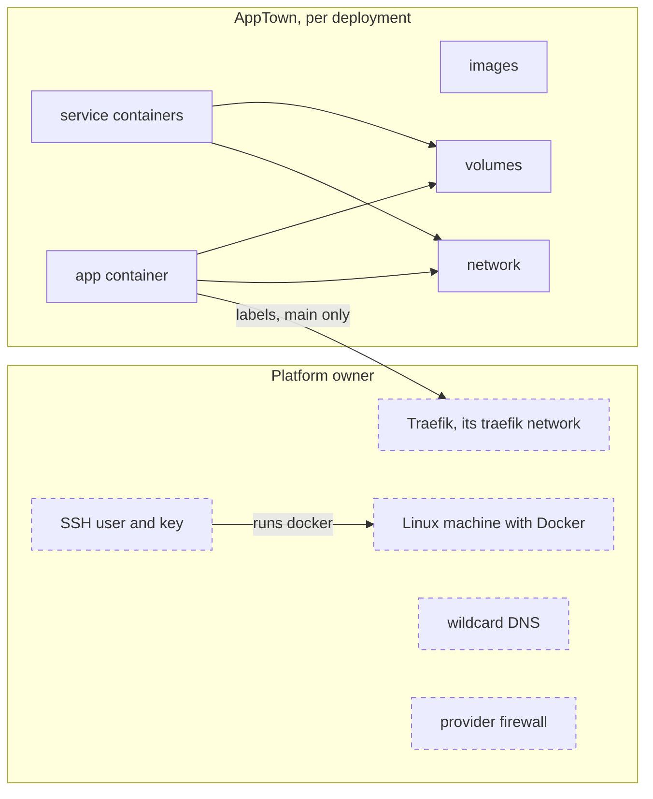

# Docker host target setup

A Docker host target runs each deployment as containers on a machine with
Docker. AppTown reaches an attached host over SSH. The built-in Docker host is
AppTown's own Docker; it needs no setup.

## Who owns what



| Platform owner | AppTown |
|---|---|
| The machine, Docker, and the SSH user AppTown signs in as | Containers for the app, its parts and its services (`container`) |
| Traefik, its `traefik` network, `websecure` entrypoint and `letsencrypt` certificate resolver | The deployment's network (`network`) |
| Wildcard DNS for the apps domain | A volume for the app's data folder and for each service that keeps data (`volume`) |
| The firewall in front of the host | The release images it pulls or builds there (`image`) |
| Containers, volumes and images AppTown did not create | Traefik labels on `main`'s container, when the host has an apps domain |

Each thing AppTown creates carries its `apptown.instance` label and is
recorded. The words in brackets are how a take-down's result names them.
On the built-in host AppTown's own machine is both sides: AppTown runs it,
and its apps' ports stay on the loopback address.

## The built-in Docker host

AppTown adds the target `built-in-docker` when it starts, unless `apptownd`
runs with `-no-local-docker`. Its apps are reached through AppTown's own
address, and their ports stay on the machine's loopback address. It cannot be
retired. The rest of this guide is about attaching another machine.

## What you need

- A Linux machine with Docker, reached over SSH by a user who can run
  `docker`. That user need not be root.
- The machine's SSH server with its default of ten sessions per connection,
  or more. AppTown shares one SSH connection per host and runs up to three
  Docker calls on it at once.
- For apps at a domain: a wildcard DNS record such as `*.apps.example.com`
  pointing at the host, and Traefik running there. AppTown labels each
  deployment's `main` container for Traefik; it does not install or run
  Traefik. [AppTown setups](setups.md) lists the network, entrypoints and
  certificate resolver Traefik needs, and the firewall rules.
- Without a domain, apps are reached at the host's address and each
  deployment's port.

## The credential

Make an SSH key for AppTown alone, and add its public key to the host user's
`~/.ssh/authorized_keys`. Store the private key as an AppTown secret, under
**Integrations › Secrets** or with:

```sh
apptown secret set DROPLET_SSH_KEY < id_ed25519
```

The secret must hold the whole private key, from its `BEGIN … PRIVATE KEY`
line. AppTown accepts the host's key the first time it connects and refuses a
different key after that.

## Add the target

Open **Deployments › Targets → Add a deployment target** and choose **Docker
host**.

| Field | What to enter |
| --- | --- |
| name | A short name for the target, such as `droplet-syd` |
| address | `ssh://user@host`, with `:port` when SSH is not on 22 |
| SSH key secret | The name of the secret holding the private key |

**Check** connects over SSH and runs `docker info`. Nothing is recorded until
you press **Add target**. Then set its offer and facts:

- **Apps domain**: the domain apps are reached under; `main` is served at
  `<project>.<domain>`. Leave it empty to reach apps by address and port.
- **Disks**: tick it when deployments may keep a data folder here.
- **Needs**: **emulators on the host** runs each declared service, such as
  Postgres, as a container beside the app.

## What happens when you deploy

In this order, on the host's Docker:

1. Check that the containers' sizes fit the host, every secret the app
   needs is set, and the disk has room. Nothing changes if one fails.
2. Pull the release's images by digest, or build them, on the host.
3. Create the deployment's network when the app needs one (it has
   services, `init` steps or more than one part), if it is not there.
4. For each service, such as Postgres: create its volume if it is not
   there, and start its container or keep the one running. Then wait until
   every service is healthy.
5. Run each `init` step to completion; its container is then removed.
6. Replace the app's other parts.
7. Replace the app's public container: the old one is removed and the new
   one starts under the same name, with a data volume when the app declares
   a data folder. Expect a short gap. On an attached host with an apps
   domain, `main`'s container gets Traefik labels.
8. Check the app answers on its readiness address, and that the running
   container is the one this release made.

The other parts and the services change while the old public container
still serves. If a step fails, the release fails at that step. AppTown
does not put back what it already replaced: after step 7, the new public
container stays under the deployment's name. Unused images are removed by a
daily clean-up, not by a deploy.

## What happens when you take down

When the deployment holds data:

1. Refuse, before anything stops, when a service keeps its data outside a
   volume, or some data cannot be copied.
2. Stop the app's containers. Its services keep running.
3. Take the final backup: each data volume and each service's data, kept
   on AppTown's disk, or in the backup store when one is attached. If it
   does not cover everything, start the containers again and remove
   nothing. A container that fails to start again is named in the result.

Then, with or without data:

4. Delete the public container, after checking its label names this
   deployment.
5. Delete, in this order, what AppTown recorded creating:
   1. containers;
   2. the network;
   3. volumes;
   4. images, unless another container still uses one.

What is kept:
- a volume AppTown did not create: it is copied into the final backup and
  left on the host;
- anything a delete failed on, listed as retained on the target's page.

There is no "without a final copy" choice on a Docker host. If it stops
part way, take it down again: what is already gone is skipped, and a new
final backup is taken first. AppTown never deletes containers, volumes or
images it did not create. A small `busybox` container reads the disk's free
space; it is not part of any deployment.

## Check it worked

The target's page shows **Target check:** with the Docker version, the
operating system and how many containers run. Its **Capacity** page shows
memory, CPU and disk. An attached host does not report its own system's memory
use, so that part of the bar reads "not read". A failed SSH connection is
shown at the top of the page with the reason.

## The SSH connection

AppTown keeps one shared SSH connection per attached host and reuses it for
Docker commands, including event streams. Up to three Docker calls run at once
per host. This limits calls, not SSH sessions: Docker opens an SSH session for
each HTTP connection, and run, attach and BuildKit can hold two or three at
once. Three calls stay within sshd's default of ten sessions per connection.
OpenSSH keeps the connection for three minutes after the last call, then
removes its socket. The sockets are private to AppTown's data folder, so
different installations do not share them.

AppTown writes the host's SSH settings to the `~/.ssh/config` of the user
`apptownd` runs as ([Setting up a server](server-setup.md)). If AppTown cannot
open and check the shared connection, the call fails with an SSH connection
sharing error. Keep AppTown's data folder path short enough for a Unix socket;
a path that is too long is reported when the host is checked. A dead
connection is replaced on the next call. After a network drop, keepalive
checks close an unresponsive connection; a call already using it can fail,
and is not run again by itself.

## Costs and limits

You pay your provider for the machine. AppTown shows no cost for it.

- Every deployment also publishes its port on all of the host's network
  addresses. Docker's published ports bypass the host's own firewall rules,
  so put a provider firewall in front of the host ([AppTown
  setups](setups.md)).
- **Stop** stops only the app's containers; its services keep running.
- Backups are kept on AppTown's disk, or in the backup store when one is
  attached ([Deployment backups](deployment-backups.md)).
- New releases are refused while Docker's disk is nearly full ([Deployment
  targets](deployment-targets.md), "Disk space").
