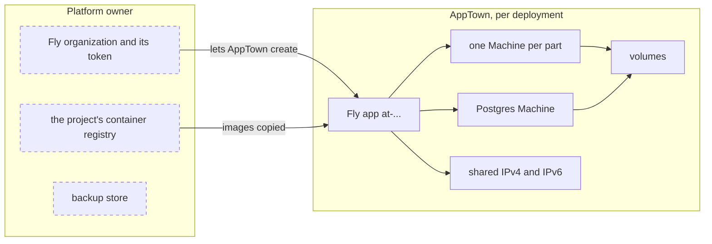

# Fly.io target setup

A Fly.io Machines target runs each deployment as a Fly app of its own, with
one Machine per part. The app is reached at its `fly.dev` address. This target
is experimental: no real app has been qualified on it yet.

## Who owns what



| Platform owner | AppTown |
|---|---|
| The Fly.io organization, and the organization token AppTown uses | One Fly app per deployment, `at-…`, with its addresses, secrets and copied images (`fly-app`) |
| The project's container registry, where releases are published | A Machine for each part, and for each `init` step while it runs |
| The backup store | A Machine for Postgres (`fly-machine`) |
| Other apps in the organization | A volume for each data folder and for Postgres (`fly-volume`) |

Every Machine AppTown makes carries the installation and the deployment in
its metadata. The app is reached at its `fly.dev` address, so there is no
DNS to set up.

## What you need

- The **Fly.io targets** feature turned on under **Setup → Features**
  ([Features](features.md)).
- A Fly.io organization, preferably one that holds only your team's apps.
- A container registry attached to each project that deploys here. Fly runs
  only images published there by digest, for `linux/amd64`. AppTown copies
  each image into Fly's own registry for the app.
- For backups, a backup store ([Deployment backups](deployment-backups.md)).

## The credential

Create an organization token with Fly's command line:

```sh
fly tokens create org
```

A deploy token, limited to named apps, is refused: it cannot create apps. An
organization token can manage every app in its organization; AppTown touches
only the apps it made and recorded. Store the token as an AppTown secret, under
**Integrations › Secrets** or with `apptown secret set FLY_API_TOKEN < file`.

## Add the target

Open **Deployments › Targets → Add a deployment target** and choose **Fly.io
Machines**.

| Field | What to enter |
| --- | --- |
| name | A short name for the target, such as `fly-syd` |
| token secret | The name of the secret holding the token; `FLY_API_TOKEN` by default |
| region | A Fly region code, such as `syd` |
| org (if the token reaches several) | The organization's slug. Leave it empty when the token reaches one organization |

**Check** reads the token, chooses the organization and checks that Fly has the
region. It answers with the organization and region, and reminds you what the
token can reach. Nothing is recorded until you press **Add target**. Then set
its offer and facts. Offer it with the **public** audience only (see below).

## What happens when you deploy

In this order, through Fly's Machines API:

1. Refuse, before anything is made, what Fly cannot run (see "Costs and
   limits").
2. Create the Fly app, or reuse the one recorded. A name already taken is
   refused.
3. For Postgres: copy its image, create its volume, start its Machine or
   keep the one running, and wait until it is ready.
4. For each part, copy its image into Fly's registry for the app, by
   digest, and create its data folder's volume or reuse the recorded one.
   Then copy each `init` step's image.
5. Set the app's secrets to the release's.
6. Run each `init` step on a one-off Machine, then destroy it.
7. Add a shared IPv4 and an IPv6 address, if the app has none.
8. Start a new Machine for each part. A part with a data folder first has
   its old Machine stopped and deleted, to free the volume.
9. Check each Machine is started and passes its checks, and that the app
   answers at its `fly.dev` address.
10. Destroy the old Machines.

If step 8 or a later one fails, AppTown destroys the new Machines and tries
to bring back the previous Machine of each part with a data folder; if that
fails too, the release says so. Secrets already set and `init` steps
already run are not undone.

Postgres runs as a stock container on its own Machine and volume. Its data
lives in a `pgdata` folder inside the volume, because a Fly volume has a
`lost+found` folder at its root and Postgres refuses to start in a folder that
is not empty. Postgres keeps its Machine and volume across releases; a release
with an incompatible Postgres image is refused.

## What happens when you take down

1. When the deployment holds data, stop the parts that write it, and take
   the final backup into the backup store. Without a backup store the
   take-down is refused, unless you choose to take it down without a final
   copy.
2. Check the app. If it is gone, or its name now belongs to another app,
   it counts as already gone and the other app is left alone. Every Machine
   in it must carry this deployment's mark, and every volume must be one
   AppTown recorded. If not, stop and name what is there; AppTown deletes
   nothing it did not make.
3. Delete the Fly app. Its Machines, addresses and secrets go with it, and
   Fly destroys its volumes.

Without a final copy, an app with volumes keeps its data: the Postgres
Machine is stopped, the part Machines are deleted, and the app and its
volumes stay, listed as retained. A deployment that was never released
holds nothing at Fly.

If it stops part way, take it down again: an app already gone is skipped.

## Check it worked

The target's page shows **Target check:** with the organization and region.
Its **Capacity** page lists the Machine size each part runs on, such as
`shared-cpu-1x (512 MB)`. Fly's prices are not read, so no cost is shown.
A deployment's **Status** tab shows each part's Machine: its state, image,
when it started, and its CPU and memory use against its size, read from the
organization's metrics with the same token. Out-of-memory kills come from
Fly's Machine events.

## Costs and limits

- Fly bills the organization for Machines, volumes and addresses.
- A Fly app answers anyone at its `fly.dev` address, with no AppTown sign-in in
  front of it. Only a deployment whose audience is public is released here.
- Postgres is the only service offered, and data folders get volumes. Other
  needs are refused before anything is made.
- Refused before anything is made: a liveness check, a readiness check that is
  not HTTP, a readiness threshold or exact status, and parts given different
  secrets (Fly gives every Machine of an app the same secrets).
- A part with a data folder stops briefly during releases and backups.
- **Restart** restarts each part's Machine. **Start** and **Stop** are
  disabled.
- Backups export Postgres as the app's user and copy data folders while their
  part is stopped. The copies are not encrypted. A restore takes a safety
  backup, stops the app, restores Postgres in place and fills a new volume for
  a data folder.
