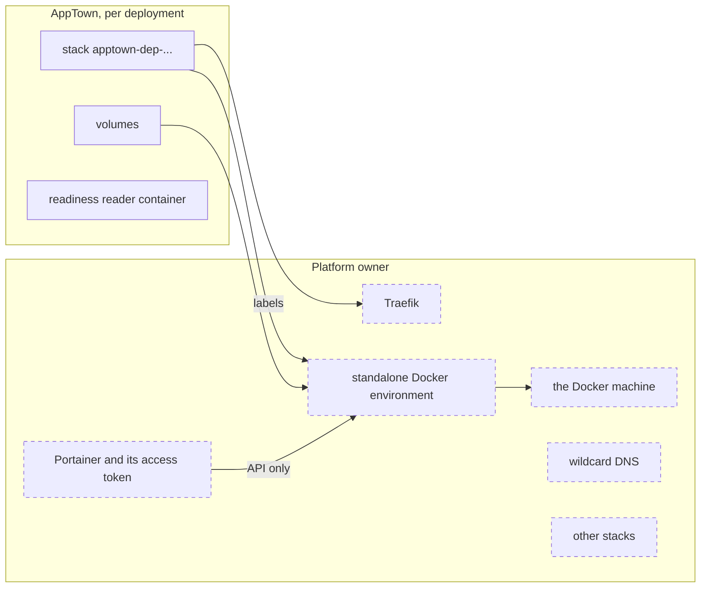

# Portainer target setup

A Portainer target runs each deployment as a stack in an environment of an
existing Portainer. AppTown talks only to Portainer's API; it never connects
to the Docker machine itself. This target is experimental: no real app has
been qualified on it yet.

## Who owns what

| Platform owner | AppTown |
|---|---|
| Portainer, and the user whose access token AppTown uses | One stack per deployment, when AppTown's own create made it (`stack`) |
| The environment and the Docker machine behind it | A volume for each data folder and service that keeps data, when the deploy made it (`volume`) |
| Traefik, and wildcard DNS for the apps domain | A small container per deployment that checks the app answers |
| Other stacks, environments and Portainer's settings | Traefik labels on the app's public container |

Each stack AppTown creates carries the stack variable `APPTOWN_INSTANCE` and
names its deployment inside the stack file. A stack AppTown did not create
stays the Portainer administrator's to remove.

## What you need

- The **Portainer targets** feature turned on under **Setup → Features**
  ([Features](features.md)).
- A Portainer that AppTown can reach over HTTP or HTTPS.
- In it, a standalone Docker environment, reached directly or through the
  Portainer agent. Edge, Kubernetes and Swarm environments are refused.
- For apps at a domain: a wildcard DNS record such as `*.apps.example.com`
  pointing at the Docker machine, and Traefik running there. AppTown labels
  each deployment's public container for Traefik; it does not install or run
  Traefik. [AppTown setups](setups.md) lists what Traefik needs.

## The credential

In Portainer, sign in as a user who can see the environment and manage its
stacks, and create an access token under **My account › Access tokens**.
AppTown does not check the user's role; a token whose user cannot manage
stacks fails at the first release.

Store two AppTown secrets, under **Integrations › Secrets** or with
`apptown secret set`:

- the Portainer address, such as `https://portainer.example.com`, with no
  user name, query or `#` part;
- the access token.

## Add the target

Open **Deployments › Targets → Add a deployment target** and choose
**Portainer environment**.

| Field | What to enter |
| --- | --- |
| name | A short name for the target, such as `home-portainer` |
| URL secret | The name of the secret holding the Portainer address |
| API key secret | The name of the secret holding the access token |
| environment | The environment's name as Portainer shows it |

**Check** finds the environment by its name and reads the Docker daemon's
identity behind it. Nothing is recorded until you press **Add target**. Then
set its offer and facts:

- **Apps domain**: the domain apps are reached under.
- **Disks**: tick it when deployments may keep a data folder here.
- **Needs**: **emulators on the host** runs each declared service as a
  container in the stack.

Once added, the target stays on that environment's Docker daemon. Renaming the
environment in Portainer cannot move it elsewhere. To use another
environment, add another target.

## What happens when you deploy

In this order, through Portainer's API:

1. Write the stack file: the app, its parts and services, and their
   volumes. Images must be in the project's container registry by digest,
   and built for the environment's platform.
2. Check Docker's disk on the environment has room.
3. Label each service with the release, and record which stack the release
   goes to before sending anything.
4. Run a throwaway container on the environment, to check AppTown can.
5. Note which of the stack's volumes are already there.
6. Create the stack, or update it after checking it names this deployment.
   A stack of that name that names another deployment is refused.
7. Record the stack, and each volume that was not there before.
8. Check the app answers, from a small reader container on the app's
   network.

If a step fails, the release fails at that step. AppTown does not put the
previous stack back.

## What happens when you take down

1. Read the stack file, and plan a copy of every volume it names and every
   volume AppTown recorded. Refuse if a recorded volume cannot be copied.
2. Stop the stack's containers. Its services keep running.
3. Take the final backup through Portainer. If it does not cover every
   recorded volume, start the containers again and remove nothing.

Then:

4. Check the stack still has the recorded id and environment, and still
   names this deployment.
5. Delete the stack.
6. Delete the volumes AppTown recorded creating.
7. Remove the readiness reader container.

What is kept:
- a volume that was there before AppTown's deploy: it is copied into the
  final backup and left in place;
- with no final backup, the data volumes, listed as retained. That is
  offered only when AppTown cannot reach the environment's Docker, and you
  choose to take it down without a final copy.

AppTown refuses to take down a stack it did not record creating; remove that
one in Portainer. AppTown never changes other stacks, environments or
Portainer's settings.

If it stops part way before the stack is deleted, take it down again. If it
stops after the stack was deleted (removing the reader container failed, for
example), taking it down again stops at the final backup, which cannot read
the deleted stack. The final backup already taken holds the data. Delete what is
left in Portainer, and ask a maintainer to remove the deployment's records.

## Check it worked

The target's page shows **Target check:** "Portainer answers" with the
environment's number. Its **Capacity** page is read through Portainer, as for
a Docker host. Other stacks in the environment count as containers AppTown did
not start.

## Costs and limits

You pay for the Docker machine. AppTown shows no cost for it.

- A liveness check, and any readiness check that is not HTTP or is on a
  non-public part, is refused.
- **Stop** stops only the app's containers; its services keep running.
- Backups go through Portainer ([Deployment backups](deployment-backups.md)).
- Container logs and diagnostics are not reported for
  Portainer deployments.

## The intranet target

An AppTown can also have a target named `intranet`, made when AppTown starts
from the **portainer-deploy** connection under **Integrations › Deploy
connectors**. It reads the secrets `PORTAINER_URL`, `PORTAINER_API_KEY` and
`APPTOWN_APPS_DOMAIN`. It confirms its environment when AppTown starts; until
it has, releases to it are refused and its page says the endpoint is not
observed.
