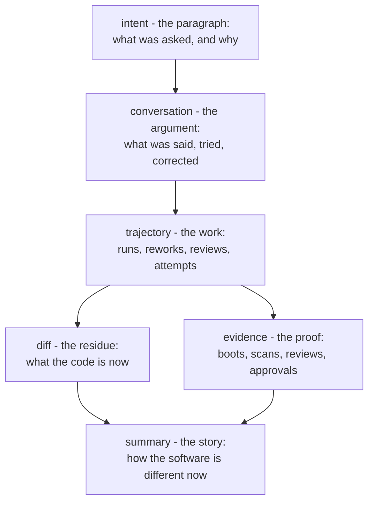
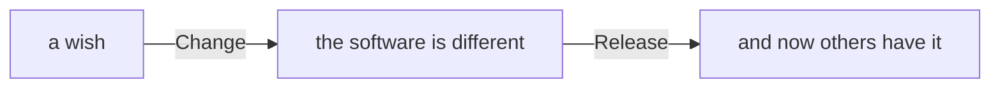

# The change

Most agentic coding platforms organize themselves around their
machinery: where the agents run, how they're orchestrated, which
models, what sandbox. AppTown organizes itself around the **change**
— one unit of intent becoming one difference in the software — because
that is the thing that has value. Nobody wants an agent fleet. They
want the game to have headlights that point forward. The infrastructure
exists to move changes; changes do not exist to exercise
infrastructure.

This document is why.

## The diff is no longer the story

For twenty years the merge request was a reasonable proxy for a unit of
work: a person thought, typed, and the diff *was* most of the
trajectory. Reviewing the diff meant reviewing the work.

Agentic coding breaks that proxy. An afternoon's conversation can
produce a diff of thousands of lines — competently, repeatedly,
cheaply. Reading it all is neither possible nor the point. Sometimes
you do not want the million lines; **you want the paragraph that
prompted them**, the argument that shaped them, and the evidence that
they do what the paragraph asked.

So the change holds the whole trajectory, with the diff as one layer:

The summary is the layer most readers actually consume: a short plain
account, re-distilled from the diff and the evidence as work proceeds,
of how the software is different now — never a narration of process.
It is also what a release hands outward as its notes.

Each layer answers a different reader. Most start at the summary and
stop there. The person who asked rereads the conversation. A reviewer reads the
intent and the evidence, and samples the diff. An auditor a year later
reads all of it — because the change keeps all of it, permanently: the
words, the reworks, the reviewer's objections, the story of what
changed. The diff alone can no longer testify to any of that. On a
change record, it doesn't have to.

## Boundaries are where invariants live

A second reason the change is the unit: **its boundary is the only
place invariants can actually be enforced.**

Inside a change, freedom: the helper may take wrong turns, rewrite its
approach, leave mess, try things. Policing every keystroke of an agent
is both impossible and pointless — the interior of a change is draft
space, and draft space must be cheap.

At the boundary, law: nothing crosses into `main` except through the
landing, and the landing is where everything the institution cares
about concentrates —

- the scans (dependencies, secrets, provenance),
- the cold boot (it must run from nothing, like a deploy will demand),
- the independent review (claim checked against diff),
- the approval, **against a written standard of what an OK asserts**,
- the law re-check (rules that changed while the change waited apply
  *now*, not as of when it started),
- the merge itself, refused over anything unaccounted for.

One boundary, everything enforced there, total freedom inside it. That
is the same shape as every workable institution: the alternative —
invariants smeared across the interior — gives you both bureaucracy
inside the work and gaps at the edge.

## Why the verbs are "change" and "release"

A project page offers two verbs that change anything (beside **Open**,
which only uses what is already there, and **Build the first version** on
a project that has no app yet):

- **Change** is the unit of *intent*: someone wanted the software to be
  different, and now it is. Its audience is the people of the project.
  Its receipt is the change record — paragraph, conversation, evidence,
  diff.
- **Release** is the unit of *promise*: a set of landed changes,
  packaged as exact bytes, handed to people who were not in the room.
  Its audience is everyone else. Its receipt is the digest — these
  bytes, built from the same source files that passed these gates, are
  the bytes you are running — and
  its notes are the changes' own narratives.

Everything else — runs, steps, workspaces, containers, models, slots —
is machinery, deliberately absent from the verbs. A person using AppTown should be able to live entirely in *"I changed it"* and *"I
released it"*, and drill into machinery only when they choose to. The
machinery pages exist and hide nothing; they are just never the
subject.

## The test

Any change, at any time, must be able to answer four questions from
its own record:

1. **What was asked?** — the paragraph, verbatim.
2. **What was done?** — the narrative of how the software is different,
   with the diff beneath it.
3. **What did it cost?** — models, tokens, dollars, attempts.
4. **Who said yes, and to what standard?** — the approvals, each
   against its written meaning.

A platform that can answer these has captured the value of the work.
A platform that can only show you where the agents ran has captured
its own reflection.
